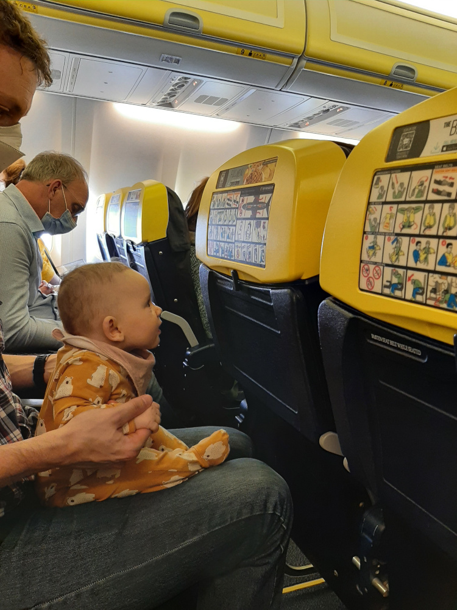
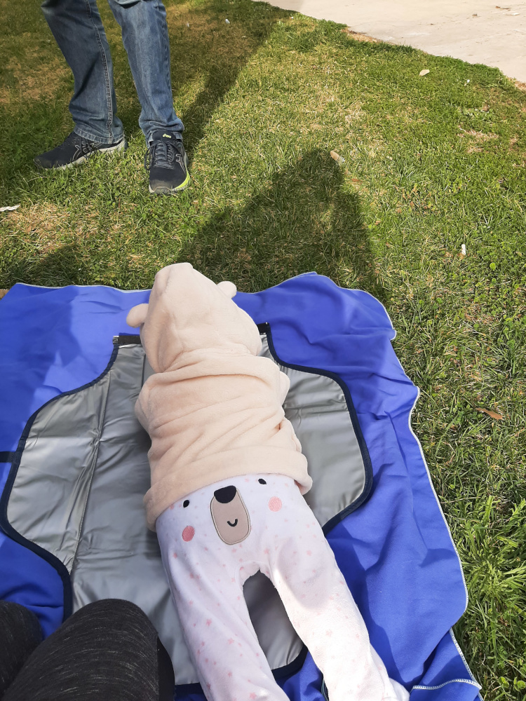

Musieliśmy zmienić nasz sposób podróżowania i dostosować go do potrzeb naszej pociechy. Ludzie często mówią, że po zostaniu rodzicem nadal 
można podróżować. To prawda, można... ale nie będzie już tak samo! Nasze wakacje są teraz mniej intensywne. Odwiedzamy
miejsca przyjazne dzieciom, w których mamy realną szansę odpocząć i złapać oddech. Znudzony, zmęczony lub sfrustrowany maluch 
z pewnością nam na to nie pozwoli! Regularnie podróżujemy z Belgii do Polski, żeby odwiedzić moją rodzinę. Po raz pierwszy polecieliśmy 
do Polski, gdy nasza córka miała 3 miesiące. Udało nam się też dwukrotnie wyjechać na wakacje w Europie: do Lizbony (gdy miała 6 miesięcy) 
i Malagi (gdy miała 14 miesięcy). Oba wyjazdy bardzo się od siebie różniły ze względu na wiek dziecka, ale także dlatego, że 
wiele nauczyliśmy się podczas pierwszej podróży.

## Jakie mamy wskazówki dotyczące samego lotu?

Bierzemy pod uwagę godzinę lotu i to, czy pasuje ona do codziennego rytmu Naszego dziecka. My na przykład, na razie nie rezerwujemy lotów
z wylotem przed 10:00 ani po 16:00 (co znacznie ogranicza nasze możliwości!) bo nasze dziecko zle reaguje na zmienioną rutynę dnia. 
Zawsze podróżujemy z wózkiem i nosidłem (na czas wejścia do samolotu przekładamy dziecko do nosidełka). Pamiętajcie, że
chociaż wózek można zabrać aż pod samo wejście do samolotu, przed przejściem przez kontrolę bezpieczeństwa trzeba odebrać na niego etykietę 
przy stanowisku odprawy. Teoretycznie, kupując bilet dla niemowlęcia (dziecka poniżej 2. roku życia), można zabrać
1 małą torbę, ale my zawsze mieliśmy też niewielką dodatkową torbę bawełnianą z całym jedzeniem i napojami dla 
naszej pociechy i nikt nigdy nie zgłaszał zastrzeżeń (gdyby pojawił się problem, wszystkie te rzeczy, upchane,
zmieściłyby się w naszym bagażu). Ogólnie rzecz biorąc, im mniej bagażu, tym lepiej. Na tygodniowy wyjazd zabieramy standardowy bagaż podręczny 
(1 mały plecak na osobę) i to naprawdę wystarcza! Po dotarciu na miejsce trzeba znaleźć 
wózek. Na każdym lotnisku odbiera się go gdzie indziej, zwykle razem z bagażem ponadgabarytowym, na razie nie zdarzylo nam się żeby odebrać go tuż 
przy samolocie. Właśnie dlatego nosidełko może być niezwykle pomocne, bo czasem droga od samolotu 
do miejsca odbioru wózka jest naprawdę długa. Przydaje się również mały kocyk, którym można okryć dziecko podczas wchodzenia do samolotu. Czasami mocno 
wieje i nigdy nie wiadomo, jak długo trzeba będzie czekać w kolejce na zewnątrz.

Zabierzcie dla dziecka wystarczająco dużo wody i przekąsek. Według TSA (Transportation Security Administration) płyny nie podlegają 
ograniczeniom, gdy podróżuje się z dzieckiem poniżej 2. roku życia. Wodę można przewozić w rozsądnych ilościach. Zwykle mamy ze sobą litrową butelkę wody, dodatkowy kubek niekapek 
już napełniony wodą, mleko w kartoniku (250 ml) oraz 2–3 słoiczki jedzenia dla dziecka. Do tego kanapki, owoce i
warzywa. Może się wydawać, że to dużo, ale dobrze mieć coś w zapasie na wypadek nieprzewidzianych sytuacji (niespodziewanych opóźnień lub 
odwołania lotu). Wygodnie jest trzymać wodę i jedzenie w osobnej bawełnianej torbie, ponieważ podczas kontroli bezpieczeństwa trzeba pokazać wszystkie płyny 
przeznaczone dla dziecka. Jeśli Wasze dziecko jest nadal karmione piersią lub mlekiem modyfikowanym, warto nakarmić je podczas startu i 
lądowania. Niemowlęta podobno nie potrafią świadomie wyrównać ciśnienia w uszach, ale możemy im pomóc, zachęcając je do przełykania. 
Na życzenie, personel pokładowy poda nam gorącą wodę do przygotowania mleka modyfikowanego. Jeśli karmicie piersią, duża chusta 
i specjalny biustonosz pomogą zapewnić nieco prywatności w ciasnym samolocie. Duży worek strunowy również może się przydać, na wypadek pieluszki, 
która gdzieś przeciekła, co nam zdarzało się często podczas startu, lub gdy dziecku ulewało się bardziej niż zwykle. Taki worek przyda się na brudne 
ciuszki. Obowiązkowo trzeba mieć też przygotowany zestaw nowych ciuchów pod ręką.
Pomaga też zabranie nowej małej zabawki dla dziecka. Poprawi mu humor i, miejmy nadzieję, zajmie je na dłuższą chwilę.

Oto konkretne wskazówki dotyczące lotnisk, z których dotychczas korzystaliśmy:

  * **Zaventem, Belgia** – świetna strefa zabaw dla dzieci obok punktów gastronomicznych (wejście znajduje się przy Starbucksie). Jest tam 
kuchenka mikrofalowa, krzesełka do karmienia, przewijaki i duży stół, przy którym mogą usiąść rodzice, to idealne miejsce na oczekiwanie na lot! Przejście 
przez kontrolę bezpieczeństwa z dzieckiem było łatwe. Całe jedzenie i woda dla dziecka zostały sprawdzone, dlatego najlepiej trzymać je w osobnej torbie, aby mieć do nich łatwy
i szybki dostęp.

  * **Pyrzowice, Polska** – mała strefy zabaw dla małych dzieci, niedaleko toalet oraz pomieszczenia z przewijakami. Kontrola bezpieczeństwa jest tutaj
nieefektywna i niepotrzebnie długa. To na przykład jedno z niewielu lotnisk, na których trzeba zdjąć buty i poddać je skanowaniu. 
Spodziewajcie się długich kolejek i braku osobnego przejścia priorytetowego dla rodzin z dziećmi.

  * **Lizbona, Portugalia** – jest osobny pas kontroli bezpieczeństwa dla osób starszych, osób poruszających się na wózkach oraz rodziców z 
niemowlętami, ale miejcie na uwadze, że przejście nim może potrwać nawet dłużej niż zwykłą kolejką, ponieważ wszyscy „wolniejsi” pasażerowie trafiają 
do tej specjalnej kolejki! Pracownicy odradzają zwykłą kolejkę, ponieważ prowadzi do niej kilka stopni w dół, 
co jednak nie powinno stanowić problemu podczas podróży z wózkiem, bo niejednokrotnie już musieliśmy nosić córkę w wózku po schodach podczas zwiedzania Lizbony.

  * **Eindhoven, Holandia** – to najlepsze lotnisko dla rodziców z niemowlętami pod względem kontroli bezpieczeństwa. 
Personel dba o to, aby rodzice z dziećmi mogli sprawnie przez nią przejść, a nowoczesne skanery pozwalają zostawić 
większość rzeczy w plecakach lub walizkach. Później często jedzenie dla dziecka sprawdzane jest dodatkowo w specjalnym urządzeniu.

  * **Malaga (AGP), Hiszpania** – na lotnisku było wystarczająco dużo miejsca, aby wygodnie usiąść, ale znaleziona przez nas strefa zabaw była 
bardzo mała i z nieznanych powodów zamknięta. Przejście przez kontrolę bezpieczeństwa było przyjemnym doświadczeniem.

## Jakie kryteria są ważne podczas szukania noclegu?

Airbnb to nasza ulubiona platforma podczas podróży. Kiedy po raz pierwszy pojechaliśmy do Lizbony, sądziliśmy, że wynajęcie 
apartamentu w centrum miasta zapewni nam elastyczność.
Moglibyśmy wrócić do apartamentu na  drzemkę dziecka, a sklepy i restauracje byłyby blisko. Nie przewidzieliśmy jednak, że domy w 
starej części miasta mają ściany cienkie jak papier. Było tak głośno, że nie mogliśmy spać, a nasze dziecko miało ze snem jeszcze większy problem. 
Kilka razy około północy i wczesnym rankiem zdarzyło się też, że ludzie wyrzucali na zewnątrz szklane butelki, budząc
wszystkich w okolicy. Następnym razem uważnie sprawdziliśmy opinie o apartamentach, szukając wszelkich wzmianek o 
poziomie hałasu. Nasz apartament w Benalmadenie był znacznie lepszy! Miał większą sypialnię, w której nawet po wstawieniu dodatkowego łóżeczka turystycznego 
nadal było wystarczająco dużo miejsca, 
aby swobodnie z niej korzystać. Tym razem zatrzymaliśmy się również w spokojnej okolicy obok parku (ze zwierzętami i placem zabaw), plaży i 
przystanków autobusowych (podczas tego wyjazdu także korzystaliśmy z transportu publicznego). Kolejnym przydatnym elementem wyposażenia 
apartamentu były zasłony zaciemniające, dzięki którym podczas drzemki dziecka 
można było pogrążyć mieszkanie w mroku. Mała kuchnia do przygotowywania śniadań i przekąsek jest dla nas zawsze niezbędna. 
Większy prysznic bardzo ułatwia wieczorne kąpiele, szczególnie po zabawie na plaży, jeśli nie możemy znalezć mieszkania z wanną.

## Dotarliście na miejsce? Co dalej?

Zawsze warto wcześniej poszukać placów zabaw w okolicy, którą zamierzacie odwiedzić. Czasami są 
naprawdę przyjemne i doskonale nadają się na przerwę z maluchem. Kiedy dzieci zaczynają chodzić, nie da się już długo trzymać ich
w wózku, muszą biegać i odkrywać świat. Warto mieć mały kocyk lub ręcznik sportowy, na którym można odpocząć w parku. 
Nawet jeśli Wasze dziecko jest jeszcze bardzo małe, dobrze jest zrobić przerwę, aby mogło poleżeć na brzuszku lub pobawić się zabawkami.

Ponieważ publiczne toalety z przewijakami mogą okazać się rzadkością, mata do przewijania jest niezbędna. Jej wodoodporna warstwa może
również przydać się jako dodatkowa izolacja podczas siedzenia na trawie. Pamiętajcie, że nawet w niektórych restauracjach toalety bywają
bardzo małe i nie mają przewijaka. W takich przypadkach również ucieszycie się, że macie ze sobą własną matę.

W Lizbonie wszystkie atrakcje turystyczne miały osobną kolejkę dla rodzin, więc prawie wcale nie musieliśmy czekać. Również w sklepach ludzie 
przepuszczali nas do przodu, nawet gdy o to nie prosiliśmy, co było naprawdę miłe.

  
  

Podróżujemy zarówno z wózkiem, jak i nosidełkiem. Daje nam to elastyczność potrzebną do odwiedzania różnych miejsc. 
Na przykład z wózkiem nie dałoby się zwiedzić centrum Lizbony, Zamku Maurów w Portugalii ani góry Calamorro 
w Hiszpanii. Z drugiej strony wózek przydaje się podczas długich spacerów wzdłuż morza lub zwiedzania takich miejsc jak
klasztor Hieronimitów w Lizbonie (który jest doskonale przystosowany do wózków). Najłatwiejszym sposobem na podjęcie decyzji 
„wózek czy nosidełko?” jest sprawdzenie opinii w serwisie Tripadvisor lub Google i wyszukanie takich, które opisują, jak dobrze 
dana atrakcja turystyczna jest przystosowana do potrzeb dzieci. Poniżej lista przedmiotów które używamy:
  * [Wózek](https://www.dreambaby.be/e/fr/db/dreambee-essentials-poussette-canne-grey-melange-214187?utm_source=google&utm_medium=shopping&s_kwcid=AL!6321!3!!!!x!!&gclid=CjwKCAiAheacBhB8EiwAItVO2yQ7N_C6VWkn4sxHW_TIX8rNzywIH3wWZIyx8EqOYPPCespcWfD0HxoCK10QAvD_BwE)
  * [Nosidełko Baby Björn](https://www.amazon.com.be/-/en/BABYBJ%C3%96RN-Carrier-Black-Cotton-White/dp/B07KPSS456/ref=sr_1_1?crid=2Q7TKLKF68UZ8&keywords=BabyBj%C3%B6rn+carrier+one&qid=1671045227&sprefix=babybj%C3%B6rn+carrier+one%2Caps%2C60&sr=8-1)
  * [Plecak Nanabeebi](https://www.nanabeebi.com/en/products/luiertas-rugzak)

  

