Moja podróż zaczęła się od porannego lotu do Porto. Ponieważ dopiero na wieczór miałam zaplanowany pociąg do Bragi, trafiła mi się
idealna okazja, aby spędzić cały dzień na zwiedzaniu historycznego serca miasta. Po krótkiej, trzydziestominutowej jeździe
metrem dotarłam na stację Bolhão. Gdy wyszłam na powierzchnię, przywitała mnie lekka mżawka, więc moim pierwszym zadaniem
stało się znalezienie sklepu z parasolami. Na szczęście z pomocą przyszedł ALE-HOP, ulubiony sklep mojej córki, oferujący całkiem
duży wybór parasolek.
Kolejnym przystankiem był pobliski targ **Mercado do Bolhão**, bo już od dłuższego czasu nic nie jadłam, a to miejsce jest ponadto zadaszone, 
co przy tak nieprzyjemnej pogodzie okazało się szczególnie przydatne. Targ powstał pierwotnie jako plac handlowy pod gołym niebem, ale
w 1914 roku otwarto obecny, neoklasycystyczny budynek. Po gruntownym remoncie miejsce to ponownie otwarto w 2022 roku i
teraz wygląda bardzo nowocześnie, jest czysto a stragany są logicznie uporządkowane. Szklany dach przepuszcza naturalne światło
do stoisk, na których sprzedaje się świeże kwiaty, warzywa, owoce, mięso, sery, oliwki i owoce morza. Uroku tego miejsca dodają stragany
z tradycyjnym rękodziełem.

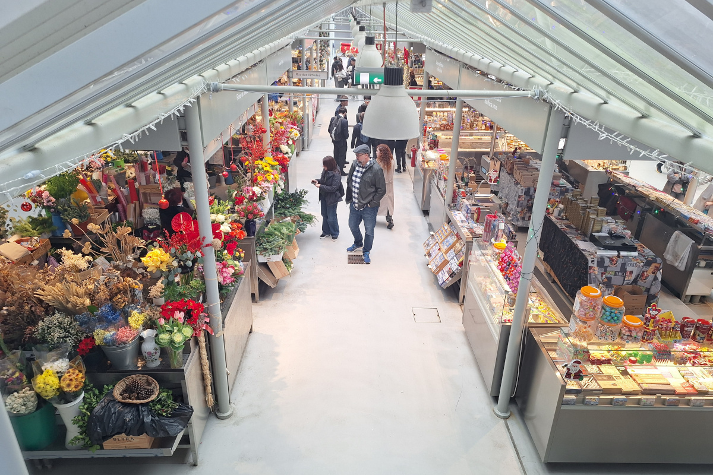
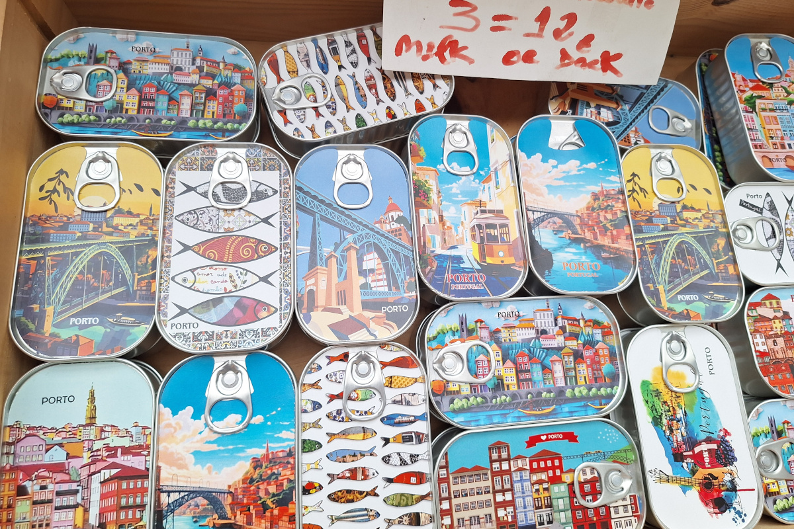

Na targu można również znaleźć autentyczne portugalskie dania, od francesinhy (kanapki z Porto) po świeże wypieki, takie
jak **Pastéis de Nata**. Te kultowe portugalskie ciastka wywodzą się z klasztoru Mosteiro dos Jerónimos w lizbońskiej dzielnicy
Belém, gdzie na początku XIX wieku katoliccy mnisi opracowali pierwszy przepis. Miałam przyjemność odwiedzić zarówno sam
klasztor, jak i Fábrica de Pastéis de Belém, czyli miejsce narodzin tych ciastek,
[podczas naszej pierwszej podróży do Lizbony](). To zdecydowanie moje ulubione
słodkości z Portugalii i chyba nigdy bym się nimi nie znudziła.
Bardzo ciekawa jest historia tego, dlaczego mnisi stworzyli ciastko tak bogate w żółtka. Zakonnicy i zakonnice zużywali
ogromne ilości białek jaj do krochmalenia ubrań, między innymi habitów. Pozostałe żółtka wykorzystywano więc kreatywnie
do przygotowywania deserów. Genialne, prawda?
Ciasto powinno być naprawdę kruche, aby przy odgryzaniu kęsa wyraźnie było słychać charakterystyczny chrupot, a gęsty, kremowy
środek powinien tworzy idealny kontrast. Najlepiej smakują ciepłe i świeżo upieczone. Spróbowałam takiego w
słynnej cukierni **Manteigaria**, tuż obok targu, i nie zawiodłam się.

  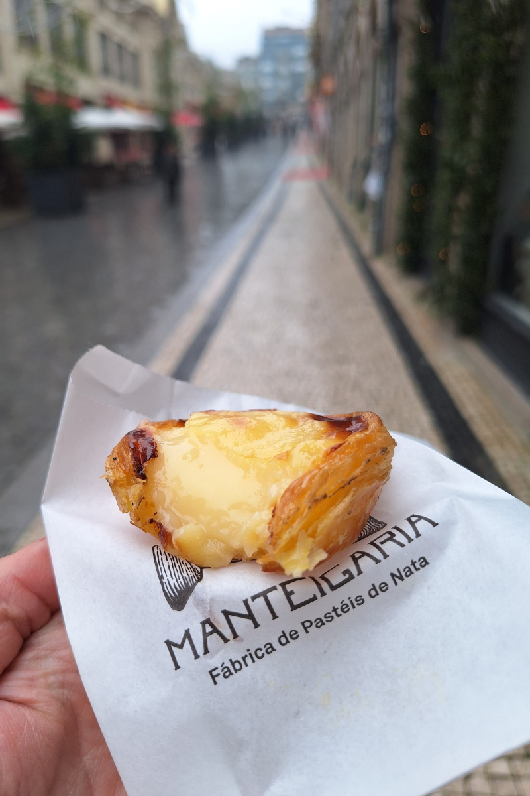
  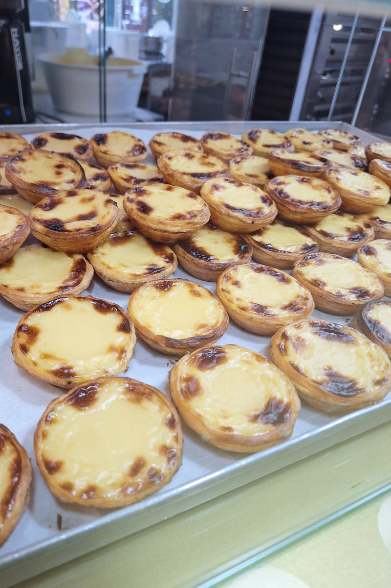

Nieopodal zdecydowanie warto zatrzymać się na chwilę przy **Capela das Almas** (Kaplicy Dusz). Jej wyjątkowa elewacja, w
całości pokryta niebiesko-białymi kafelkami azulejo, widoczna jest już z daleka. Te przepiękne ceramiczne płytki
przedstawiają sceny z życia świętych i zostały dodane do kaplicy w 1929 roku. Świątynia stoi przy głównej ulicy handlowej
Porto, Rua de Santa Catarina, a niebieskie azulejos pokrywają imponującą powierzchnię około 360 metrów kwadratowych.
Kaplica to doskonały przykład pięknej i niepowtarzalnej architektury, którą warto zobaczyć podczas zwiedzania tętniącej
życiem okolicy Bolhão.

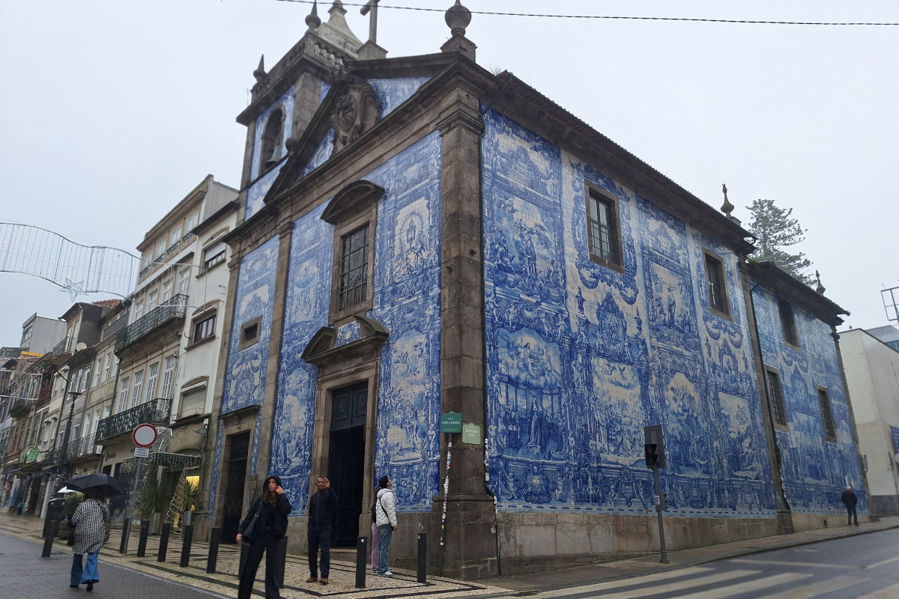

  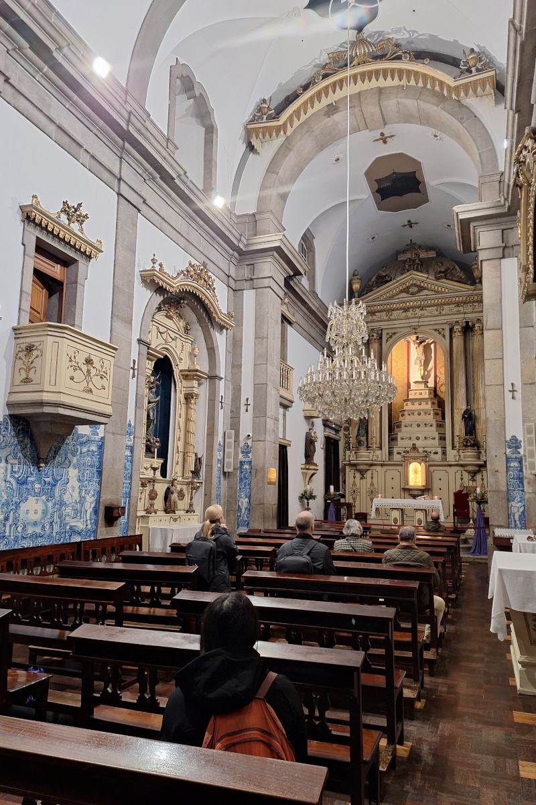
  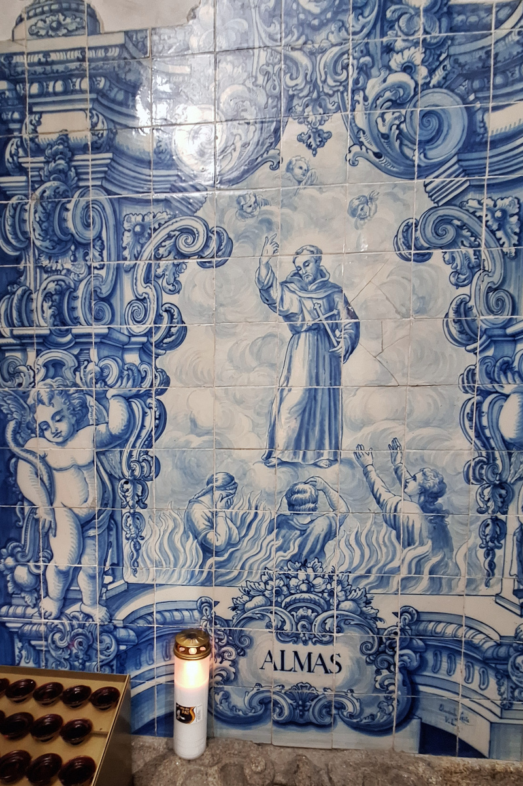

Następnie ruszyłam w stronę Gai i kultowego mostu **Ponte Luís I**. Ta niezwykła konstrukcja ma dwa poziomy, z
których każdy pełni inną funkcję: górny przeznaczony jest dla tramwajów i pieszych, a dolny dla samochodów i pieszych.
Most zaprojektował Théophile Seyrig, uczeń Gustave'a Eiffla, a jego budowę ukończono w 1886 roku. Obiekt doskonale
odzwierciedla szybką industrializację i rozwój Porto w tamtym okresie.
Spacer górnym poziomem oferuje zapierające dech w piersiach panoramy rzeki Douro, historycznej dzielnicy Ribeira oraz
piwnic winnych Vila Nova de Gaia. Wyjątkowa, dwupoziomowa konstrukcja jest zarówno funkcjonalna, jak i efektowna, dzięki
czemu most należy do najczęściej fotografowanych zabytków Portugalii. Mnie szczególnie spodobała się mglista pogoda, która
dodała magii widokom na rzekę i otaczające ją zielone wzgórza.

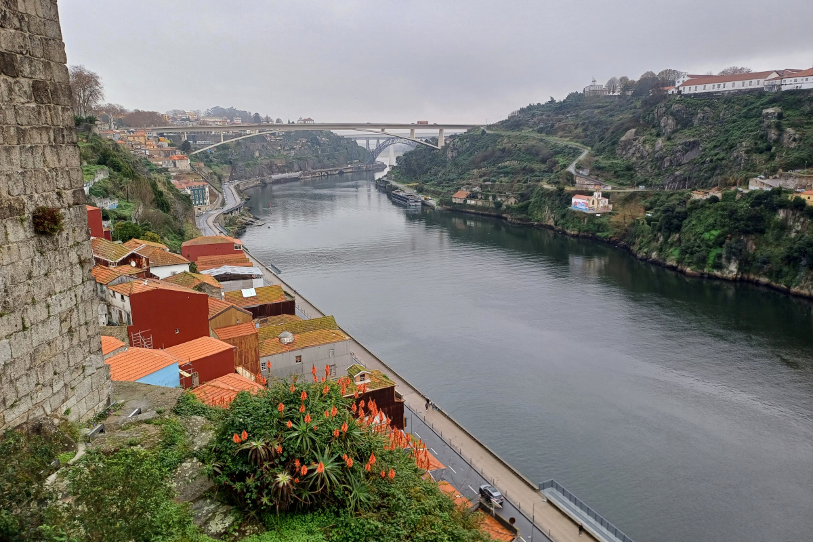
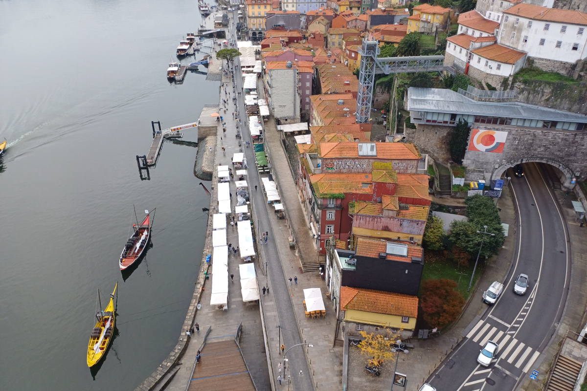
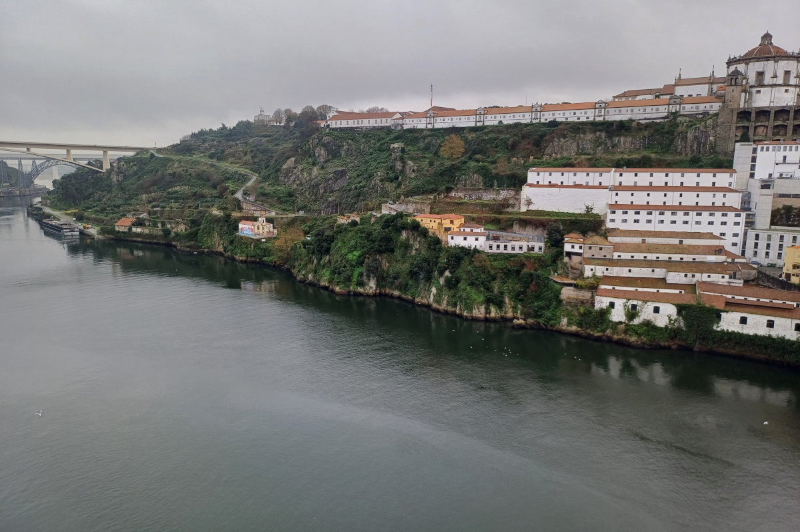

  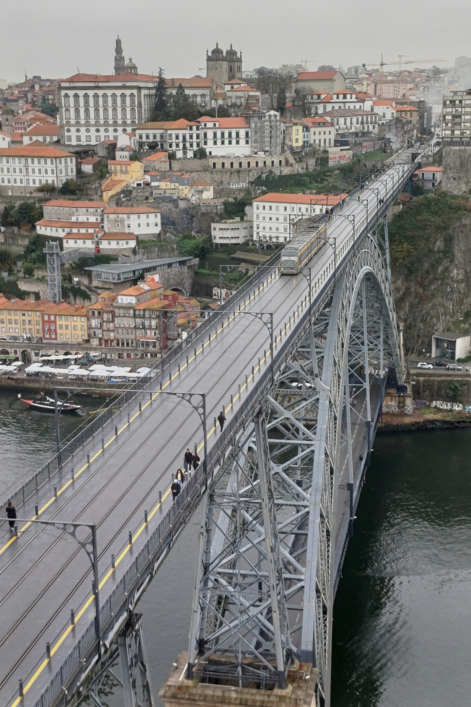
  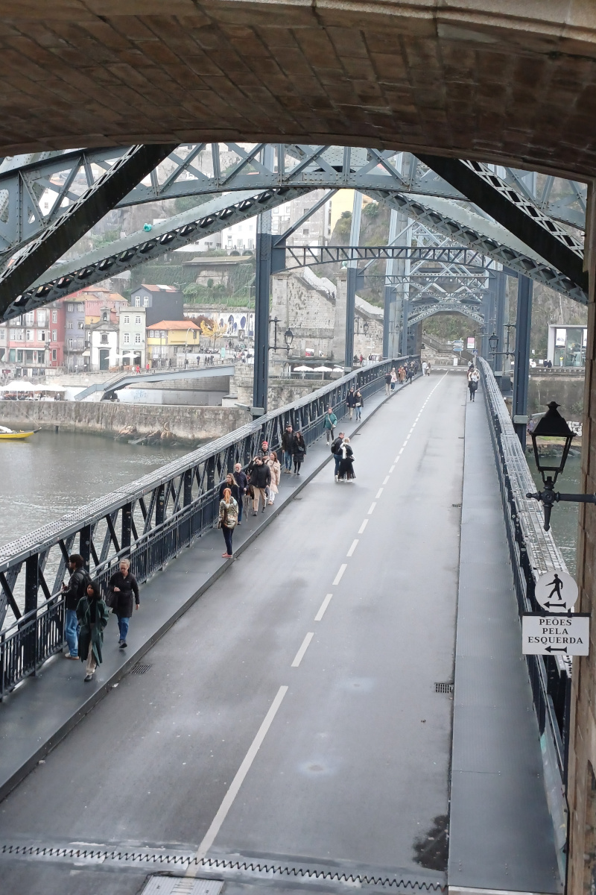

**Mosteiro da Serra do Pilar**, XVI-wieczny klasztor wpisany na listę światowego dziedzictwa UNESCO, oferuje jeden z
najlepszych punktów widokowych na Porto i rzekę Douro. Po wizycie przy tarasie widokowym obok klasztoru ruszyłam dalej w
głąb dzielnicy Gaia, przechodząc przez Jardim do Morro. **Gaia** słynie z piwnic wina Porto, gdzie można poznać proces produkcji
tego kultowego trunku i wziąć udział w degustacji. Kolejka linowa łączy nabrzeże z górną częścią dzielnicy, zapewniając
malownicze widoki na miasto i rzekę. Ja wybrałam spacer wąskimi uliczkami biegnącymi pod kolejką, a następnie promenadą
wzdłuż rzeki. Ta tętniąca życiem okolica pełna jest restauracji, kawiarni i sklepików, a z każdego miejsca rozciąga się
piękny widok na Porto i dwupoziomowy most Ludwika I.

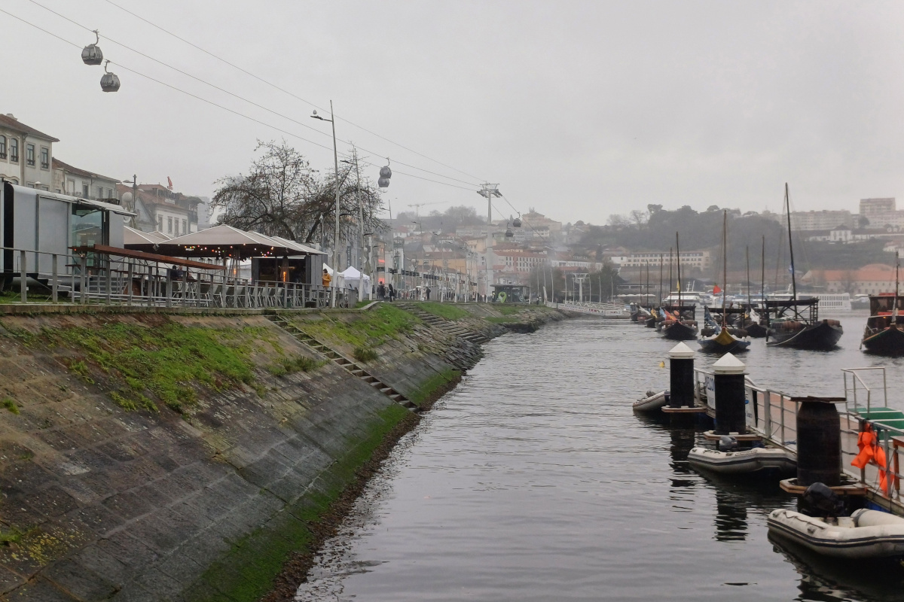
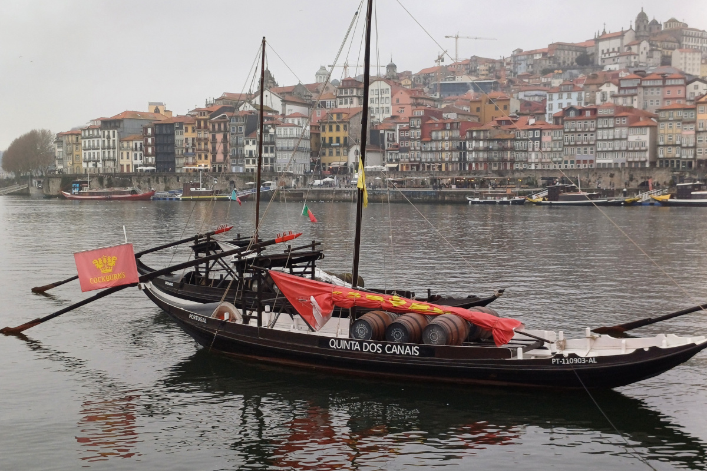

Podobnie jak wiele innych miejskich obszarów w Portugalii, Gaia zmagała się w XX wieku z trudnościami gospodarczymi, co
doprowadziło do okresów zaniedbania. Wraz z upadkiem przemysłu i przeprowadzkami mieszkańców do nowoczesnych osiedli wiele
budynków zostało opuszczonych. Renowacja zabytkowych kamienic bywa bardzo kosztowna, wiec właścicielom często brakuje środków
aby to sfinansowac, zwłaszcza gdy w grę wchodzą skomplikowane kwestie własnościowe lub spory prawne (sporo kamienic przeszła 
na właśniośc do kolejnych pokolen pierwotnych właścicieli). Bardzo podobny problem zauważyłam w
[Funchal na Maderze]().
Na szczęście rozwój turystyki przyniósł nowe zainteresowanie ożywieniem Gai. Projekty takie jak dzielnica WOW (World of
Wine) zamieniły opuszczone przestrzenie w tętniące życiem miejsca kultury i rozrywki. Jak widać na zdjęciu poniżej, część
dachów wciąż jest zawalona, ale prace nad przywróceniem okolicy dawnego blasku trwają.

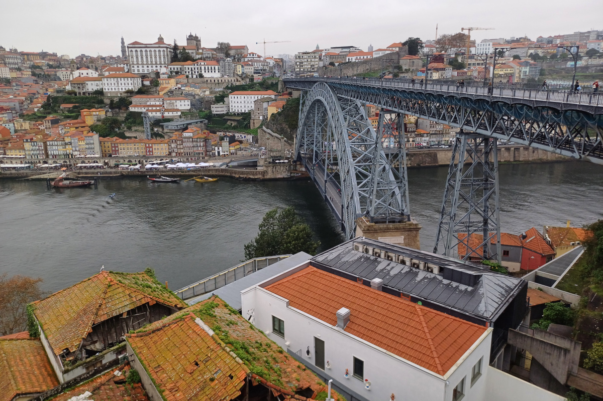

Dworzec kolejowy **Porto São Bento** to kolejne miejsce, w którym można podziwiać wspaniałe kafelki azulejo, jest ich ponad
20 000! To nie tylko węzeł komunikacyjny, ale też perła architektury i kultury, przyciągająca rzesze zwiedzających. Dworzec
ma bardzo dogodną lokalizację, w samym sercu Porto. Na ścianach można wypatrzeć sceny z historii Portugalii oraz z
tradycyjnego życia na wsi, w tym święta, targi i lokalne zwyczaje. Nazwa stacji pochodzi od dawnego klasztoru benedyktynów.
Mimo zabytkowego charakteru São Bento jest w pełni działającą stacją kolejową, obsługującą pociągi regionalne i
międzymiastowe, w tym połączenie do Bragi.

  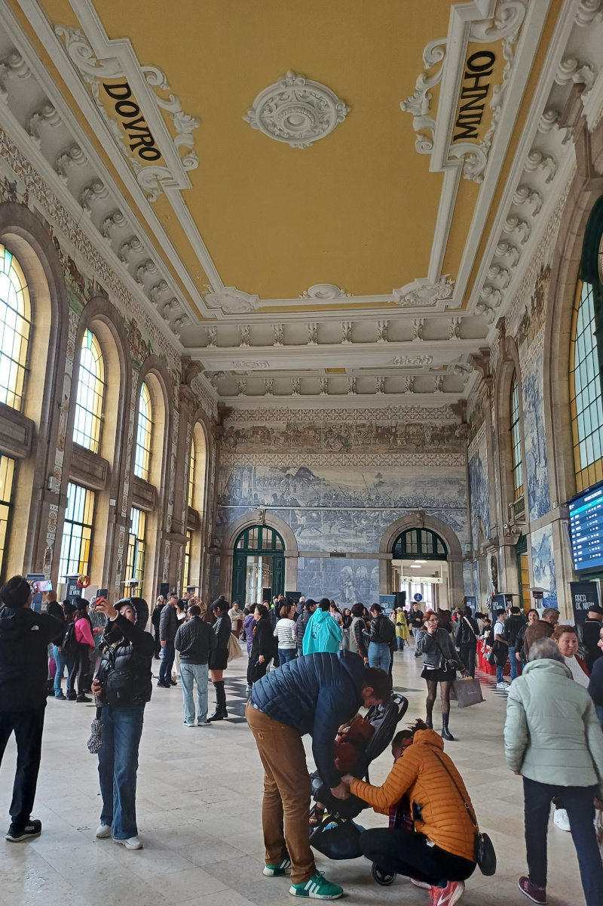
  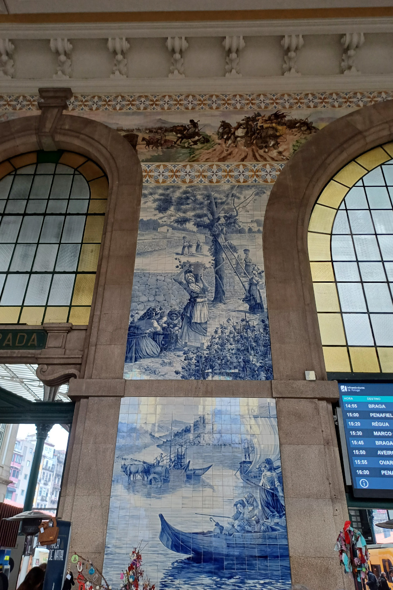

**Jardins do Palácio de Cristal**, zadbany park z fontannami i rzeźbami, okazał się idealnym miejscem na spokojny spacer.
Nie polecałabym go jednak, jeśli masz na zwiedzanie miasta tylko 6 godzin, a pogoda nie dopisuje. W centrum ogrodów stoi
Pavilhão Rosa Mota, znany również jako Super Bock Arena. W tej wielofunkcyjnej hali odbywają się koncerty, wydarzenia
sportowe i wystawy. Zauważyłam tam kilka pawi, ale wszystkie chowały się pod dachem pawilonu.
Ogrody zaprojektowano pierwotnie wokół Kryształowego Pałacu, który zburzono w 1951 roku, jednak park zachował dawną nazwę.

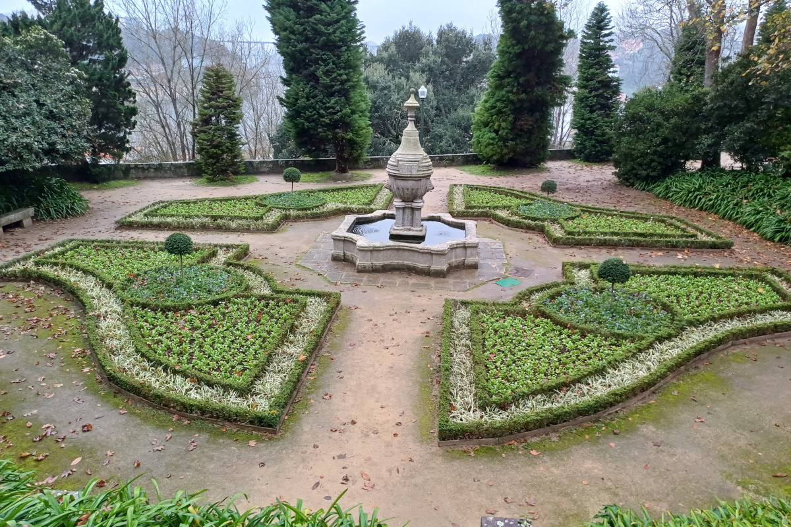

W drodze do parku zwróciłam uwagę na **zabytkowe tramwaje**, symbol historii i uroku miasta. Obsługiwane przez STCP (Sociedade
de Transportes Colectivos do Porto), są jednym ze sposobów na zwiedzanie ulic Porto. Do dziś kursują zaledwie 3 linie,
prowadzące przez najbardziej malownicze zakątki miasta. Tramwaje zostały pięknie odrestaurowane i zachowały oryginalne
drewniane elementy oraz klasyczny wygląd. Jeśli interesuje Cię historia sieci tramwajowej w Porto, odwiedź Museu do Carro
Eléctrico (Muzeum Tramwajów) i jego kolekcję zabytkowych wagonów.

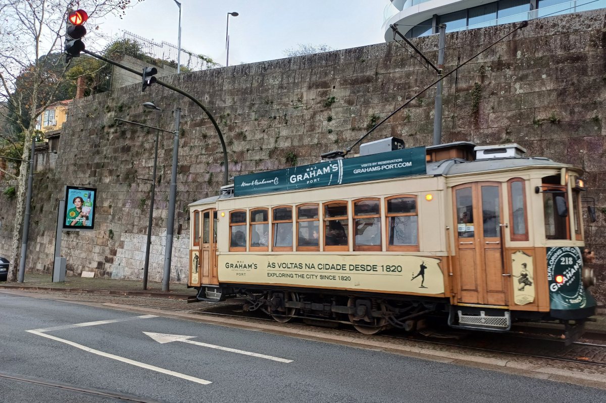

Gdy mijałam jarmark bożonarodzeniowy w **Jardim da Cordoaria**, robiło się już ciemno. Był niewielki, ale przyjemnie się po
nim spacerowało. Okoliczne ulice wypełniał dym oraz unoszący się zapach pieczonych kasztanów, sprzedawanych przez licznych handlarzy z
tradycyjnych wózków z małymi piecykami na węgiel. Unoszący się z nich dym tworzył przytulną, świąteczną atmosferę. Pieczone
kasztany sprzedaje się na ulicach jesienią i zimą, od października do stycznia, więc to prawdziwie sezonowy przysmak. Po
raz pierwszy spróbowałam tej zdrowej przekąski kilka tygodni wcześniej na Maderze i bardzo mi smakowała! Są dość sycące,
a podaje się je w małych papierowych rożkach, idealnych do jedzenia podczas spaceru. Wysoka budowla widoczna nieopodal jarmarku
okazała się kościołem Clérigos, jednym z symboli Porto. Niestety nie mogłam wejść do środka bez biletu, ponieważ trwał
akurat pokaz świetlny Spiritus. Na ulicach zaczęły rozbłyskiwać wszystkie świąteczne dekoracje i mimo deszczowej pogody
w mieście panował radosny nastrój. Moją uwagę przykuł również kościół **Igreja do Carmo**, znajdujący się w okolicy jarmarku,
widoczny na górnym zdjęciu poniżej.

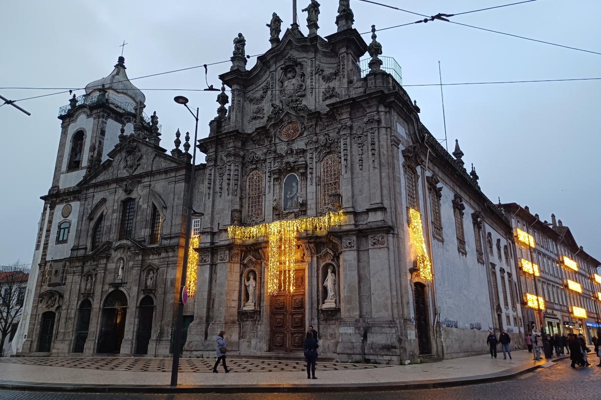
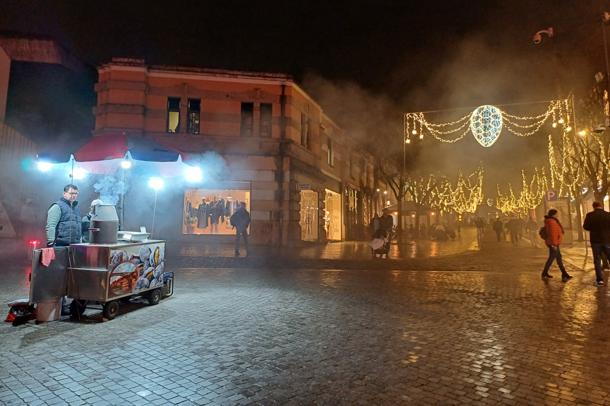
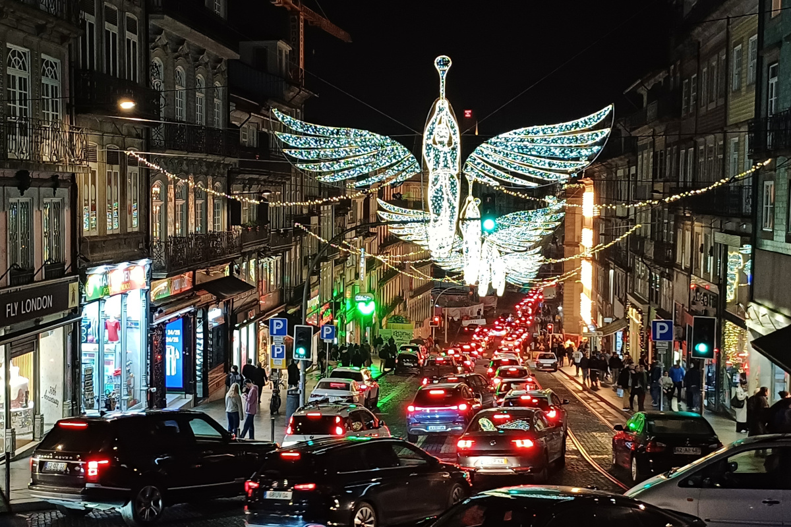

W drodze na dworzec, skąd miałam złapać pociąg do Bragi, uświadomiłam sobie, że nie odwiedziłam katedry w Porto! Do odjazdu
została godzina, więc szybko pobiegłam do dzielnicy Batalha, gdzie stoi świątynia.
Gdy podchodziłam od strony Avenida Dom Afonso Henriques, od razu zwrócił moją uwagę przypominający twierdzę wygląd katedry.
Wzdłuż tej części ulicy stały również świąteczne stragany, dodające miastu odświętnego klimatu. Pochodziłam po niemal
pustych okolicach katedry i zeszłam nieco w dół, błądząc wąskimi uliczkami.
Było już zupełnie ciemno, więc niestety z placu katedralnego nie zobaczyłam widoku na rzekę Douro ani na most Ludwika I.
Katedra jest ważnym punktem na szlaku pielgrzymkowym Camino de Santiago i często można tu spotkać pielgrzymów rozpoczynających
swoją wędrówkę. Choć moja wizyta była bardzo krótka, i tak fascynujące było zobaczyć ten historyczny i kultowy zabytek.

  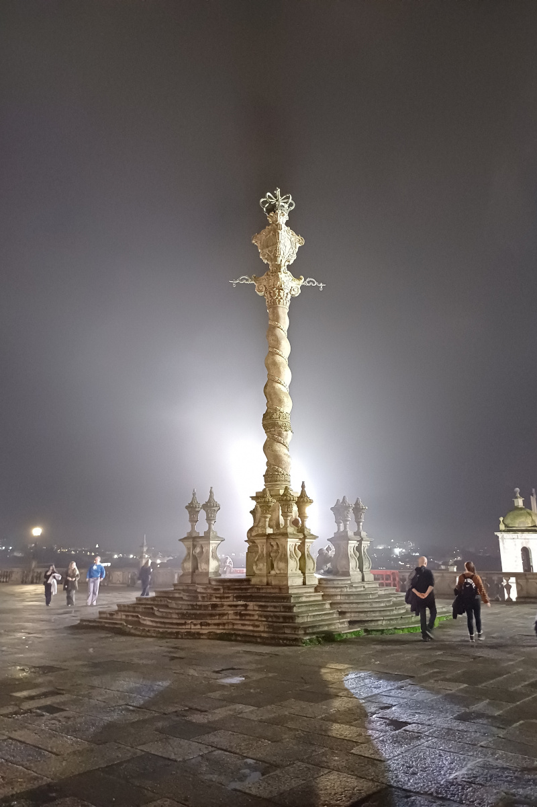
  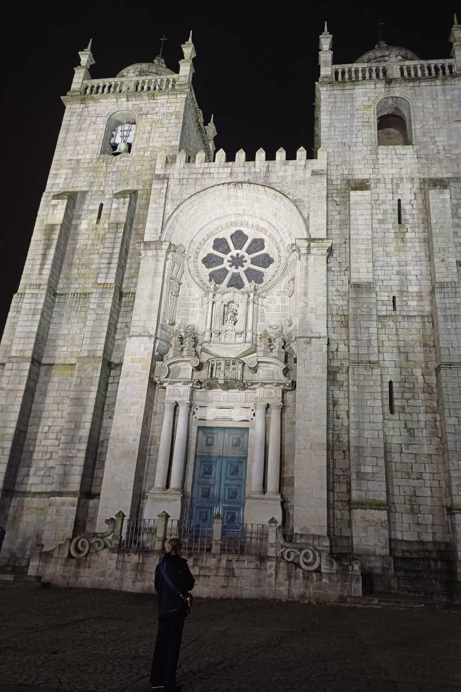

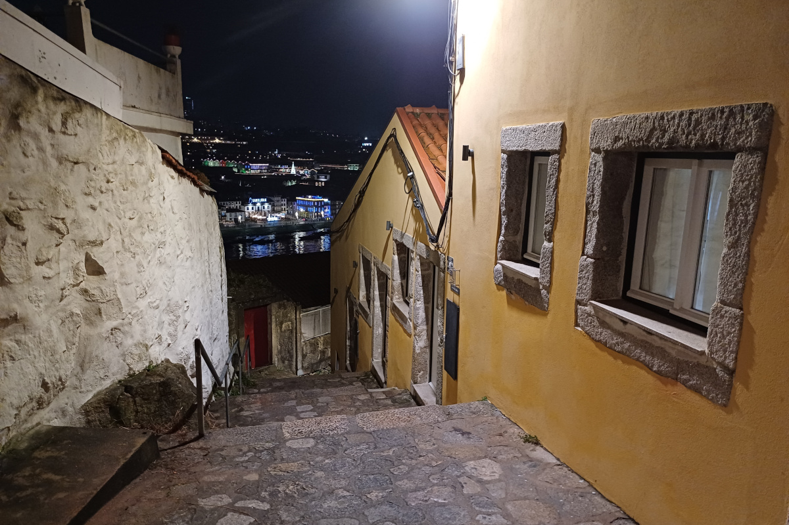

Gdy mój dzień w Porto dobiegał końca, nie mogłam powstrzymać uśmiechu na myśl o tym, jak wiele udało mi się zobaczyć i
przeżyć w zaledwie kilka godzin. Od gwarnego Mercado do Bolhão po zjawiskowe azulejos na dworcu São Bento, miasto zaskakiwało
mnie na każdym kroku. Świąteczne światła rozświetlające mżawkę oraz zapach pieczonych kasztanów sprawiały, że ulice
wydawały się przytulne nawet podczas niesprzyjajacej pogody.
Wsiadając do pociągu [do Bragi](), wiedziałam już jedno, na pewno tu jeszcze wrócę,
żeby odkryć jeszcze więcej!

## Informacje praktyczne:

* Bilet na metro kosztował 2,85 euro (2,25 euro za strefę Z4 + 0,60 euro za kartę Andante). Kartę Andante można wielokrotnie
doładowywać. Na automacie biletowym znajduje się naklejka z nazwami wszystkich stacji metra, a obok nich podana jest strefa
obowiązująca przy przejeździe z lotniska. Ja jechałam do stacji Bolhão, więc obowiązywała mnie strefa Z4. 
Więcej szczegółów [na oficjalnej stronie](https://en.metrodoporto.pt/pages/391), choć gdy sprawdzałam połączenie Aeroporto – Bolhão, cena biletu
jednorazowego wynosiła 2 euro, więc strona nie podaje poprawnych cen (strefa była już jednak prawidłowa).

* Restauracja w Porto PAPO CHEIO - A Tasca de Cedofeita. Lokal ma niewielką salę w środku oraz stoliki na zewnątrz i serwuje
pyszne dania regionalne. Świetny stosunek jakości do ceny i bardzo miła obsługa.
Adres: R. de Cedofeita 95, 4050-166 Porto, Portugalia

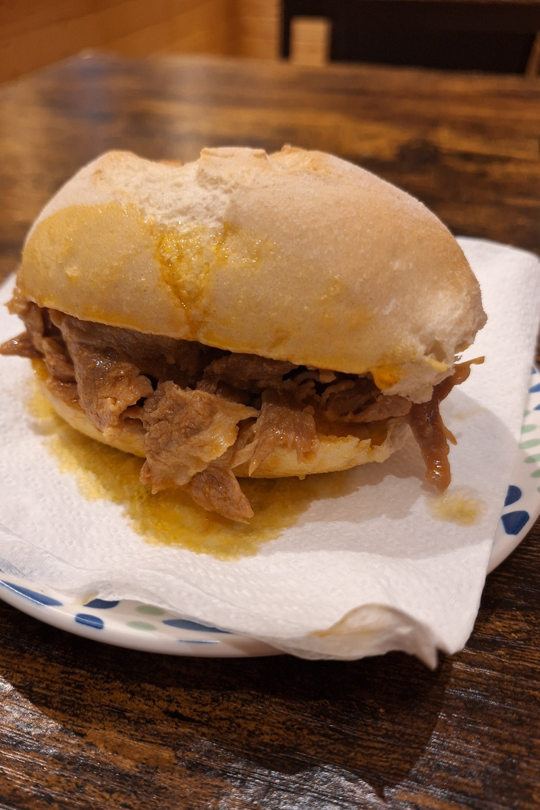

* Manteigaria – [Fábrica de Pastéis de Nata](https://manteigaria.com/) sprzedaje świeże i ciepłe Pastel de Nata z pysznym,
bardzo delikatnym kremem. Ciastka są przygotowywane i pieczone na miejscu (1,30 € za sztukę).

* Pociąg z Porto do Bragi kosztował 3,95 euro (3,45 euro za bilet + 0,50 euro za kartę SIGA). Karta jest wielokrotnego
użytku, działa zbliżeniowo i może pomieścić do 31 pojedynczych biletów, które można wykorzystać w obie strony. Obsługa
automatu biletowego okazała się nieco kłopotliwa, bo nawet po przełączeniu na język angielski tłumaczenie było częściowe i nieprecyzyjne.
Potrzebowałam kilku prób, aby ustalić, jak kupić właściwy bilet ale się udało!

