Transgraniczny Rezerwat Biosfery Gerês-Xurés (**Reserva de la Biosfera Transfronteriza Gerês-Xurés**) rozciąga się na
terenie Galicji (Hiszpania) oraz Regionu Północnego (Portugalia). Ze swoimi najwyższymi szczytami, Nevosą (1646 m) i
Fontefríą, położonymi w sercu pasma Serra Gerês-Xurés, został uznany za rezerwat biosfery UNESCO w 2009 roku. Rzadkim,
ale kultowym drapieżnikiem tego obszaru jest wilk iberyjski. Znacznie częściej można tu spotkać konie Garrano, półdzikie
konie pochodzące z północnej Portugalii. Swobodnie przemierzają rezerwat i są symbolem kulturowego oraz przyrodniczego
dziedzictwa regionu. W lasach rezerwatu dominuje dąb pirenejski, zapewniający kluczowe siedliska dla dzikich zwierząt.
Zauważyliśmy również wiele eukaliptusów, ale wszystko zależy od tego, którą część tego rozległego obszaru się odwiedza.
Szczególnie podobały mi się formacje skalne widoczne w wyższych partiach gór.

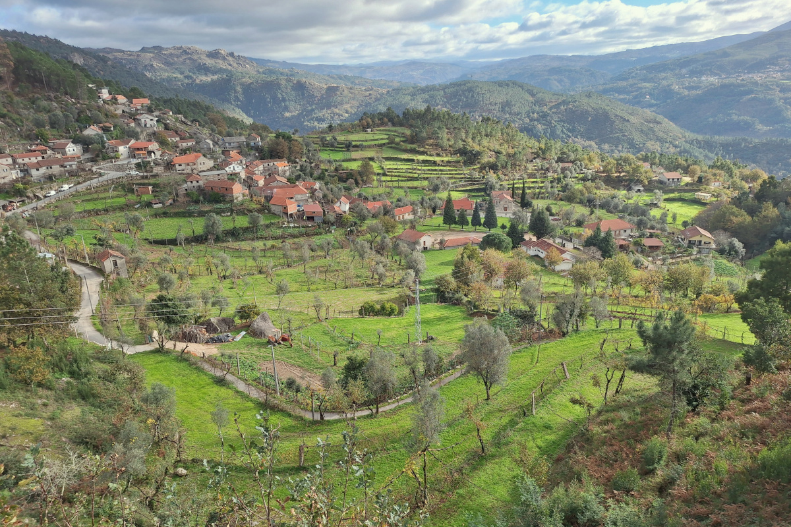

Naszą wędrówkę rozpoczęliśmy przy **Miradouro da Ermida** we wsi Ermida, gdzie zostawiliśmy samochód. Wybraliśmy krótką
pętlę o długości 6,5 km (Miradouro da Ermida – Miradouro Fraga do Justo – Cascata da Rajada – Miradouro Silhas –
Miradouro da Vela – Miradouro da Ermida), nawigując przy pomocy aplikacji Organic Maps i częściowo podążając szlakiem
oznaczonym jako pętla „PR14 Alternativo".

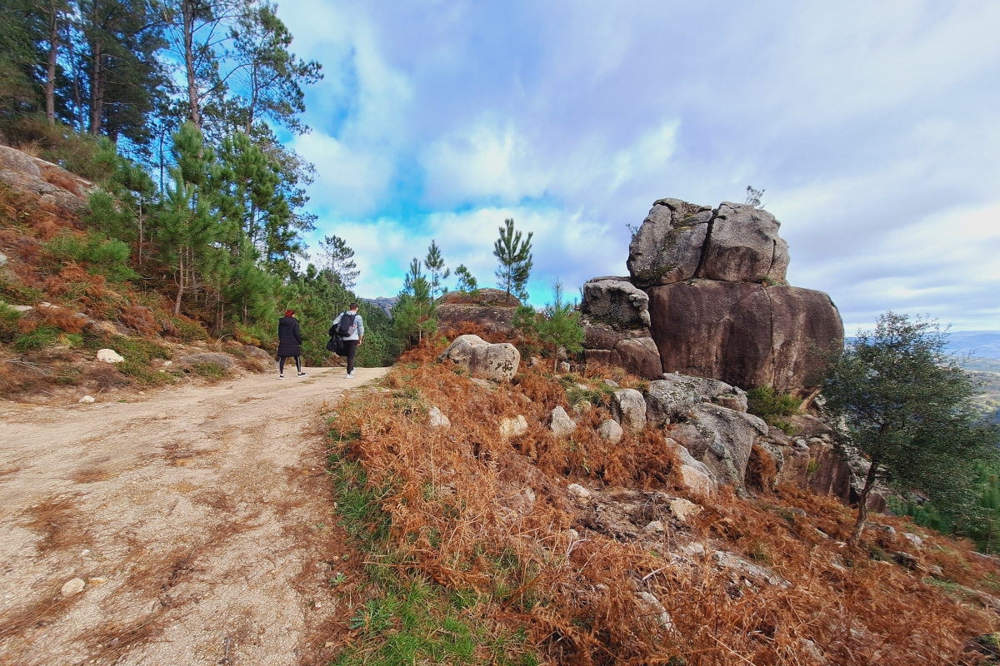

  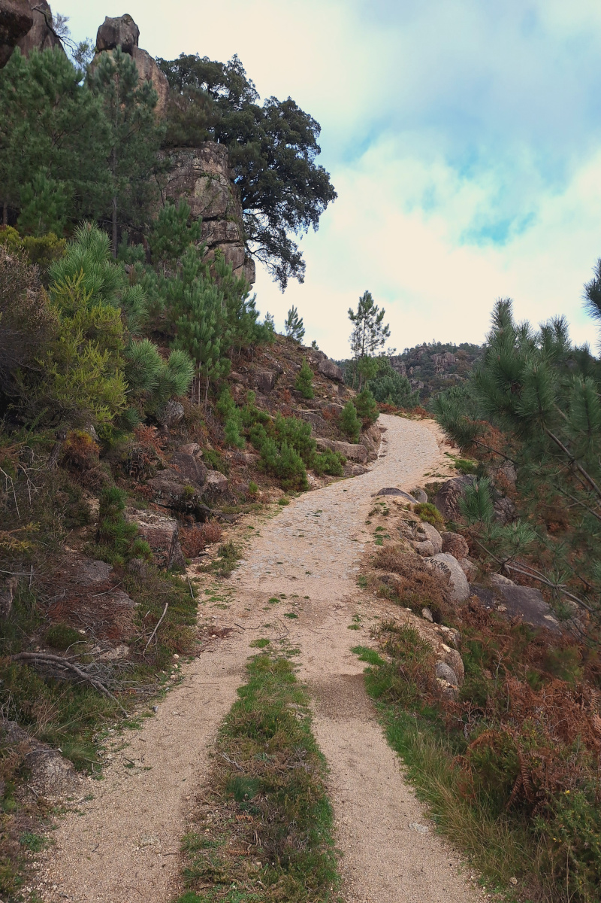
  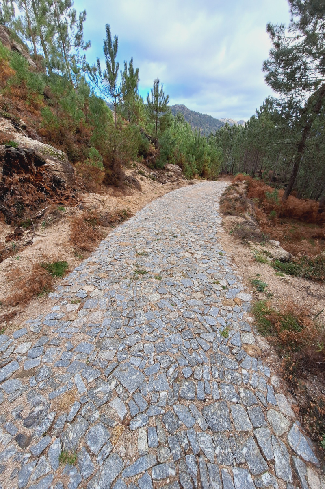

Najpierw poszliśmy za znakami w stronę **Miradouro Fraga do Justo**. Z tego punktu widokowego można zobaczyć całą otaczającą
dolinę rzeki Arado, z jej rwącymi wodami płynącymi między skałami, które niżej zamieniają się w widoczny wodospad Rajada.
**Cascata da Rajada** była naszym głównym celem, malowniczy wodospad na końcu przyjemnej trasy z dużą ilością cienia.
Szlak na końcu robi się nieco kamienisty, ale nie jest szczególnie trudny technicznie. Według opinii w Google w sierpniu wody jest
znacznie mniej, ale na początku grudnia strumień był bardzo dobrze widoczny. Niektórzy wspinają się na skały na końcu trasy, aby
dotrzeć do podnóża wodospadu. Trzeba jednak uważać, bo kamienie potrafią być bardzo śliskie. Latem można też znaleźć
większą i głębszą lagunę, w której da się popływać. Okolice Cascata da Rajada to przyjemne miejsce na dłuższy odpoczynek.

  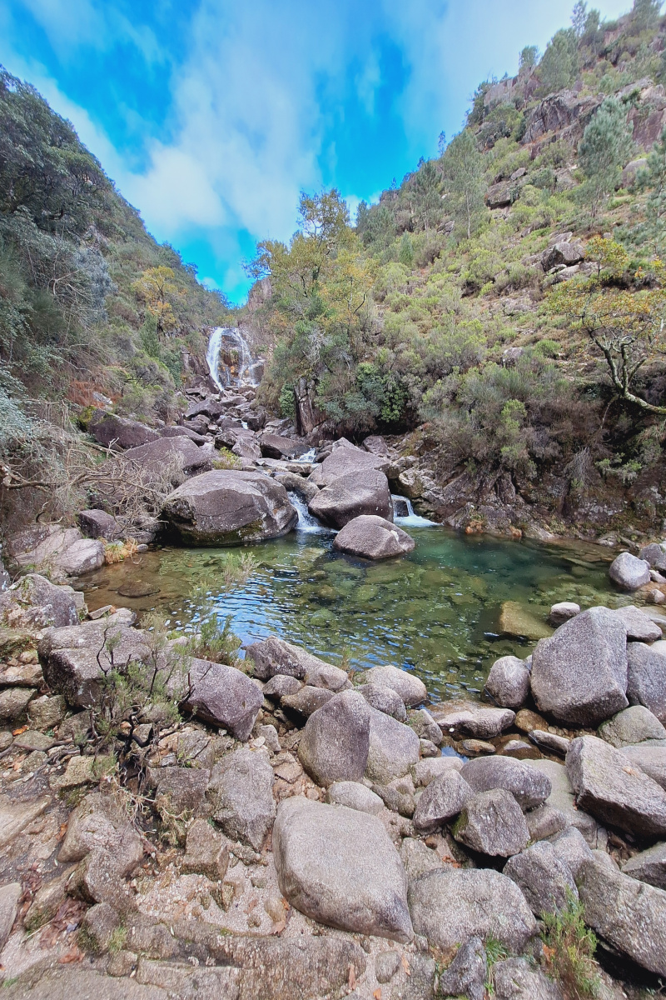
  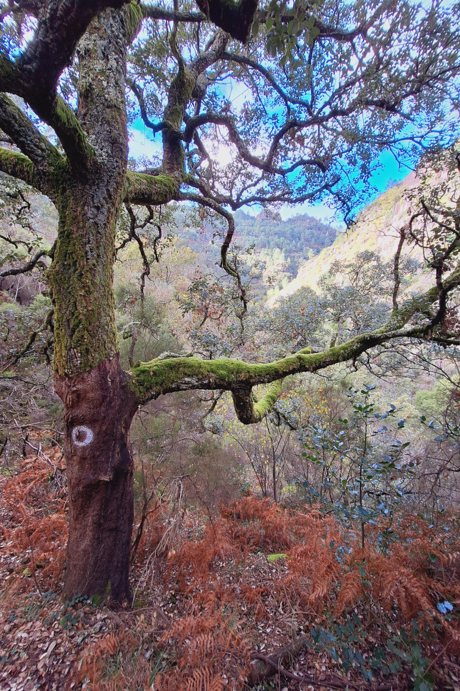

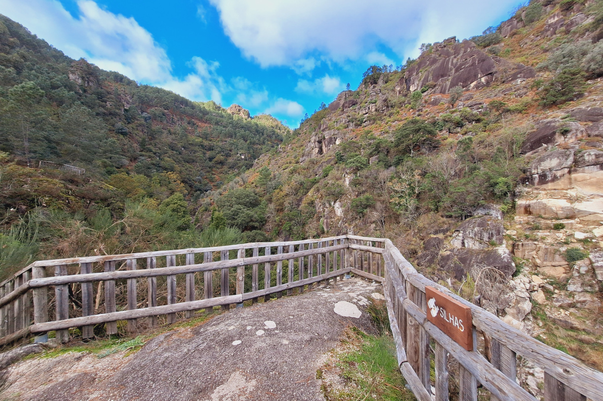

W pobliżu wodospadu znajdują się kolejne punkty widokowe na naturalnych skałach, takie jak **Miradouro Silhas**. Widoki z
obu jego platform są zjawiskowe. Warto poszukać ścieżek prowadzących do każdej z nich, choć nie zawsze są oczywiste i trzeba
przecisnąć się między drzewami i krzewami. Następnie ruszyliśmy z powrotem do wsi Ermida, zatrzymując się przy kolejnym
punkcie widokowym, **Miradouro da Vela**. Ten jest bardzo łatwo dostępny gdyż prowadzi do niego wyraźna ścieżka.

Nieopodal zauważyliśmy fragment lasu, który niedawno spłonął. Duże obszary centralnej i północnej Portugalii porastają
eukaliptusy, drzewa bardzo łatwopalne. Eukaliptus doskonale się rozwija i regeneruje po pożarach, dlatego budzi w Portugalii
sporo kontrowersji. Sprowadzony w latach 50. XIX wieku, jest dziś najpospolitszym drzewem w kraju. Choć jest cenny dla
przemysłu papierniczego ze względu na szybki wzrost i wysoką wydajność, wyjaławia glebę, zużywa dużo wody i rozprzestrzenia
się w niekontrolowany sposób na nieużytkach. Jego łatwopalne liście i kora dodatkowo zwiększają ryzyko pożarów. Zdjęcia
poniżej dobrze pokazują, jak szybko eukaliptus potrafi się odrodzić po pożarach z końca lata.

  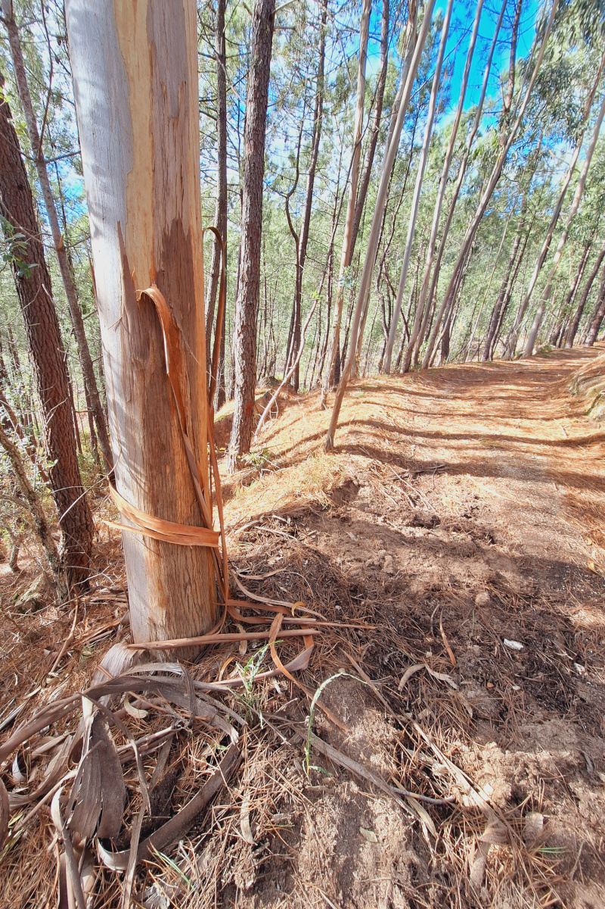
  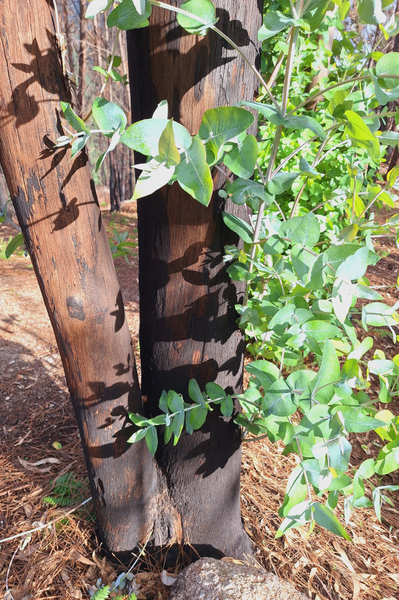

  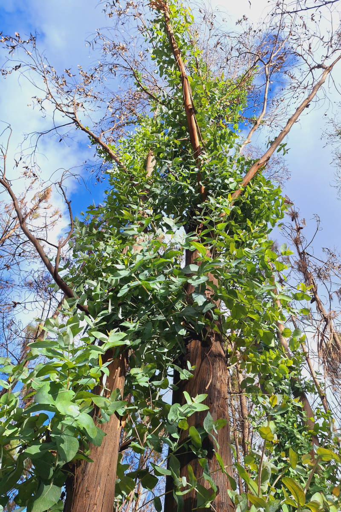
  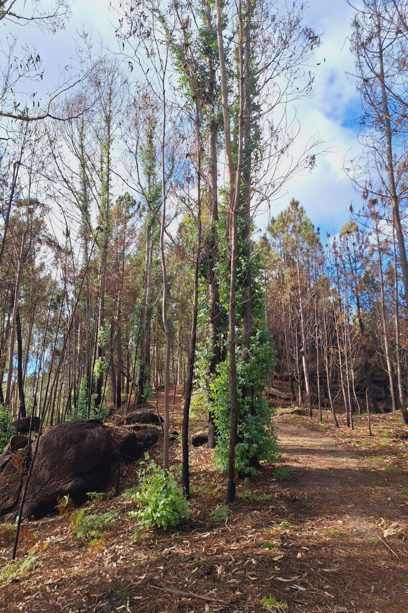

Po wizycie na tym punkcie widokowym kontynuowaliśmy spokojny spacer, aby poznać wieś i jej wiejskie okolice. Jednym z
najbardziej charakterystycznych elementów tego regionu są hórreos, tradycyjne spichlerze stojące niemal przy każdym domu.
Konstrukcje te, budowane z drewna lub kamienia i wsparte na słupach zakończonych płaskimi kamieniami, uniemożliwiają
gryzoniom dostanie się do przechowywanego ziarna. Zwykle mają kształt kwadratu lub prostokąta, a w ścianach znajdują się
szczeliny zapewniające wentylację.

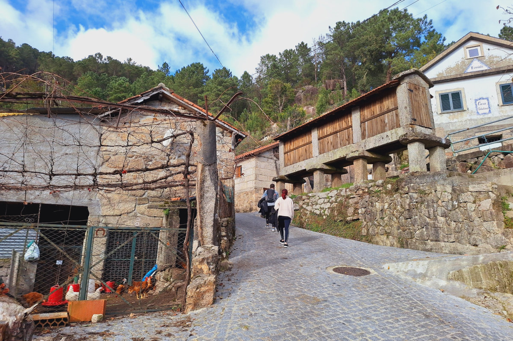

Później odwiedziliśmy pobliski wodospad **Cascata do Arado**. Zaparkowaliśmy przy rondzie, na którym kończy się asfaltowa
droga (współrzędne: 41.715924, -8.132380) i przeszliśmy 15 minut drogą gruntową (około 850 m), którą spokojnie pokonają
też dzieci. Można podjechać bliżej, bo droga gruntowa jest w dobrym stanie i jest tam sporo miejsc parkingowych. Cascata
do Arado to piękny, niewielki wodospad o łatwym dojściu. Latem odwiedzający często kąpią się w jego naturalnych basenach.
Aby dotrzeć do podnóża wodospadu, trzeba pokonać nieoznakowaną ścieżkę i przejść w bród przez rzekę, ponieważ oficjalny
szlak prowadzi jedynie do górnego punktu widokowego. Lepiej zachować ostrożność, są tam tablice ostrzegające o wcześniejszych wypadkach.

  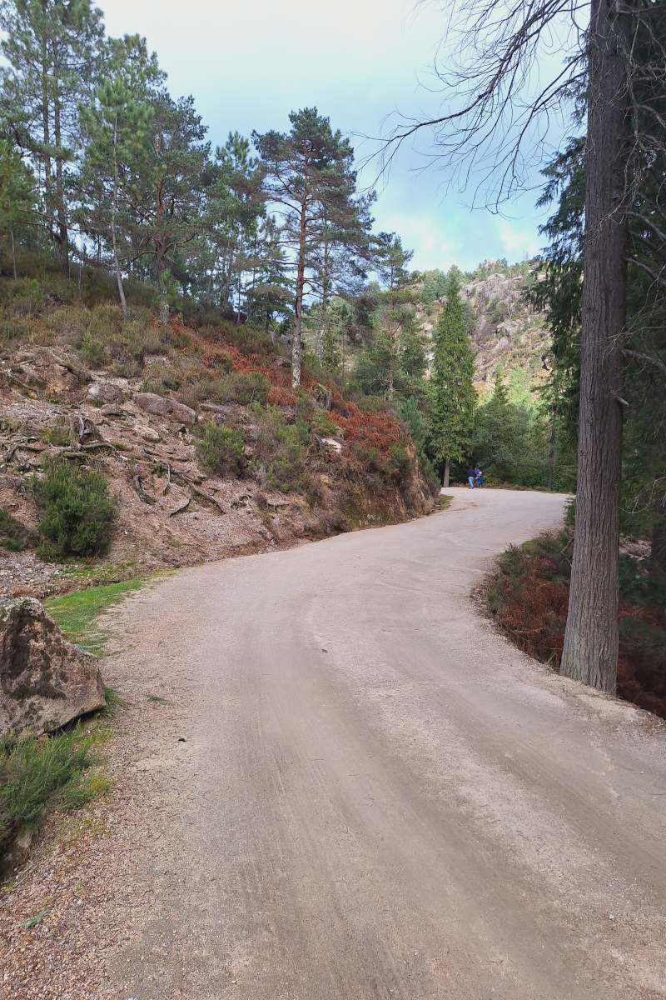
  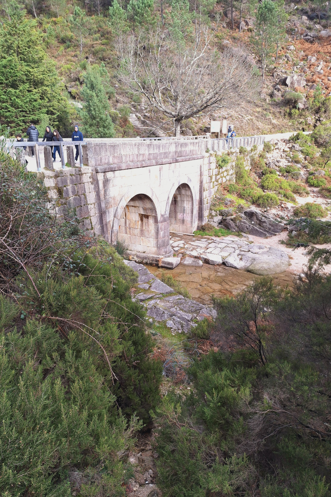

  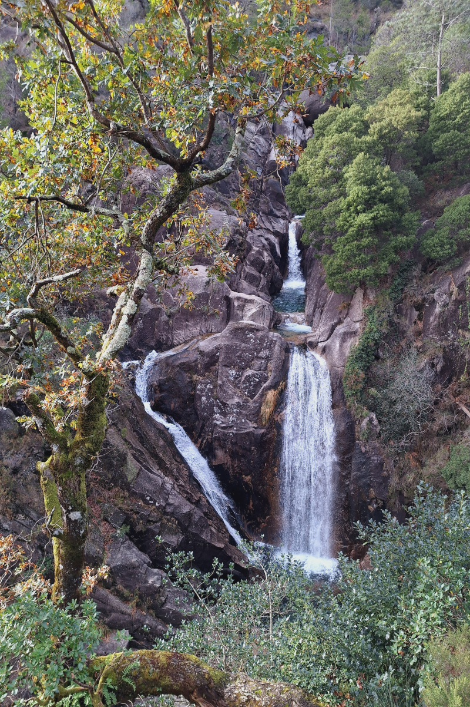
  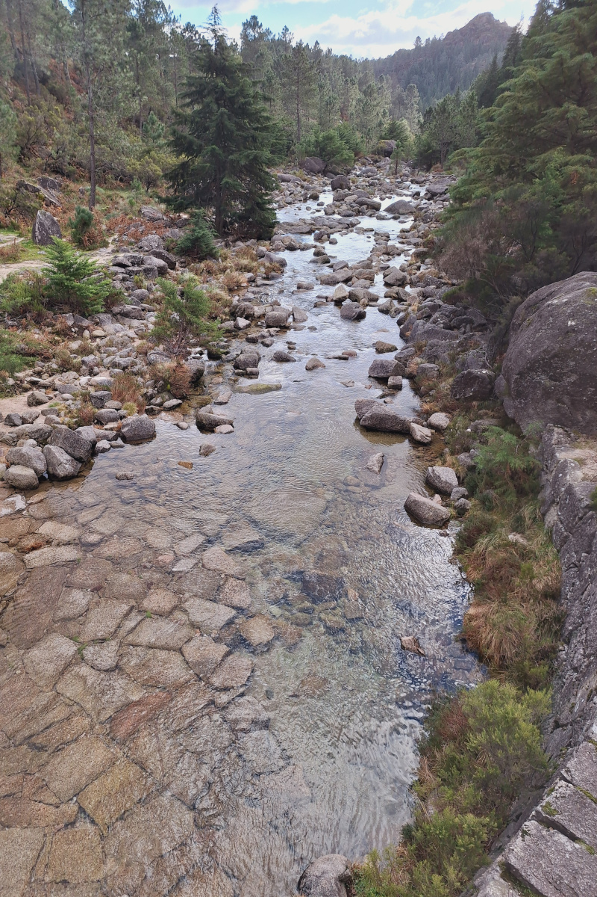

Na koniec weszłam jeszcze na punkt widokowy (**Viewpoint Rocas**) położony niedaleko parkingu. Podejście jest strome i
nieoznakowane, zajmuje około pięciu minut. Nie ma wyraźnej ścieżki, trzeba wspinać się po skałach, a ostatni odcinek
pokonuje się po sztucznych schodach. Choć podejście bywa trudne i wymaga trochę prób i błędów, było ciekawsze niż sama
panorama ze szczytu, która jest ładna, ale nie najlepsza, jaką widzieliśmy.

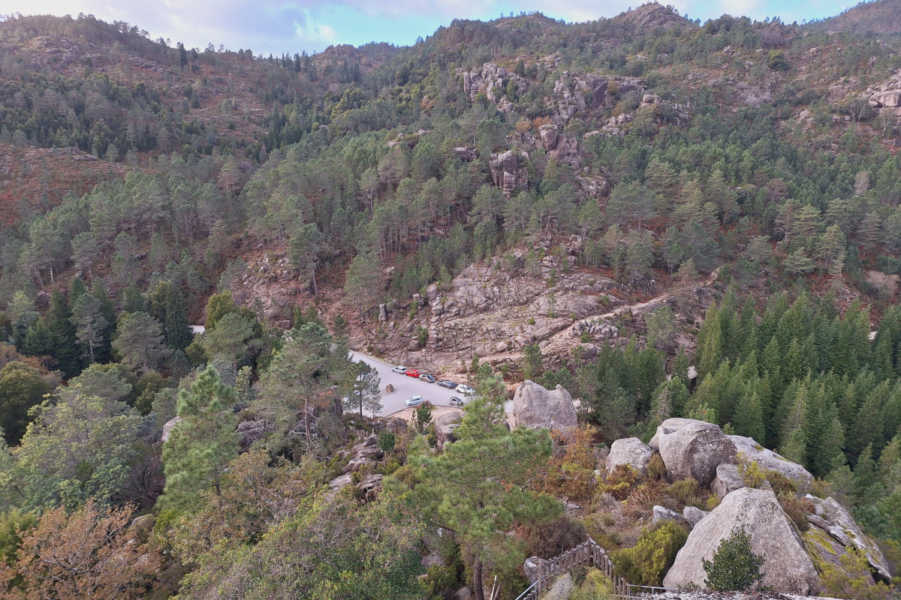

Rezerwat Gerês-Xurés to wyjątkowy kierunek dla miłośników przyrody, oferujący możliwość wędrówek, obserwowania dzikich
zwierząt i poznawania lokalnej kultury. Jeden dzień spędzony w tym parku przekonał mnie, że warto tu wrócić na dłuższą
przygodę. Zwłaszcza wtedy, gdy dni są dłuższe, a większa ilość światła pozwala na dalsze wędrówki.

Do tej części Portugalii przyjechałam po weekendzie spędzonym w [Bradze i Guimarães](),
oraz wcześniejszym dniu w [Porto]().

__Informacje praktyczne:__

* Na stronie [Transgranicznego Rezerwatu Biosfery Gerês-Xurés](https://turismo.cm-terrasdebouro.pt/aventura/) znajdziesz
opisy szlaków z tego regionu, od PR1 do PR15, a także dłuższych tras GR34 (pętla 34 km) i GR50 (187,5 km, trasa liniowa).
Można stamtąd pobrać plik PDF ze wszystkimi szczegółami każdej wędrówki, ale nie jest on zbyt pomocny przy odnajdywaniu
drogi, stanowi raczej tylko ogólny opis. Do nawigacji używaliśmy aplikacji Organic Maps i wszystkie szlaki były w niej
zaznaczone, więc nie mieliśmy żadnych problemów z odnalezieniem szlaku.

  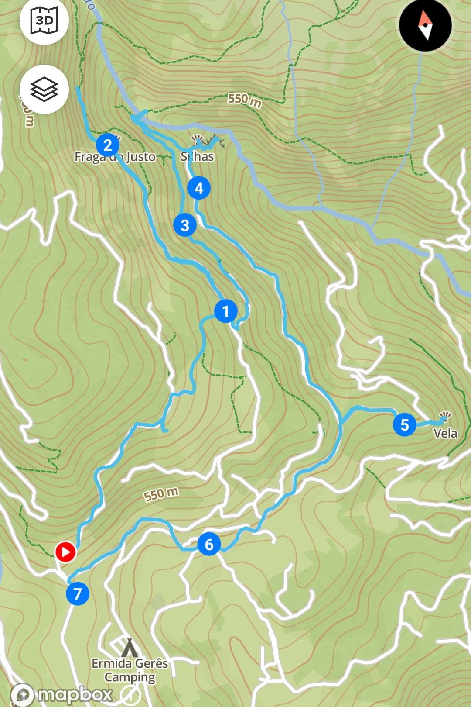
  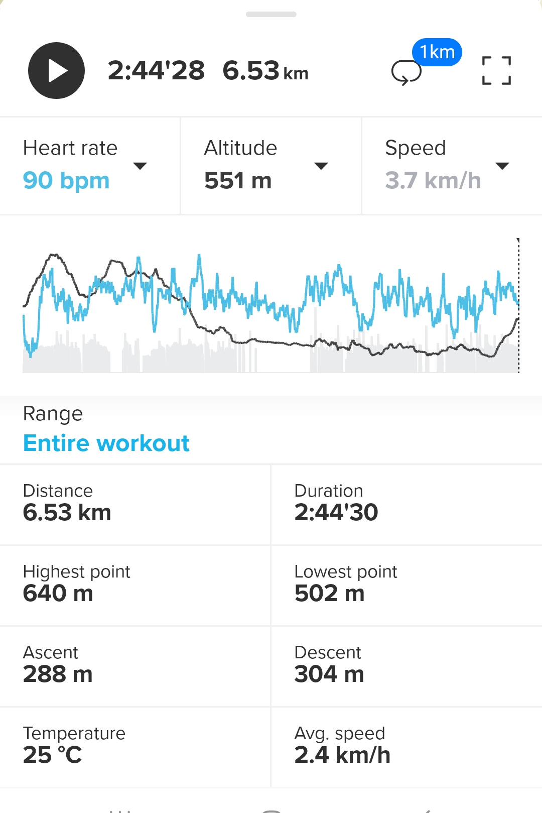

* [Szczegóły szlaku PR14](https://turismo.cm-terrasdebouro.pt/listings/pr14-trilho-do-sobreiral-da-ermida/#en-pr14) znajdziesz
na oficjalnej stronie. Trasa oznaczona jest poziomymi paskami w kolorze żółtym i czerwonym. W miejscach, gdzie szlak zmienia
kierunek, czerwony pasek ma kształt litery L wskazującej, w którą stronę należy skręcić (przykład poniżej oznacza, że
powinniśmy skręcić w lewo). Dokładniejsze wyjaśnienie znajduje się w pliku PDF dostępnym pod powyższym linkiem.

  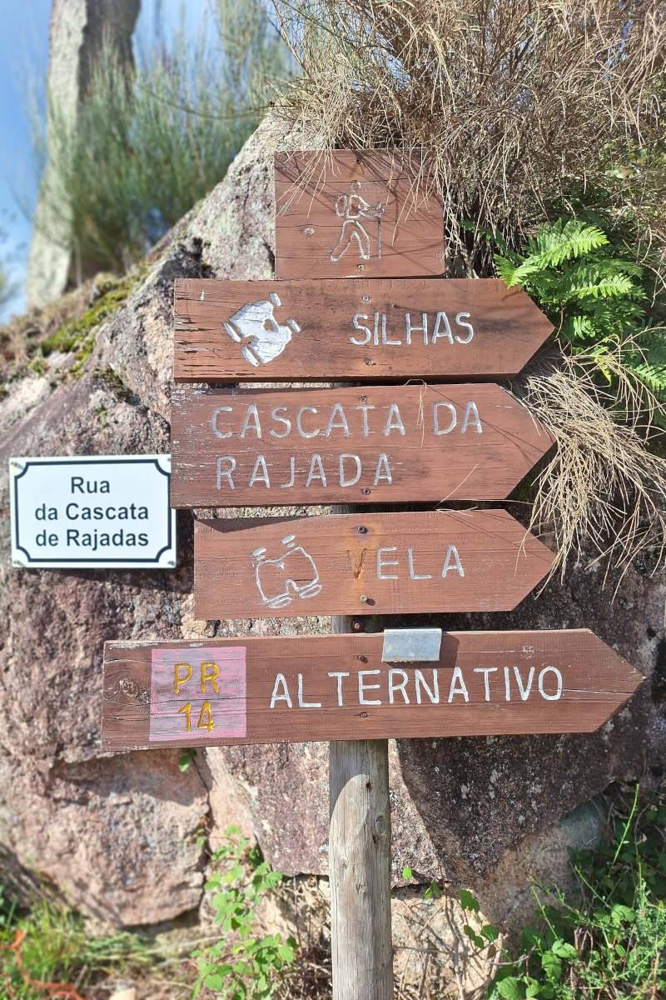
  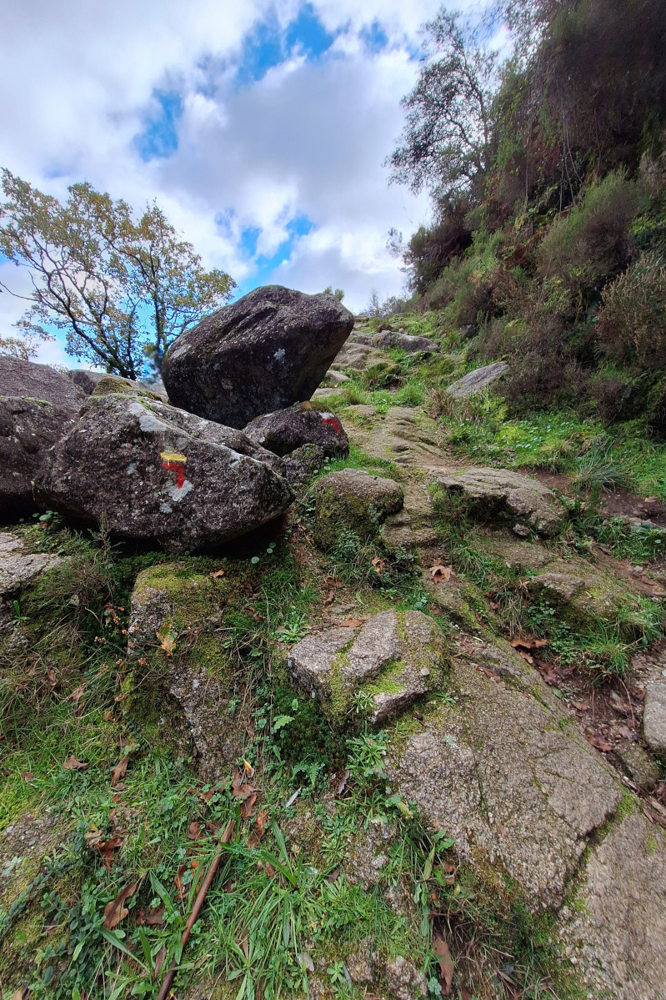

* Przy każdym punkcie widokowym (poniżej Miradouro Silhas) wisiały tabliczki **„Se vir Incendo, ligue 117"**, co można
przetłumaczyć jako **„W razie pożaru dzwoń pod 117"**.
 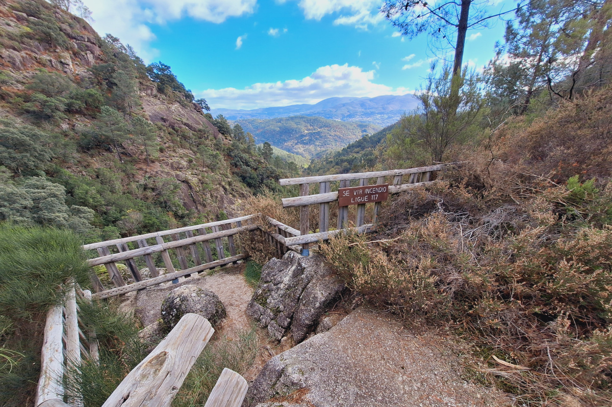

