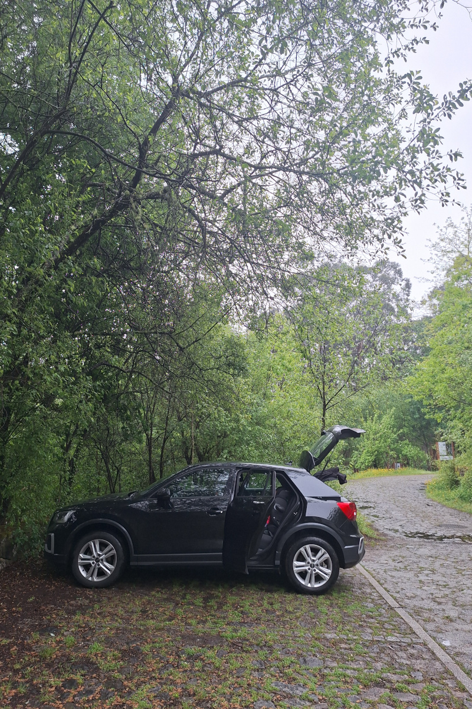
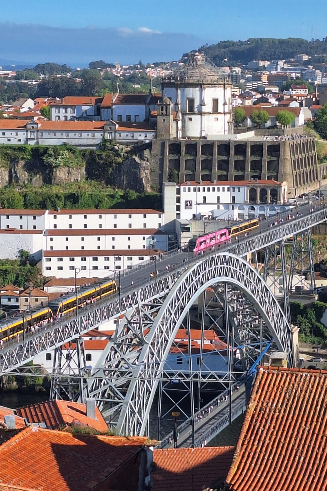
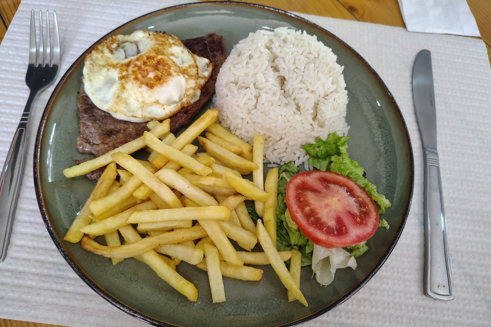
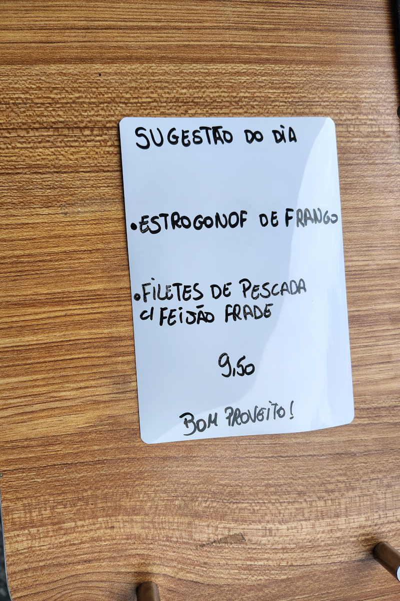
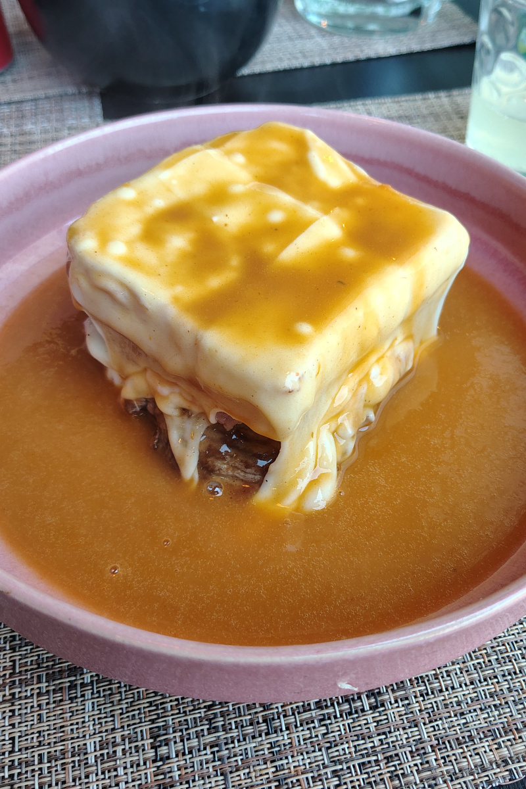
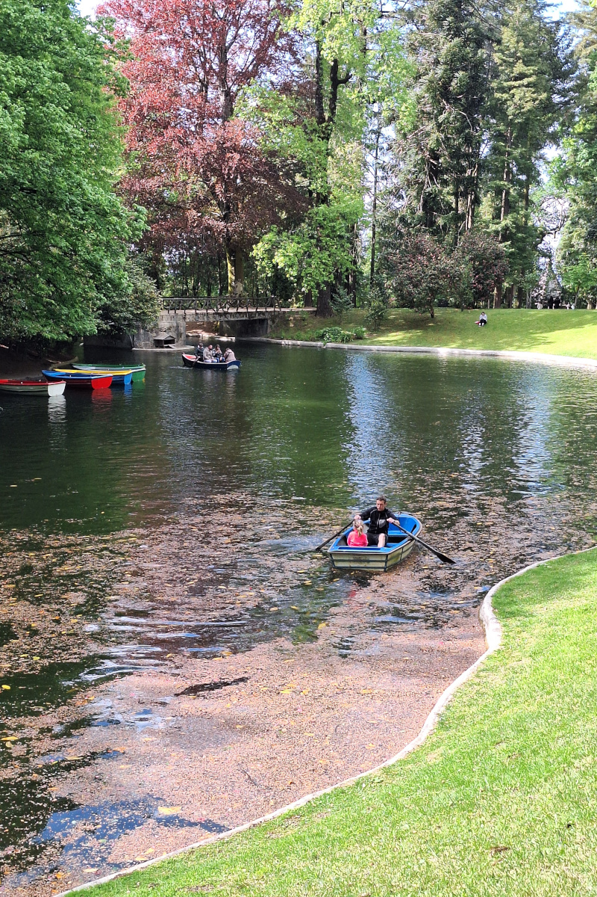
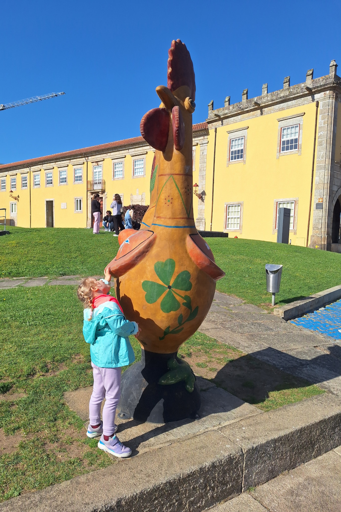

Północna Portugalia to jeden z najbardziej niedocenianych regionów Europy na wiosenne wakacje. Historyczne miasta, 
piękne plaże, górskie krajobrazy, znakomita kuchnia oraz stosunkowo niewielkie odległości między atrakcjami sprawiły, że 
kraj ten okazał się idealnym kierunkiem na naszą rodzinną podróż.
Jak co roku, dzieci w Belgii mają dwutygodniową przerwę wielkanocną, dlatego szukaliśmy miejsca cieplejszego niż Belgia, 
ale jednocześnie niezbyt odległego, z dobrym połączeniem lotniczym. 

Podczas naszej 8-dniowej objazdówki odwiedziliśmy **Porto, Bragę, Barcelos, Ponte de Lima, Viana do Castelo** oraz kilka 
mniejszych nadmorskich miejscowości. Połączyliśmy zwiedzanie miast z odkrywaniem przyrody i lokalnej kuchni. Podróżowaliśmy 
z czteroletnią córką oraz moim tatą, który przyleciał z Polski, dlatego zależało nam na spokojnym planie podróży z odpowiednią 
równowagą między zwiedzaniem, plażami, pieszymi wycieczkami i atrakcjami przyjaznymi rodzinom. Północna Portugalia okazała 
się strzałem w dziesiątkę!

W tym artykule znajdziesz nasz szczegółowy plan podróży, wskazówki dotyczące transportu, informacje o noclegach, polecane 
restauracje, zestawienie kosztów oraz praktyczne porady dotyczące zwiedzania północnej Portugalii samochodem. Jeśli planujesz 
objazdówkę po Portugalii, z dziećmi lub bez, i chcesz zobaczyć coś więcej niż samo Porto, ten przewodnik pomoże Ci zaplanować 
własną podróż.

## Nasza trasa i pierwsze wrażenia
Porto oraz okolice Bragi odwiedziłam już wcześniej, w grudniu 2024 roku spędziłam tam długi weekend u koleżanki z pracy, 
i bardzo mi 
się tam spodobało. Tym razem chciałam pokazać rodzinie więcej atrakcji północnej Portugalii, wynajmując samochód i 
organizując pobyt podobny do tego, który odbyliśmy [latem ubiegłego roku w Danii]().
Dołączył do nas również mój tata, który przyleciał z Polski. Był to nasz pierwszy wyjazd, podczas którego jedna z osób 
podróżowała z innego kraju. Takie wypady zawsze wiąże się z pewnym ryzykiem, zwłaszcza w przypadku ewentualnych opóźnień 
lub odwołanych lotów, ale na szczęście wszystko przebiegło bez problemów. My przylecieliśmy dzień wcześniej, natomiast 
loty powrotne mieliśmy wszyscy tego samego dnia, co znacznie ułatwiło organizację. 

Poniżej znajduje się mapa naszej trasy.
<iframe src="https://www.google.com/maps/d/u/0/embed?mid=1vUmgFtmt-hGxwTlX1H6uc6AoQyJPCFE&ehbc=2E312F" width="640" height="480"></iframe>

Więcej szczegółów na temat mojej wcześniejszej podróży znajdziesz w tych wpisach:
[Deszczowy dzień pełen przygód w Porto](),
[Dziedzictwo i święta: magiczna wizyta w Bradze i Guimarães]() oraz
[Przyrodnicze i kulturowe skarby Gerês-Xurés]().

## Transport – jak poruszaliśmy się po regionie?

Samochód odebraliśmy na lotnisku i tam również go zwróciliśmy. Na ostatnie dwa dni pobytu w Porto auto nie było nam 
już potrzebne, ponieważ miasto zwiedzaliśmy pieszo. Firma Sixt oferuje kilka punktów zwrotu samochodów w Porto, w tym jeden 
poza ścisłym centrum miasta. Zwrot auta w innym miejscu niż punkt odbioru wiązał się jednak z dodatkową opłatą. Z tego 
względu bardziej opłacało nam się oddać samochód na lotnisku, skąd wcześniej go również odebraliśmy.

Następnie, z lotniska udaliśmy się metrem do naszego apartamentu w centrum Porto. Bilet na metro kosztuje 2,90 € (2,30 € za przejazd w strefie Z4 oraz 0,60 € za kartę Andante).
Kartę Andante kupuje się tylko raz i można ją wielokrotnie doładowywać kolejnymi biletami. Przy automatach biletowych znajduje 
się naklejka z nazwami wszystkich stacji metra oraz odpowiadającymi im strefami dla przejazdu z lotniska. Naszym celem była 
stacja General Torres, dlatego obowiązywał nas bilet w strefie Z4. Więcej informacji można znaleźć na o[ficjalnej stronie 
metra w Porto](https://en.metrodoporto.pt/pages/391). Pamiętaj, aby przed wejściem do metra skasować bilet w jednym z 
kasowników znajdujących się obok automatów biletowych lub na peronie. W przypadku przesiadki bilet należy skasować ponownie. 
My zrobiliśmy to na stacji Trindade, gdzie przesiadaliśmy się na linię D. W tej części miasta metro w dużej mierze porusza 
się po powierzchni, dlatego bardziej przypomina szybki tramwaj niż klasyczne metro. Z lotniska pojechaliśmy linią E (fioletową) 
do stacji Trindade, jest to stacja końcowa tej linii. Następnie przesiedliśmy się na linię D w kierunku Santo Ovídio i 
wysiedliśmy na stacji General Torres. Linia D kursuje bardzo często i przejeżdża przez słynny most Luísa I, dzięki czemu 
już podczas podróży można podziwiać jedną z najbardziej charakterystycznych panoram Porto.

  
  

## Parkowanie i jazda samochodem
Przez cały wyjazd ani razu nie zapłaciliśmy za parking. W mniejszych miejscowościach oraz przy większości atrakcji turystycznych 
parkowanie było bezpłatne. W Bradze, gdzie spędziliśmy cztery noce, również można było parkować za darmo w niektórych strefach. 
Problem pojawiał się jednak późnym popołudniem, kiedy wracaliśmy z całodniowych wycieczek i znalezienie wolnego miejsca 
parkingowego nie zawsze było łatwe. Po kilku dniach wiedzieliśmy już, na których ulicach najłatwiej znaleźć darmowe miejsce.
W niektórych miejscach zauważyliśmy, że mieszkańcy zostawiali samochody poza wyznaczonymi miejscami parkingowymi. Nam również 
zdarzyło się zaparkować w podobny sposób, ale zawsze zgodnie z przepisami i nigdy w miejscach objętych zakazem parkowania.
Nasz apartament znajdował się w samym centrum miasta, dlatego musieliśmy pogodzić się z ograniczoną liczbą miejsc parkingowych. 
W najgorszym przypadku od najdalej położonego miejsca parkingowego do apartamentu mieliśmy około 250 metrów spaceru. Zawsze 
zapisywaliśmy lokalizację zaparkowanego samochodu w telefonie, dzięki temu następnego dnia nie traciliśmy czasu na szukanie 
auta wśród wąskich uliczek.

Podczas pobytu w Porto skorzystaliśmy również z aplikacji Bolt, aby dojechać z naszego apartamentu do Parque de Serralves.
Za przejazd o długości około 6 km zapłaciliśmy około 6–7 € w jedną stronę. Przy podróży w trzy osoby była to bardzo 
konkurencyjna cena w porównaniu z kosztami transportu publicznego (mój tata pojechał już wcześniej na lotnisko, dlatego 
tego dnia podróżowaliśmy we trójkę). Dodatkowo był to zdecydowanie najszybszy i najwygodniejszy 
sposób, aby tam dotrzeć.

## Ceny paliwa i płatne drogi
Cena benzyny wahała się od 1,88 € do 2,02 € za litr, a najtańsze stacje znaleźliśmy przy supermarketach Auchan.
Łącznie przejechaliśmy niecałe 500 kilometrów, dlatego tankowaliśmy tylko raz, na stacji [niedaleko lotniska](https://maps.app.goo.gl/1HjWYrcv8PPcYu159).
W Portugalii funkcjonuje rozbudowany system płatnych autostrad, jednak przez cały wyjazd świadomie ich unikaliśmy. Różnica 
w czasie przejazdu zazwyczaj wynosiła mniej niż 10 minut, a jazda przez niewielkie miejscowości okazała się znacznie 
przyjemniejsza. Ruch był niewielki, choć liczne ograniczenia prędkości sprawiały, że podróż trwała nieco dłużej.
Warto wiedzieć, że przy wynajmie samochodu w Sixt trzeba korzystać z automatycznego systemu poboru opłat drogowych (E-Toll). 
Usługa ta wiąże się jednak z dodatkową opłatą dzienną w wysokości 2,23 €, dlatego nawet krótki przejazd płatną autostradą 
może okazać się stosunkowo kosztowny. Na szczęście, jeśli w czasie wynajmu nie przejedziemy przez żadną płatną bramkę, 
opłata zostaje zwrócona (lub przeliczona ze względu na ilość dni podczas których korzystaliśmy z platnych autostrad). W 
naszym przypadku zwrot pojawił się na koncie zgodnie z obietnicą, w ciągu 30 dni od zakończenia 
wynajmu. Samochody wyposażone są w elektroniczne urządzenie do automatycznego naliczania tych opłat.

## Zakwaterowanie
Mieszkaliśmy w apartamentach Airbnb w A Ver o Mar i Braga – za każdym razem były to całe mieszkania na wyłączność. Oba 
obiekty oferowały samodzielne zameldowanie za pomocą skrzynki na szyfr (lockbox), były bardzo przestronne i miały wysokie 
oceny. [Pierwsze mieszkanie](https://www.airbnb.com/rooms/1476400048216795229?source_impression_id=p3_1777192418_P3A-TqFdcgkEuJr5) 
było bardzo wygodne i położone blisko dużej plaży. Samo miasteczko nie było wprawdzie bardzo urokliwe, ale stanowiło świetną 
bazę wypadową do zwiedzania wybrzeża i znajdowało się blisko lotniska, z którego drugiego dnia naszego pobytu musiałem 
odebrać tatę.
[Apartament w Bradze](https://www.airbnb.com/rooms/1049432939272944201?source_impression_id=p3_1777192408_P3XfhOAaPK4f9YVo)
był nowoczesny, świetnie zlokalizowany i wyposażony w windę, jednak rozkładana sofa w salonie była dość niewygodna.

W Porto znaleźliśmy ciekawą ofertę przez Booking [Cais de Gaia Historic Loft](https://www.booking.com/Share-dKIhYxt). 
Zazwyczaj porównuję oferty na Airbnb i Booking, zwłaszcza w większych miastach, gdzie konkurencja jest większa. Ten 
apartament okazał się strzałem w dziesiątkę i miał doskonałą lokalizację. Mieszkanie było znacznie mniejsze niż poprzednie, 
ale bardzo dobrze rozplanowane, więc w niczym nam to nie przeszkadzało. Gospodarz powitał nas osobiście i przekazał nam 
wiele przydatnych wskazówek.

Średni koszt noclegu: 90 € za noc  
•	Najlepiej rezerwować z co najmniej 3-miesięcznym wyprzedzeniem, aby trafić na dobre okazje   
•   Średnia ocena: 4.9+ 

## Jedzenie na mieście
Szukaliśmy lokalnych restauracji z świetnymi opiniami i dobrym stosunkiem jakości do ceny. Warto pamiętać, że restauracje 
w Portugalii zamykają się około godziny 15:00 i otwierają ponownie o 19:00. Zawsze znajdzie się kilka miejsc otwartych 
przez cały dzień, ale jest ich naprawdę niewiele i często są to lokale typu fast food. Aby uniknąć jedzenia późnym wieczorem, 
co byłoby trudne z naszą córką, jedliśmy glówny posiłek w porze lunchu. Okazało się to bardzo korzystne dla naszego portfela, 
ponieważ większość restauracji oferowała specjalny danie dnia „sugestão do dia” w niższej cenie, około 10 euro (do wyboru 
było od 2 do 6 dań). Zawsze jedliśmy w restauracjach, ponieważ jedzenie było tanie i bardzo smaczne. Nasza córka uwielbia 
próbować nowych potraw, ale uważam, że i tak łatwo jest znaleźć coś odpowiedniego dla dzieci. Zaskoczyło nas, że prawie 
zawsze frytki serwowano razem z ryżem i mięsem, podczas gdy warzywa stanowiły mniejszą część posiłku. Spróbowaliśmy również 
słynnej kanapki z Porto – francesinhy, ale nie stała się ona moim ulubionym daniem, ponieważ była zbyt ciężka. W lokalnych 
restauracjach nie mogliśmy porozumieć się po angielsku, więc ze pomocą przyszła nam sztuczna inteligencja. Jeśli nie było 
nawet menu po angielsku, robiliśmy zdjęcie dań dnia, które często były wypisane na tablicy przed restauracją, i prosiliśmy 
AI o przetłumaczenie. Następnie prosiliśmy AI o przygotowanie listy z wybranymi napojami i daniami po portugalsku, którą 
pokazywaliśmy kelnerce. Były bardzo zadowolone z tak jasnych instrukcji. Wszyscy byli zawsze bardzo mili, nawet jeśli 
pojawiały się pewne trudności w komunikacji.

  
  

## Lista restauracji, które moglibyśmy polecić.
Porto: [Spice Art Indian Restaurante & Bar](https://maps.app.goo.gl/SjQhQqhTJLWr8sya9)   
Porto: [Mirone - Cachorrinhos do Morro](https://maps.app.goo.gl/s3bZUU24cY7yKSX5A)   
Porto: [Manteigaria](https://maps.app.goo.gl/zCoh84FsDt8h5q379)   
Porto: [Casa Expresso](https://maps.app.goo.gl/63yRQpKE3E2N7Rnh8)   
Barcelos: [Cafe Raiz Barcelos 2 - the only one not closing in the afternoon](https://maps.app.goo.gl/eMqirbf4LDqyaec2A)   
Aver-o-Mar: [Tasquinha Sra. Das Neves](https://maps.app.goo.gl/ghn9cEL98cqAE7B9A)   
Viana do Castelo : [Recanto da Picanha](https://maps.app.goo.gl/e3jPQnhyxjK3MH81A)   
Ponte de Lima: [NACOS Restaurante](https://maps.app.goo.gl/3YfZDo8QcpXRYjDRA)   
Braga: [Atípica](https://maps.app.goo.gl/UpCRBGD8gC8D7bw88)   
Braga: [Bella Braga Caffé & Restaurante](https://maps.app.goo.gl/tsmwZfs4sLDtM2q1A)   

## Przegląd budżetu (na 8 dni, 3 osoby dorosłe i czteroletnie dziecko)

| Kategoria                                 | Suma (€) |
|-------------------------------------------|---------------:|
| Lot samolotem                             |            750 |
| Transport (samochód, paliwo, metro, bolt) |            555 |
| Noclegi                                   |            740 |
| Restauracje                               |            355 |
| Zakupy spożywcze                          |             86 |
| Atrakcje                                  |             44 |
| **Razem**                                 |       **2530** |

## Nasze wrażenia z podróżowania z dzieckiem
Ta podróż była łatwiejsza ze względu na krótsze odległości między atrakcjami. Pomimo, że dobrej jakości placów zabaw było 
jak na lekarstwo, nasza córka była pochłonięta naturą. Cieszyła się, gdy udawało nam się znaleźć choćby mały plac zabaw, 
ale odkrywanie plaż, lasów czy starych, średniowiecznych miasteczek było dla nich idealną alternatywą. Bardzo smakowało 
jej też portugalskie jedzenie i zawsze próbowaliśmy zamawiać różne dania, które córka potem od nas próbowała zamiast
zamawiać jej osobny posiłek. Czasami zamawialiśmy dodatkową przystawkę, ale przez 
większość czasu porcje były na tyle duże, że spokojnie mogliśmy się z nią podzielić. W restauracjach bez proszenia zawsze 
dostawała dodatkowy talerz dla dziecka, co było bardzo miłym gestem.

Wiele szlaków miało kilka wariantów, dzięki temu zawsze mogliśmy dobrać odpowiednią dla nas długość. Jedną z atrakcji 
było pływanie łódką po jeziorze w parku Bom Jesus, krótka, 15-minutowa przejażdżka, ale dała jej mnóstwo radości. Podobało 
jej się również szukanie kolorowych kogutów w Barcelos, gdzie ten symbol Portugalii był ukryty w różnych miejscach miasta. 
Krótki spacer po Serra da Labruja z wodospadami i dwoma wiszącymi mostami był jednym z miejsc, którymi była zachwycona. 
W pobliżu pierwszego mieszkania, w którym się zatrzymaliśmy, znajdował się też ładny [park](https://maps.app.goo.gl/KqtFnzwtaMAmBqcSA) ale jej absolutnym faworytem 
okazał się [Jardins do Palácio de Cristal](https://maps.app.goo.gl/3VEPVtXa1NSFgGso9) ze względu na mieszkające tam zwierzęta.

  
  

## Podsumowanie i rekomendacje
Nie żałujemy żadnego z wybranych miejsc. Równowaga między miastami, górami a wybrzeżem sprawdziła się znakomicie. Na wiosenną 
wycieczkę Północna Portugalia to doskonały wybór. Choć lokalni mieszkańcy twierdzili, że pogoda nie była wybitnie dobra, dla nas 
15–20°C było bardzo komfortowe i przyjemne podczas zwiedzania.
