Północne wybrzeże Portugalii zaskoczyło nas znacznie bardziej, niż się spodziewaliśmy.
Podczas naszej podróży samochodowej między Porto a Bragą odwiedziliśmy Vianę do Castelo, Barcelos, Parque Natural do Litoral 
Norte, słynne wiatraki w Apúlii oraz starożytną osadę na wzgórzu Castro de São Lourenço.
W tym wpisie dzielę się szczegółowym planem pierwszych dwóch dni naszego pobytu, praktycznymi wskazówkami oraz 
wrażeniami z odkrywania tej części północnego wybrzeża Portugalii podczas naszych wiosennych wakacji.

Mimo opóźnionego lotu mojego taty, udało nam się rozpocząć wycieczkę do Viany do Castelo jeszcze przed porą obiadową.
Aby mój mąż i córka nie musieli spędzać dodatkowej godziny w samochodzie, zostawiłam ich w urokliwym **Parque da Cidade da 
Póvoa de Varzim**, położonym tuż przy głównej drodze prowadzącej na lotnisko. Po 30-minutowej jezdzie samochodem, odebrałam 
tatę z lotniska, następnie wróciłam po męża i córkę, po czym wspólnie ruszyliśmy prosto do **Viany do Castelo**.

Najbardziej charakterystyczny zabytek miasta, **Sanktuarium Najświętszego Serca Jezusowego** (Santuário de Santa Luzia), 
wznosi się na wzgórzu górującym nad miastem i wybrzeżem Atlantyku.
Jak się później okazało, był to najcieplejszy dzień całego naszego wyjazdu, dlatego mój pomysł, aby wejść do sanktuarium schodami, 
nie należał chyba do najlepszych. Choć była dopiero godzina 11:00, upał dawał się już mocno we znaki.
Zaparkowaliśmy samochód w górnej części miasta i przeszliśmy labiryntem wąskich uliczek, zanim dotarliśmy do głównych 
schodów prowadzących do kościoła. Niestety, niemal cała trasa prowadziła w pełnym słońcu, bez odrobiny cienia.

  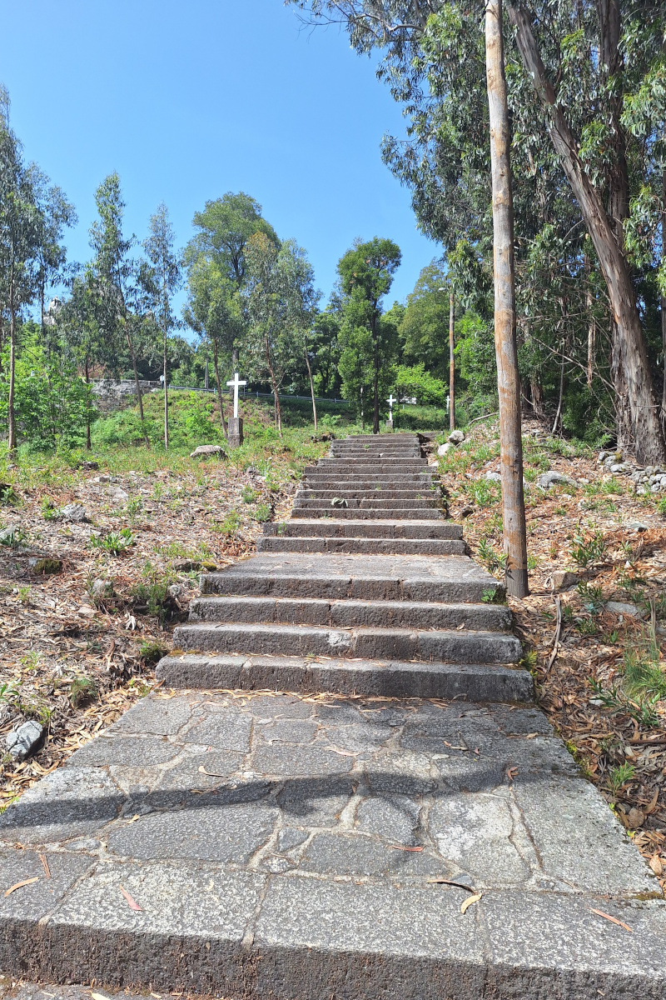
  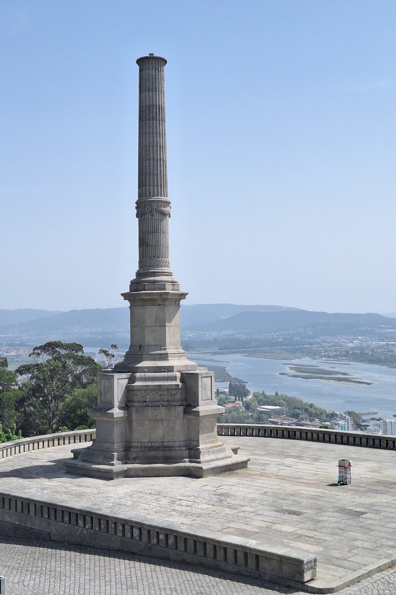

Po drodze minęliśmy górną stację zabytkowej kolejki linowej Santa Luzia, najdłuższej kolejki tego typu w Portugalii, 
jednak w okolicy nie było żywej duszy, a wagonik się nie poruszał, więc przez chwilę zastanawialiśmy się, czy tego dnia w 
ogóle kursuje. Teraz już wiedzieliśmy, że już za chwilę naszym oczom ukażą się spektakularne widoki i rzeczywiście tak się 
stało. W koncu naszym oczom ukazał się majestatyczny kościół, rozległy plac przed sanktuarium oraz zapierające dech w piersiach 
panoramy oceanu, rzeki Limy i miasta rozciągającego się poniżej.

Za kościołem znajduje się niewielki teren piknikowy z drewnianymi stołami ukrytymi w cieniu drzew. Wiele osób odpoczywało 
tam, chroniąc się przed silnym południowym słońcem. Kościół stoi na wzgórzu **Monte de Santa Luzia**, na którym znajdują się 
również pozostałości starożytnej celtyckiej osady (Citânia de Santa Luzia, nie zwiedzaliśmy). Idąc w kierunku miejsca piknikowego, zauważyłam 
boczne wejście prowadzące na wieżę widokową. Obok stał nawet automat do zakupu biletów, jednak po odpoczynku w cieniu drzew 
zupełnie zapomnieliśmy, aby tam wrócić i wejść na górę. Wnętrze kościoła okazało się mniejsze, niż się spodziewaliśmy, 
jednak prawdziwą atrakcją tego miejsca jest bez wątpienia panoramiczny taras znajdujący się przed sanktuarium.

  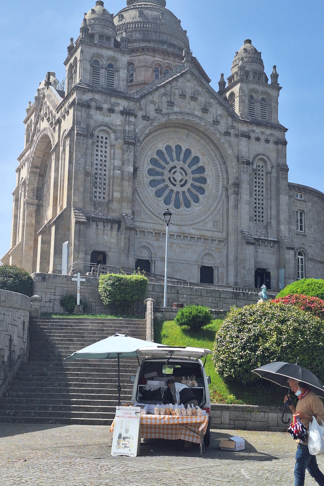
  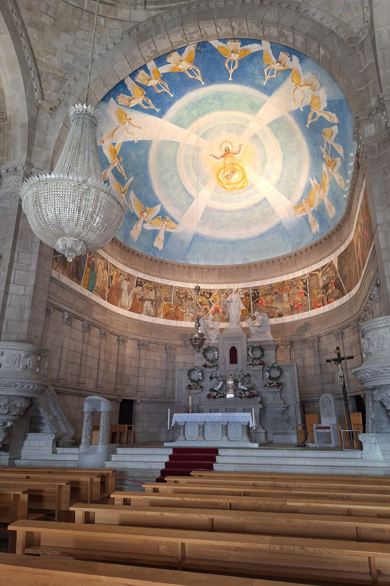

Była już zdecydowanie pora obiadowa, więc zeszliśmy do centrum miasta, tym razem docierając do podnóża schodów w bardziej 
centralnej części miasta, niz ta gdzie zostawiliśmy auto.
Po smacznym obiedzie byliśmy wreszcie gotowi, aby na dobre rozpocząć zwiedzanie Viany do Castelo. Naszym pierwszym przystankiem 
była nadbrzeżna promenada. Na **Praça da Liberdade** nasza córka z radością biegała przez dużą fontannę, podczas gdy my podziwialiśmy 
stojący nieopodal pomnik upamiętniający Rewolucję Goździków z 1974 roku, która zakończyła wieloletnią dyktaturę w Portugalii 
i przywróciła krajowi demokrację oraz wolność. Pomnik symbolizuje wyzwolenie poprzez zerwane łańcuchy.

Stamtąd ruszyliśmy w stronę fortu, mijając po drodze **statek-muzeum Gil Eannes**. Jednostka Gil Eannes służyła niegdyś 
jako statek zaopatrzeniowy, pływający szpital oraz lodołamacz, natomiast dziś pełni funkcję statku-muzeum, choć tym razem 
zrezygnowaliśmy ze zwiedzania jego wnętrza. Gdy skręciliśmy w Rua dos Mareantes, atmosfera całkowicie się zmieniła.
Restauracje serwujące owoce morza, niewielkie lokalne sklepiki, sieci rybackie oraz stosy pustych plastikowych skrzynek 
nadawały tej okolicy prawdziwie morski charakter.

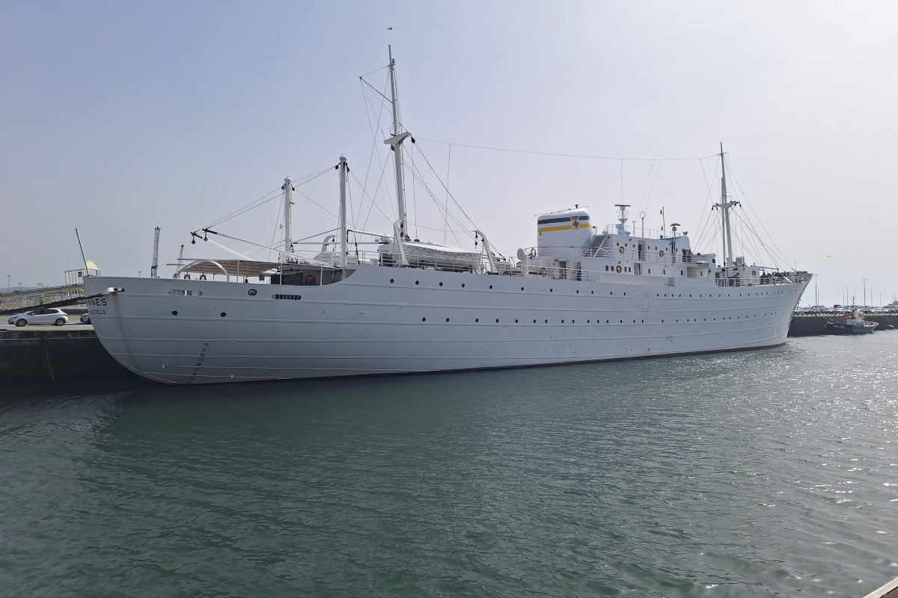

**Forte de Santiago da Barra** okazał się jednak lekkim rozczarowaniem. Choć widok na wzgórze Monte de Santa Luzia i górujące 
nad nim sanktuarium był piękny, panoramy portu i miasta nie zrobiły na nas większego wrażenia. Patrząc z perspektywy czasu, 
nie sądzę, aby spacer aż tam był naprawdę wart zachodu, zwłaszcza że znacznie bardziej podobało nam się późniejsze spacerowanie 
 po urokliwym Starym Mieście. Historyczne centrum Viany do Castelo zachwyciło nas swoim klimatem, szczególnie wąskie 
uliczki otaczające **Sé Catedral de Viana do Castelo**. Na **Praça da República** wciąż można było zobaczyć wielkanocne dekoracje, 
które dodawały miastu jeszcze więcej uroku i które bardzo podobały sie naszej córce.

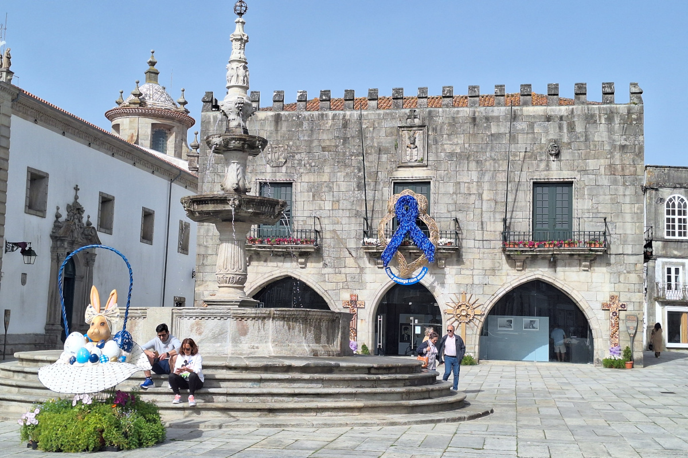

W drodze powrotnej do samochodu minęliśmy Mercado Municipal de Viana do Castelo, czyli miejski targ spożywczy.
W mieście znajduje się również Museu do Traje de Viana do Castelo, poświęcone tradycyjnym portugalskim strojom, które cieszy 
się bardzo dobrymi opiniami. Uznaliśmy jednak, że nie będzie to interesujące miejscem do odwiedzenia z czteroletnim dzieckiem.

Zamiast tego postanowiliśmy opuścić miasto i późne popołudnie spędzić na odkrywaniu **Parque Natural do Litoral Norte**.
Zaparkowaliśmy przy wejściu na plażę Ofir, tuż obok ogromnych wieżowców mieszkalnych Torres de Ofir. Te potężne budynki 
widać z bardzo dużej odległości, gdyż następnego dnia dostrzegliśmy je nawet z punktu widokowego Miradouro de São Lourenço. 
Szczerze mówiąc, niezbyt harmonijnie wpisują się w otaczający krajobraz. Tego dnia bardzo mocno wiało, byc może dzięki temu 
okolica była niemal pusta. Dotarliśmy tam jednak dość późno, około godziny 17:00, gdy ostatni surferzy 
wychodzili już z wody, co mogło się również przyczynić do bardzo małej ilości turystów. Przy wejściu na plażę odbywał się 
zlot zabytkowych pojazdów, więc przez chwilę podziwialiśmy klasyczne samochody, zanim ruszyliśmy w stronę rezerwatu przyrody.

  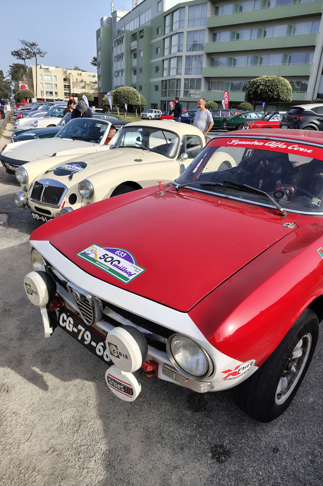
  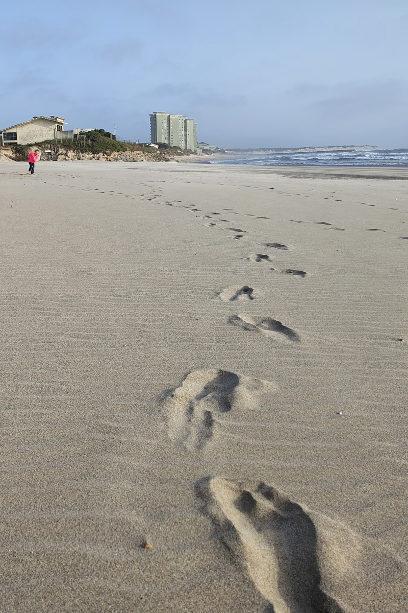

Z parkingu do początku drewnianych kładek było około 1,3 km. Trasa prowadziła przez okolicę pełną domków letniskowych i 
wakacyjnych apartamentów ukrytych wśród pięknych lasów sosnowych. Teoretycznie można było przejechać wąskimi jednokierunkowymi 
uliczkami bliżej początku szlaku, jednak w pobliżu nie było absolutnie żadnego miejsca do parkowania. Przy drogach ustawiono 
drewniane słupki i duże głazy, aby uniemożliwić nielegalne parkowanie na poboczu drogi. Drewniane kładki prowadzące przez wydmy i porośnięte 
trawami tereny były świetnie przygotowane i oferowały piękne widoki na rzekę oraz miasto **Esposende** po drugiej stronie. Podczas 
spaceru spotkaliśmy zaledwie kilka osób. Naszym ostatnim przystankiem był Miradouro da Restinga do Cávado, gdzie drewniane 
pomosty pozwalają podziwiać mokradła i delikatną roślinność bez ingerowania w ten cenny ekosystem.

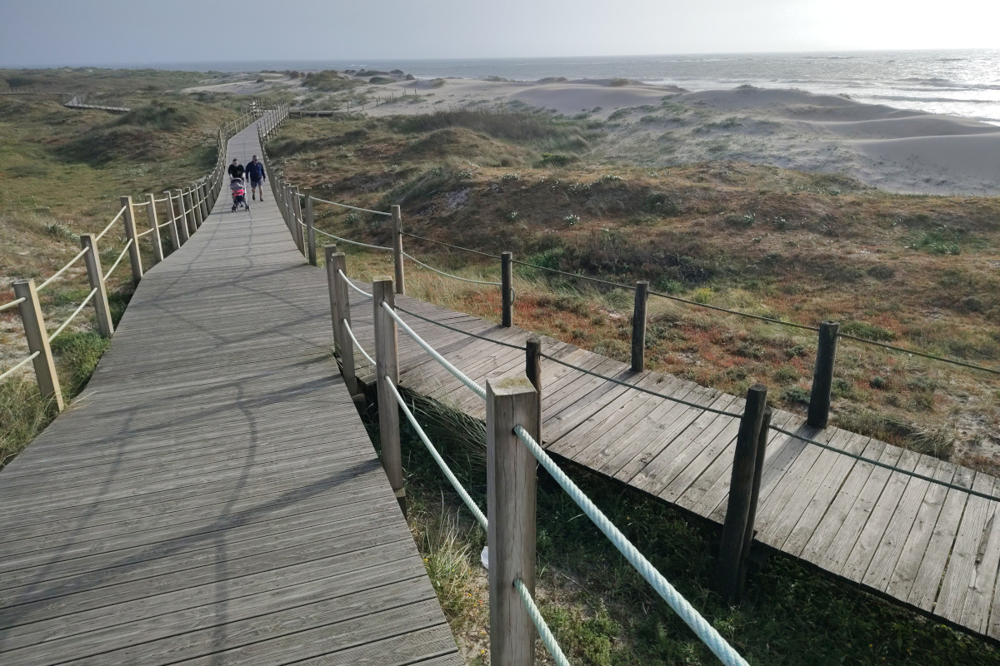

Naturalne wydmy wyglądały wręcz bajecznie, uformowane przez silny wiatr w piękne, falujące wzory. Niestety, jedna z kładek 
prowadzących na plażę była częściowo zapadnięta i wyglądała bardzo niebezpiecznie. Na szczęście w porę zdążyliśmy zatrzymać 
naszą córkę, zanim wbiegła na uszkodzone schody.

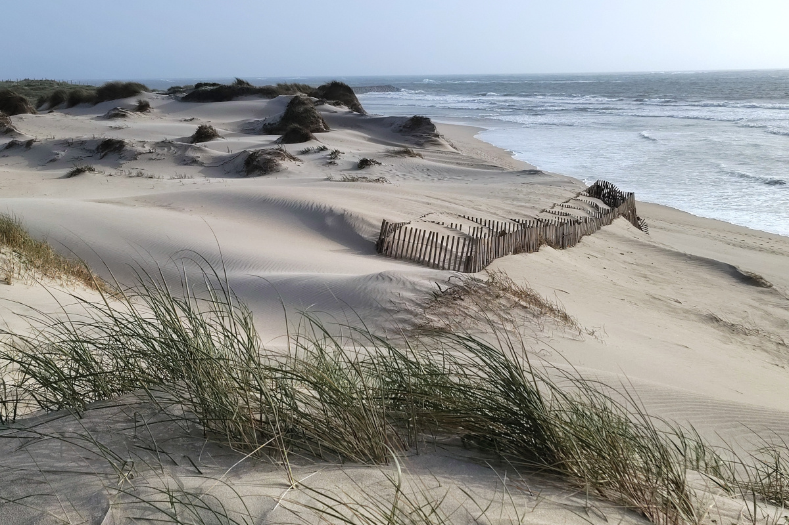

Spędziliśmy trochę czasu na ogromnej, niemal pustej plaży, biegając, bawiąc się i podziwiając okolicę, jednak wiatr był 
po prostu zbyt silny, aby zostać tam na dłużej. Piasek nieustannie wpadał nam do oczu i we włosy, aż w końcu zmusił nas 
do opuszczenia plaży. Mimo wiatru było to wspaniałe miejsce na spacer. Jedną z największych zalet wizyty w kwietniu, 
zwłaszcza późnym popołudniem, było to, że niemal cały teren mieliśmy wyłącznie dla siebie. To był intensywny, ale piękny 
dzień i gdy wróciliśmy do apartamentu, byliśmy bardziej niż gotowi na zasłużony odpoczynek.

  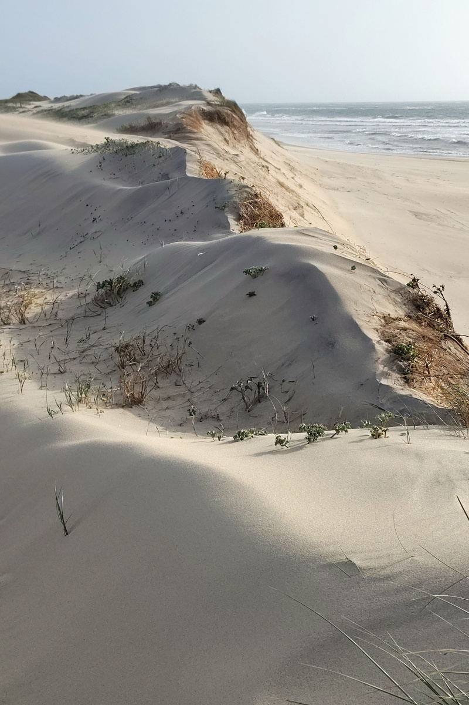
  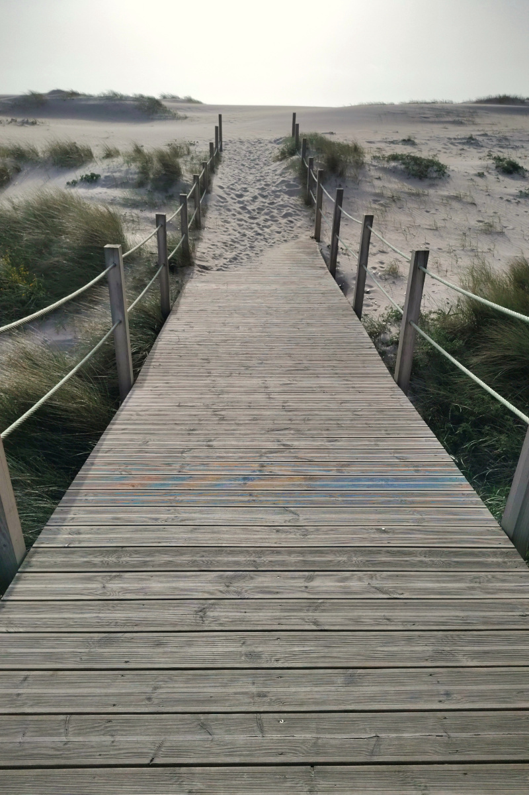

Kolejny dzień rozpoczęliśmy porannym spacerem po **Póvoa de Varzim**, mieście, w którym spędziliśmy pierwsze dwie noce 
naszego pobytu. Musieliśmy przejść prawie 2 km do portu, ponieważ nie udało nam się znaleźć żadnego bezpłatnego miejsca 
parkingowego bliżej nabrzeża. Sobotni poranek okazał się w centrum miasta wyjątkowo ruchliwy, częściowo z powodu meczu 
piłkarskiego rozgrywanego na stadionie, przynajmniej tak przypuszczaliśmy, sądząc po hałasie dochodzącym z jego okolic.
Poza kasynem oraz niewielkim portem z pięknym murem ozdobionym płytkami azulejos, miasto nie wydało nam się szczególnie 
interesujące. Znajdowała się tam również niewielka twierdza, jednak nie zdecydowaliśmy się wejść do środka, ponieważ 
sprawiała wrażenie małej i niezbyt ciekawej. Mimo to spacer wzdłuż nabrzeża był bardzo przyjemny, a po drodze mijaliśmy 
kilka placów zabaw. Radziłabym jednak pominąć to miasteczko na rzecz Barcelos, tam było dużo przyjemnych miejsc, gdzie 
można było spacerować, na przykład wzdłuż rzeki.

Poprzedniego wieczoru wybraliśmy się zobaczyć stary wiatrak zwany **Antigo Moinho de Vento** i obejrzeć zachód 
słońca. Ta okolica okazała się piękna, z pustą plażą, niewielkimi wydmami i wspaniałymi widokami o zachodzie słońca.
Przez wydmy prowadziły ładne drewniane kładki, ale byliśmy dość zaskoczeni ilością śmieci zalegających w okolicy kładek.

  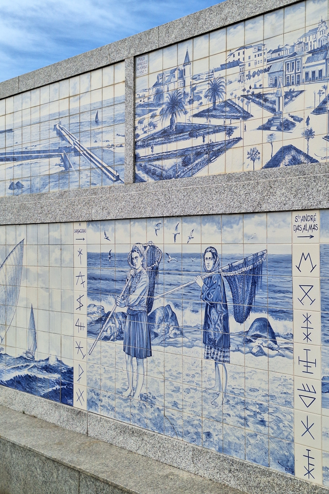
  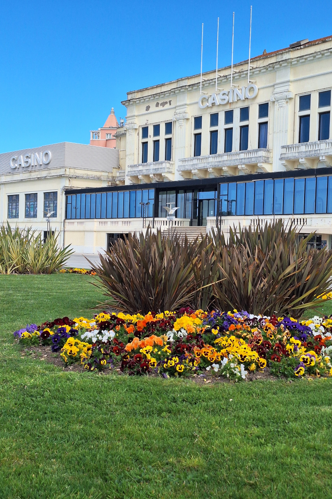

W drodze do Bragi, gdzie mieliśmy spędzić kolejne cztery noce, zaplanowaliśmy jeszcze kilka przystanków. Naszym pierwszym 
celem były słynne **wiatraki w Apúlii**. Te charakterystyczne wiatraki stoją bezpośrednio na nadmorskich wydmach, tworząc 
niezwykle malowniczy krajobraz. Tuż obok znajdował się niewielki parking, więc znalezienie miejsca postojowego nie stanowiło 
żadnego problemu. Tradycyjne portugalskie wiatraki budowano pierwotnie do mielenia zbóż, przede wszystkim kukurydzy, na 
mąkę dla lokalnych mieszkańców. Ich charakterystyczną cechą była cylindryczna kamienna podstawa oraz obracający się dach, 
dzięki któremu skrzydła można było ustawiać w rożnych kierunkach. Położenie tuż przy wybrzeżu pozwalało w pełni 
wykorzystywać silne atlantyckie wiatry. Brzmiało to sensownie, ponieważ wiatr, który zastaliśmy tego dnia, był niezwykle 
silny i praktycznie uniemożliwiał normalny pobyt na plaży. Szybko podbiegliśmy do skał, aby podziwiać ocean, jednak unoszony 
przez wiatr piasek uderzał nas tak mocno, że niemal natychmiast się wycofaliśmy. Nawet robienie zdjęć było trudne, ponieważ 
piasek dostawał się dosłownie wszędzie.

  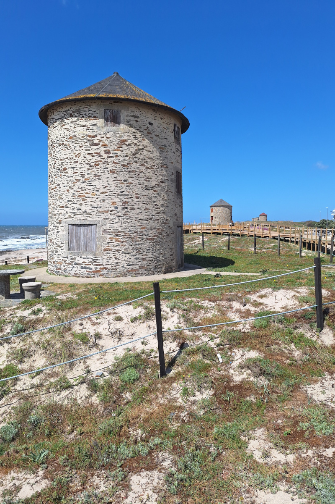
  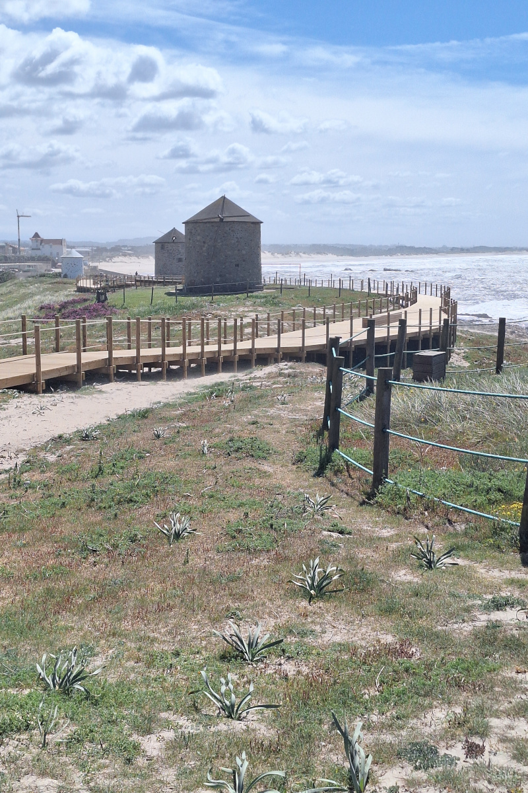

Z biegiem lat wiele z tych wiatraków popadło w ruinę, jednak część z nich została odrestaurowana i dziś można je podziwiać, 
choć wyłącznie z zewnątrz. Po około trzydziestu minutach ruszyliśmy w stronę kolejnego naszego celu, **Castro de São Lourenço**,
ważnego stanowiska archeologicznego położonego niedaleko Esposende. Jechaliśmy tam bardzo malowniczą nadmorską drogą 
prowadzącą przez piękne lasy sosnowe pełne domów letniskowych. Zdecydowanie był to lepszy wybór niż podróż ekspresową.
Castro de São Lourenço zachowało pozostałości osady z epoki żelaza, niegdyś zamieszkanej 
przez społeczności celtyckie. Część zabudowań została zrekonstruowana, dzięki czemu łatwiej wyobrazić sobie pierwotny wygląd osady.
Ponieważ domy budowano na tarasach wykutych w zboczu wzgórza, mieszkańcy mogli maksymalnie wykorzystać dostępną przestrzeń.

  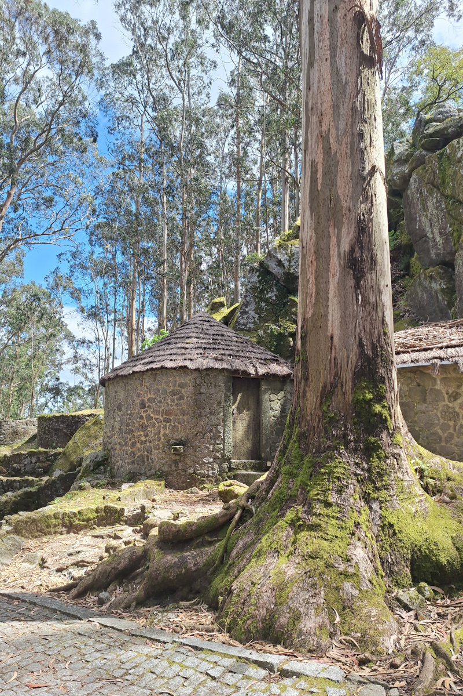
  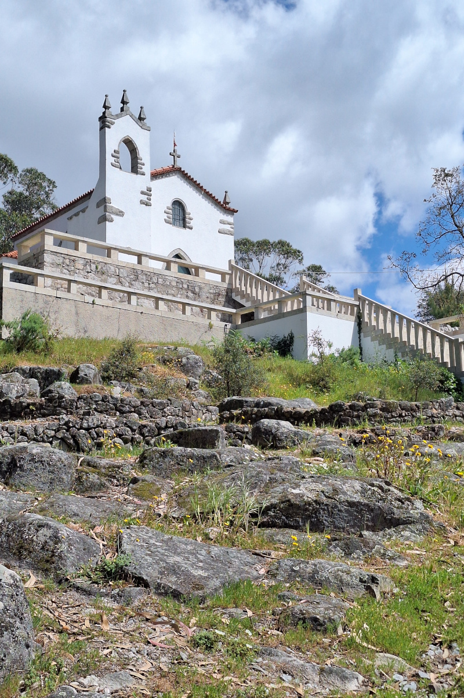

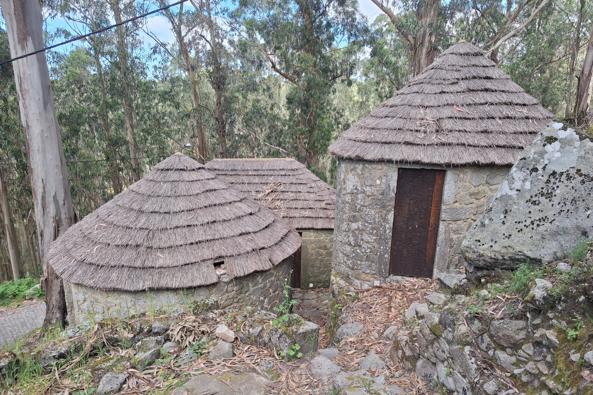

Punkt widokowy **Miradouro de São Lourenço**, znajdujący się przy niewielkiej kaplicy São Lourenço, oferował rozległe panoramy 
wybrzeża Atlantyku i okolicznych terenów. Stamtąd mogliśmy nawet dostrzec wysokie wieżowce Torres de Ofir oraz rezerwat przyrody, 
który odwiedziliśmy poprzedniego dnia.

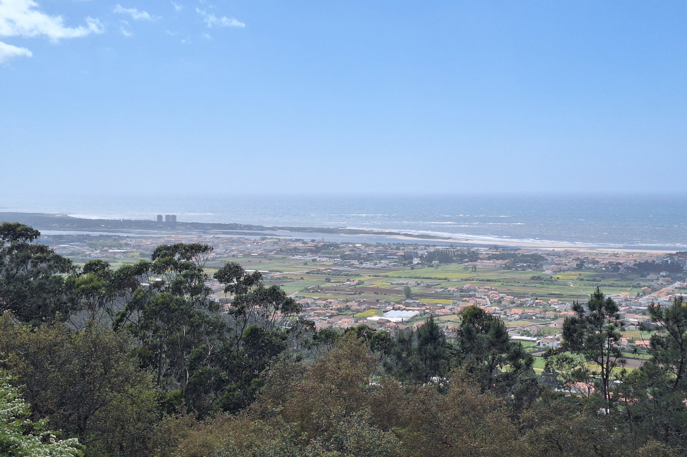

Przez otaczający las prowadziło kilka krótkich szlaków pieszych, jednak nasza córka od razu odrzuciła pomysł dalszego spaceru.
Zamiast tego odwiedziliśmy niewielkie muzeum znajdujące się tuż obok stanowiska archeologicznego, gdzie skromna wystawa 
prezentuje najważniejsze odkrycia dokonane podczas wykopalisk. Samo stanowisko nie jest zbyt duże, ale zdecydowanie warto 
zatrzymać się tu na krótki postój podczas zwiedzania tej części wybrzeża. Rosnący wokół las eukaliptusowy dodatkowo 
podkreśla wyjątkowy klimat tego miejsca.

W tym momencie wszyscy byli już naprawdę głodni.
Kiedy dotarliśmy do naszego ostatniego przystanku tego dnia, **Barcelos**, okazało się, że jest już po godzinie 15:00, a więc wiele 
restauracji, które wcześniej zapisaliśmy jako nasze opcje, było już zamkniętych. Po długich poszukiwaniach najpierw poszliśmy 
do restauracji,
która, mimo że Google Maps wskazywało ją jako otwartą, okazała się zamknięta. W kolejnym lokalu poinformowano nas, że 
wszystkie dania główne zostały już wyprzedane i dostępne są jedynie dodatki. Będąc już kompletnie wygłodniali, zmęczeni 
i lekko sfrustrowani, postanowiliśmy spróbować szczęścia jeszcze w jednej restauracji, położonej nieco dalej.
Na szczęście ta brazylijska restauracja okazała się strzałem w dziesiątkę. Kelnerki były niezwykle sympatyczne, jedzenie 
pyszne, a szybka obsługa była dokładnie tym, czego w tamtym momencie potrzebowaliśmy. Po obiedzie od razu ruszyliśmy do 
centrum miasta.

Gdy dotarliśmy do **Jardim Velho de Barcelos**, miasto nagle wydało się znacznie bardziej zielone, kolorowe i o wiele bardziej 
urokliwe, niż się spodziewaliśmy. Naszą uwagę szczególnie przyciągnęły kolorowe, bogato zdobione bramy ustawione wzdłuż skraju 
placu. Jak wyjaśnili mi później nasi znajomi, każda z tych tak zwanych bram festiwalowych została przygotowana przez inną 
parafię z okazji lokalnych świąt i uroczystości. W północnej Portugalii, zwłaszcza w okolicach Barcelos, Bragi i regionu 
Minho, parafie od pokoleń tworzą ozdobne łuki, bramy i kwiatowe konstrukcje na potrzeby religijnych festiwali. Takie dekoracje 
są powodem do dumy i przyjaznej rywalizacji między parafiami, a lokalne społeczności często spędzają całe tygodnie, przygotowując 
je z kwiatów, wstążek, światełek i ręcznie wykonanych ozdób.

  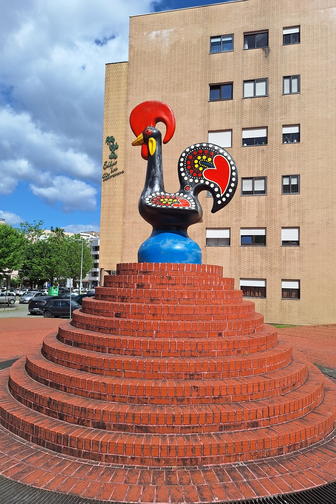
  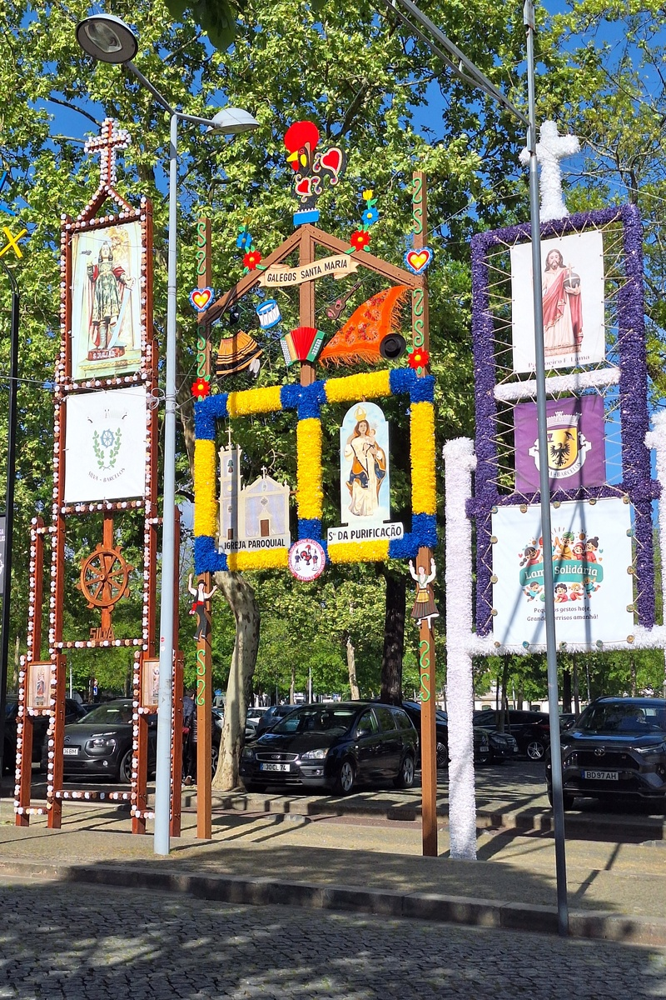

Barcelos okazało się wyjątkowo atrakcyjne dla naszej córki, ponieważ przez cały spacer wypatrywała figurek koguta rozmieszczonych 
w różnych częściach miasta. Kogut z Barcelos jest jednym z narodowych symboli Portugalii i właśnie z tego miasta wywodzi 
się jego legenda. Według opowieści niesłusznie oskarżony pielgrzym, sądzony w Barcelos, oświadczył, że pieczony kogut 
zapieje, aby udowodnić jego niewinność. Cudownie kogut rzeczywiście zapiał, ratując pielgrzyma przed śmiercią, a od tamtej 
pory stał się portugalskim symbolem sprawiedliwości, wiary, uczciwości i szczęścia. W uliczkach miasta ukryto także wiele 
innych rzeźb, dzięki czemu spacer zamienił się dla naszej córki w świetną zabawę.

  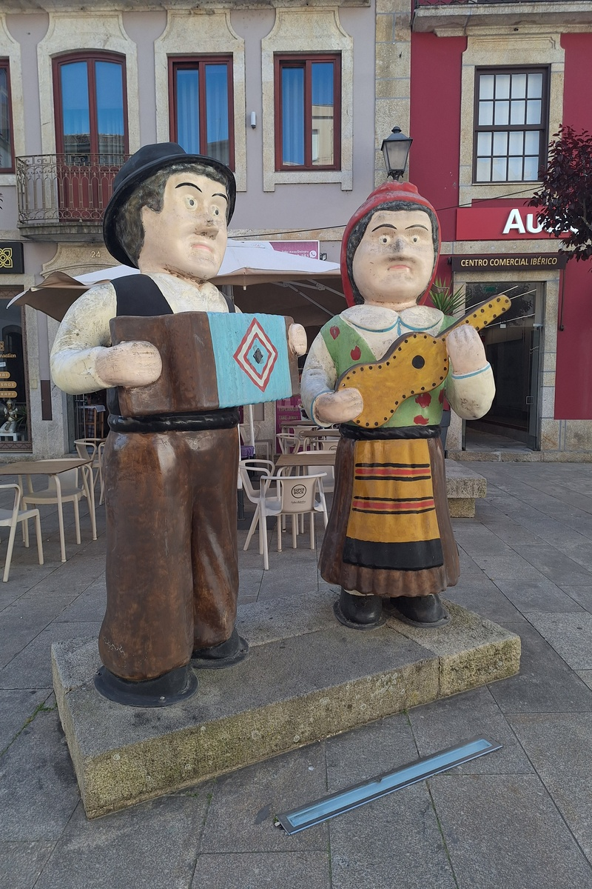
  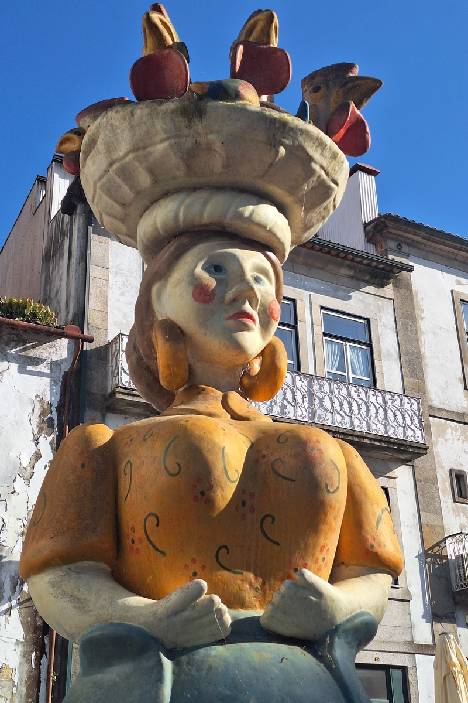

Główną ulicą skierowaliśmy się w stronę **Igreja do Senhor Bom Jesus da Cruz**, którego charakterystyczną sylwetkę było 
widać już z daleka. Nietypowy, okrągły kształt kościoła od razu przykuł naszą uwagę. Wnętrze było pięknie udekorowane 
błyszczącymi zdobieniami i licznymi rzeźbami, dzięki czemu sprawiało wyjątkowo bogate i imponujące wrażenie. Obok kościoła 
znajduje się ogromny plac, który obecnie służy jako parking, choć na mapach oznaczony jest jako teren targowy. Jak się 
dowiedzieliśmy, w każdy czwartek zamienia się on w ogromny targ, na którym można kupić żywność, ubrania, ceramikę oraz 
wiele lokalnych produktów.

  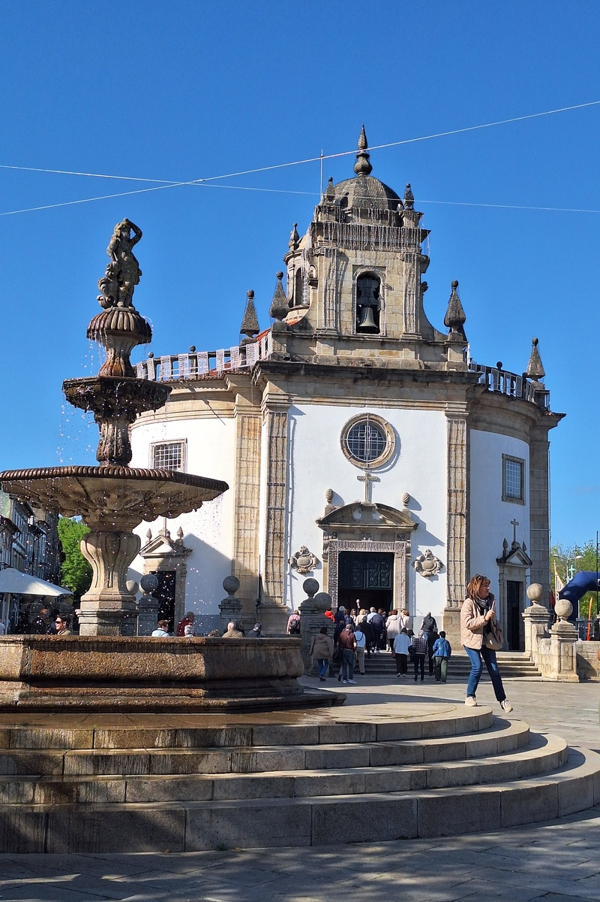
  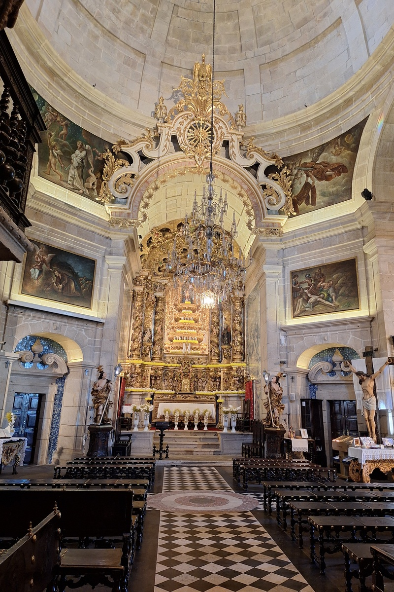

Obok kościoła znajduje się uroczy Jardim das Barrocas, gdzie zrobiliśmy krótką przerwę, siedząc na ławce i odpoczywając 
w promieniach słońca. Tam również znaleźliśmy kolejną rzeźbę koguta z Barcelos. Motyw koguta towarzyszył nam niemal 
wszędzie, pojawiał się na ceramicznych figurkach, płytkach azulejos, kuchennych dekoracjach, magnesach oraz niezliczonych 
pamiątkach.

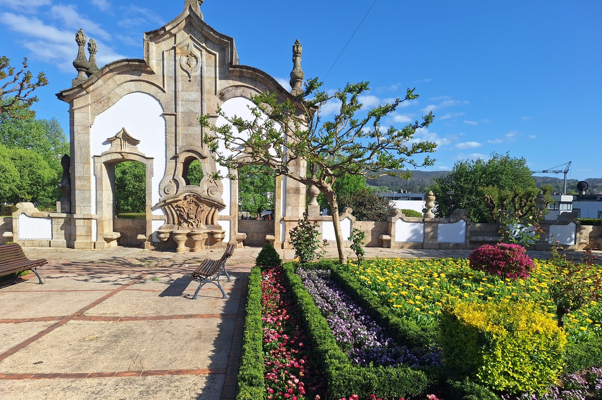

Następnie przeszliśmy główną ulicą handlową, Rua António Barroso, w kierunku Igreja Matriz de Santa Maria Maior de Barcelos.
Wystawy sklepowe wypełniały kolorowe ceramiczne koguty, ręcznie malowane płytki, kuchenne akcesoria oraz tradycyjne tkaniny 
ozdobione słynnym motywem. Bardzo szybko zrozumieliśmy, dlaczego kogut z Barcelos uważany jest za jeden z najbardziej 
rozpoznawalnych symboli Portugalii.

  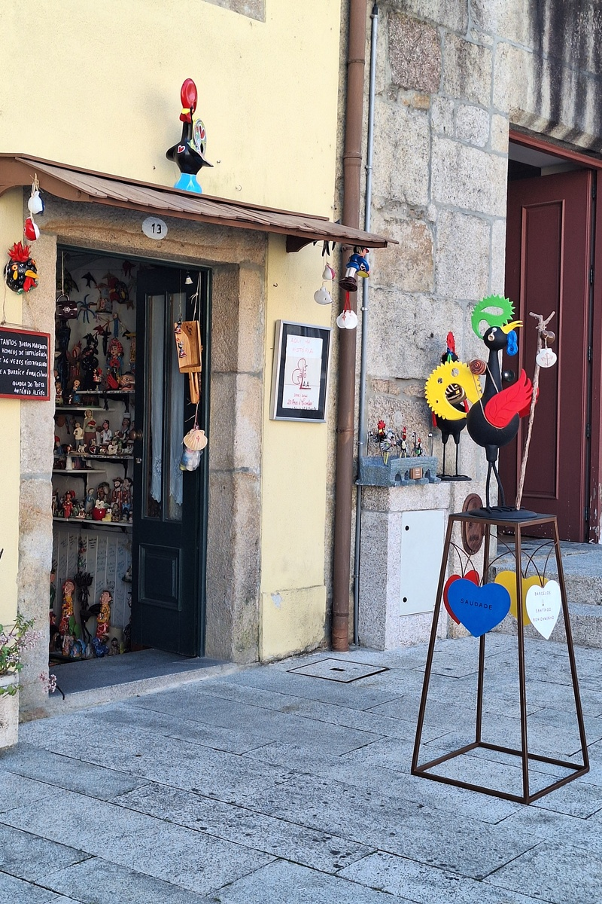
  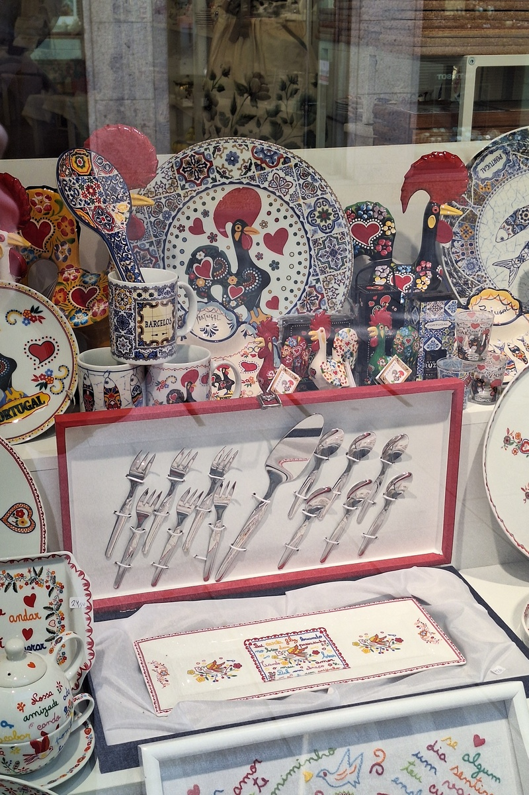

Samo wnętrze kościoła było przepiękne, zwłaszcza dzięki niebieskim płytkom azulejos zdobiącym ściany. W portugalskich 
kościołach azulejos pełniły nie tylko funkcję dekoracyjną, ale także przedstawiały sceny religijne i tworzyły spokojną, 
sprzyjającą refleksji atmosferę. Niebieska kolorystyka była inspirowana chińską porcelaną i symbolizowała elegancję oraz 
prestiż. Nasza córka chciała posiedzieć tam przez chwilę w ciszy, wsłuchując się w muzykę rozbrzmiewającą we wnętrzu.

Cała okolica otaczająca kościół jest niezwykle przyjemna. Wzdłuż rzeki ciągnie się promenada, po której można spacerować 
lub po prostu usiąść na jednej z ławek i odpocząć. W pobliżu znajdują się również niewielkie ruiny archeologiczne, które 
okazały się ciekawym miejscem do krótkiej eksploracji. Przepływająca przez Barcelos rzeka Cávado to ta sama rzeka, którą 
oglądaliśmy dzień wcześniej w Parque Natural do Litoral Norte, gdzie uchodzi do Oceanu Atlantyckiego.

  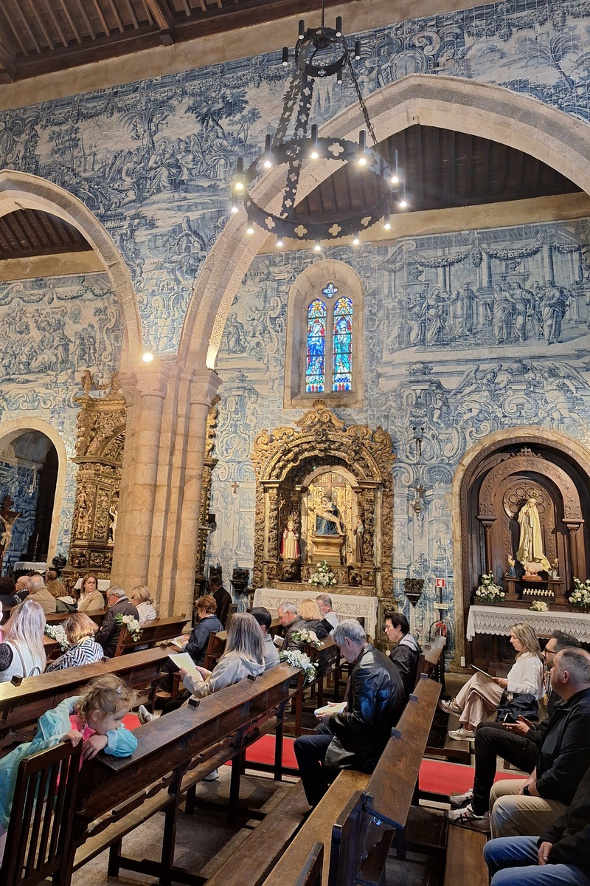
  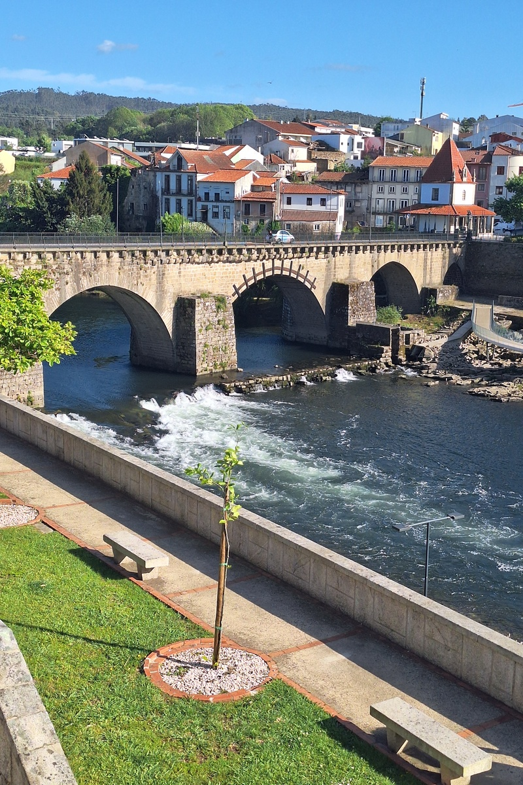

**Museu Arqueológico de Barcelos** to niewielkie muzeum archeologiczne na świeżym powietrzu, położone pomiędzy głównym 
kościołem a rzeką.
Oprócz pozostałości archeologicznych oferuje także fantastyczne widoki zarówno na rzekę, jak i na panoramę miasta.
Położone w pobliżu średniowiecznego mostu Ponte Medieval de Barcelos zapewnia również doskonały punkt widokowy na sam most.

  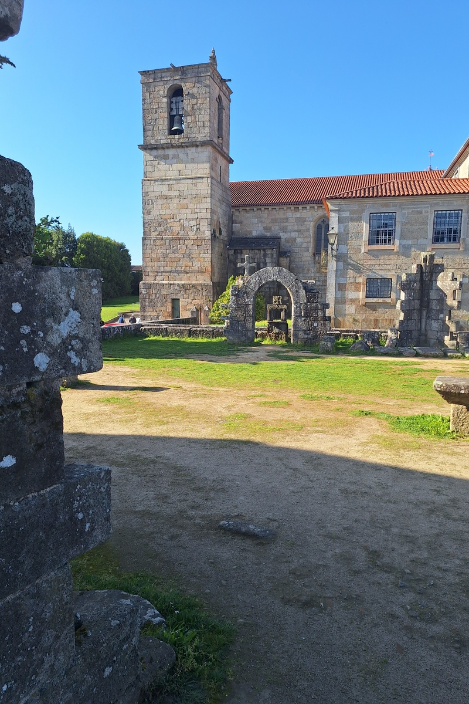
  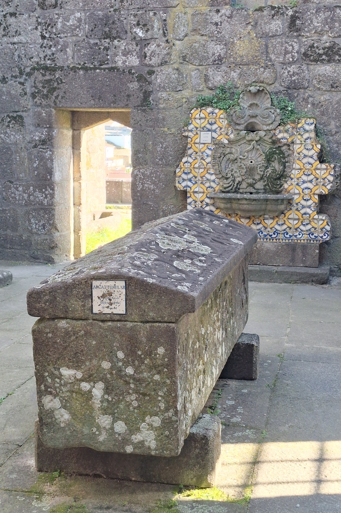

W drodze powrotnej do samochodu odkryliśmy jeszcze więcej rzeźb kogutów ukrytych w różnych zakątkach miasta. Nigdy nie 
było wiadomo, gdzie pojawi się kolejna. Barcelos okazało się dla nas wspaniałym zaskoczeniem, kolorowym, tętniącym życiem 
i niezwykle przyjemnym miastem, idealnym na spacer oraz relaksujący przystanek w drodze do Bragi.

__Informacje praktyczne:__

* Povoa de Varzim: bezpłatny [parking](https://maps.app.goo.gl/zE33kPoTeKkxEbbR9)
* Sanktuarium Najświętszego Serca Jezusowego (Santuário de Santa Luzia)   
Wstęp do kościoła jest bezpłatny. Wejście na taras widokowy na szczycie wieży kosztuje 2 €. Bilety można kupić w automacie 
znajdującym się na miejscu. Na szczycie wzgórza dostępny jest duży, bezpłatny parking. [Parking w mieście](https://share.google/DfdJuT9CMddlz0BCi). 
Wejście na górę zajęło nam około 40 minut, przy przewyższeniu wynoszącym około 160 metrów.
* Parque Natural do Litoral Norte: bezpłatny [parking](https://maps.app.goo.gl/mCgbHtMYRYJhvr5p8)
* Wiatraki w Apúlii   
Wstęp oraz parking bezpłatny. Przy parkingu znajduje się budynek z ogólnodostępnymi toaletami (100m od parkingu 
idac w kierunku miasta).
* Castro de São Lourenço    
Wstęp, museum oraz parking bezpłatny
* Barcelos   
Wszystkie odwiedzone przez nas atrakcje w mieście były bezpłatne.

