Kolejne dwa dni spędziliśmy na zwiedzaniu Bragi oraz bardziej turystycznego Guimarães, znanego jako „kolebka Portugalii”. 
Oba miasta odwiedziłam już w grudniu 2024 roku i możecie o nich przeczytać w moim wcześniejszym wpisie „Magiczna wizyta w 
Bradze i Guimarães”. [A Magical Visit to Braga and Guimarães](). 
Tym razem jednak niezwykle miło było zobaczyć te same miejsca w zupełnie innej scenerii. Wszędzie kwitły piękne wiosenne 
kwiaty, które dodawały miastom intensywnych kolorów i sprawiały, że tętniły życiem. W grudniu panowała tam magiczna świąteczna 
atmosfera, a drzewa pomarańczowe uginały się od owoców, dlatego obie pory roku mają swój niepowtarzalny urok.

Ponieważ zatrzymaliśmy się w samym centrum Bragi, mogliśmy bez problemu spacerować po mieście również wieczorami, wychodząc 
na kolację i podziwiając piękne place pełne kolorowych kwiatów. Oprócz zwiedzania samego miasta odwiedziliśmy także Bom 
Jesus do Monte oraz Sanktuarium Matki Bożej z Sameiro, a wszystko udało nam się zobaczyć w ciągu jednego dnia.

  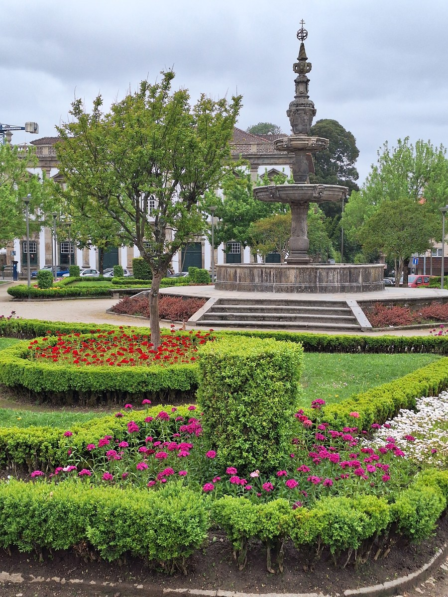
  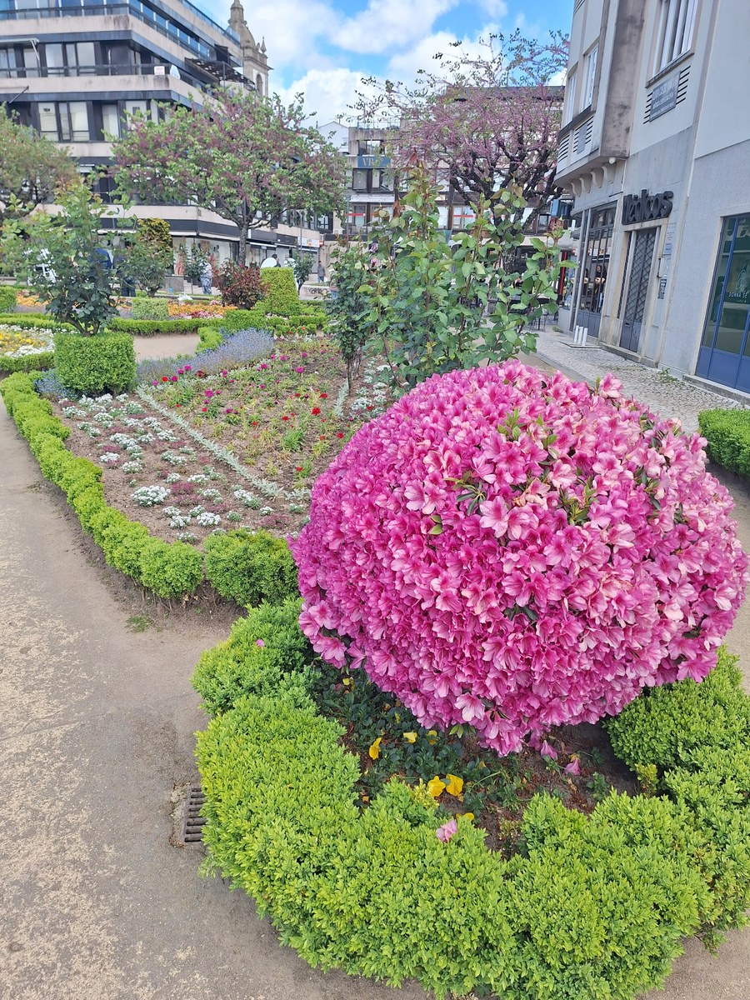

  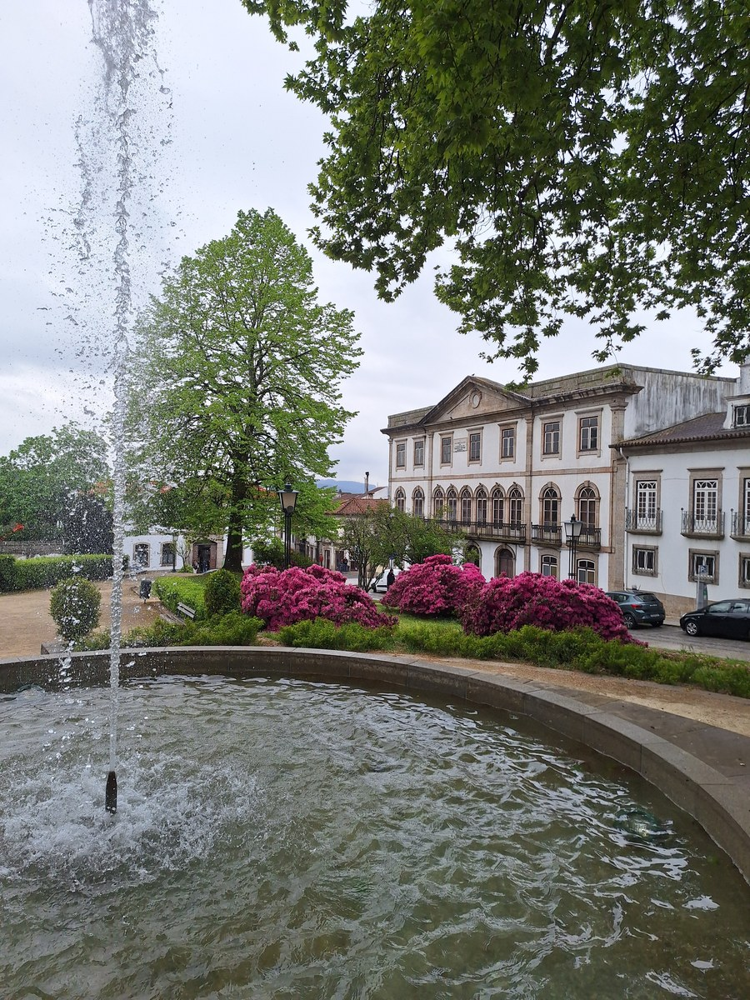
  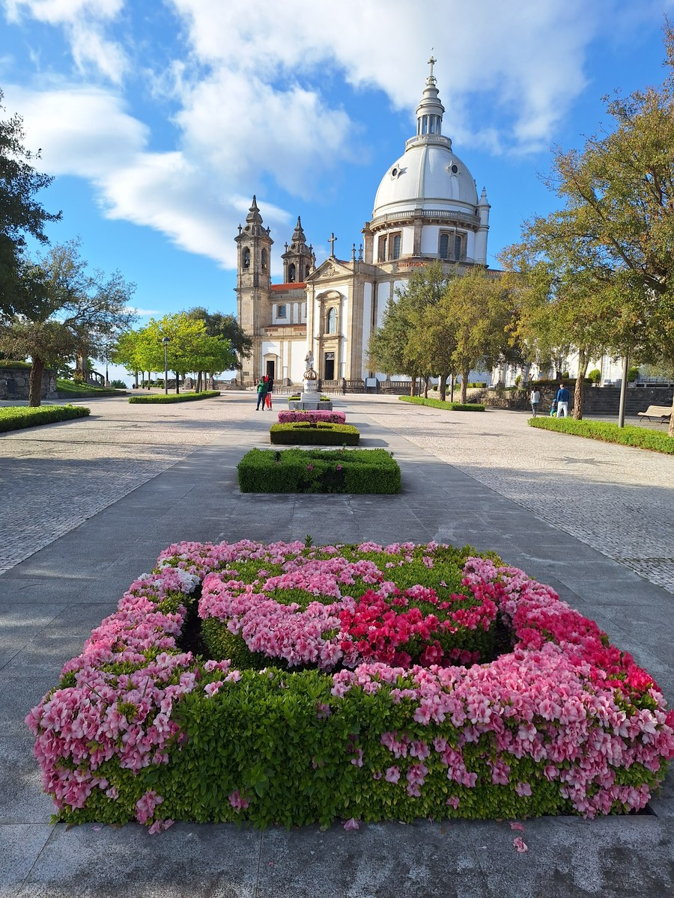

W dniu, w którym pojechaliśmy do Guimarães, pogoda była zdecydowanie najgorsza. Rano padał deszcz, choć prognozy zapowiadały 
późniejszą poprawę, więc postanowiliśmy mimo wszystko pojechać. Podczas mojej poprzedniej wizyty nie udało mi się zobaczyć 
Sanktuarium Penha, dlatego tym razem właśnie tam skierowaliśmy się najpierw.
Dla wielu odwiedzających jest to znacznie więcej niż tylko sanktuarium, to jeden z głównych terenów rekreacyjnych Guimarães, 
gdzie mieszkańcy przychodzą na spacery, pikniki i odpoczynek z dala od miejskiego zgiełku.

Choć pogoda nie pozwoliła nam podziwiać widoków, od razu było widać, że góra Penha oferuje znacznie więcej niż samo sanktuarium. 
Wokół kościoła znajdowały się tablice informacyjne opisujące szlak pieszy PR3, a także miejsca piknikowe, gdzie można 
odpocząć w otoczeniu przyrody. Cały teren porasta las, pomiędzy którym wyrastają imponujące granitowe formacje skalne, 
tworząc krajobraz wręcz idealny do dłuższego spaceru i odkrywania okolicy.

Zauważyliśmy liczne ścieżki prowadzące pomiędzy ogromnymi głazami i przez las. Od razu pomyśleliśmy, że warto tu wrócić 
w słoneczny dzień, aby w pełni nacieszyć się panoramą Guimarães i okolicznych wzgórz.
Było ponuro i ciemno, a podczas spaceru wokół sanktuarium ponownie zaczął padać deszcz. Szybko wróciliśmy więc do samochodu. 
Na szczęście, gdy dotarliśmy do miasta, opady ustały, a późnym popołudniem mogliśmy nawet cieszyć się słońcem.

  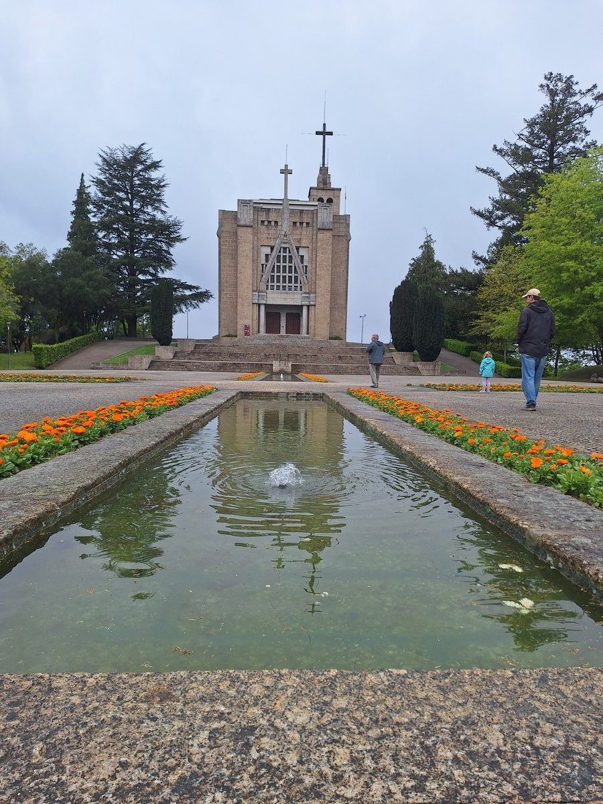
  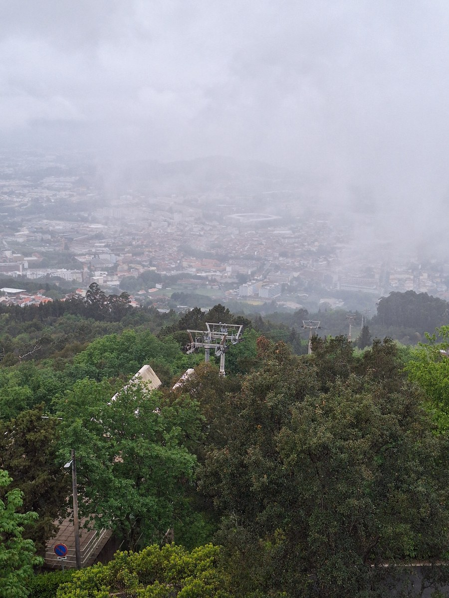

Następnego dnia naszym celem było udanie się na północ od Bragi, w okolice Ponte de Lima. Plan zakładał połączenie zwiedzania 
tego średniowiecznego miasteczka z dwoma krótkimi pieszymi wycieczkami. Dzień rozpoczęliśmy od wizyty w chronionym krajobrazie 
lagun **Bertiandos and São Pedro de Arcos Lagoons Protected Landscape**. Zaparkowaliśmy obok centrum dla odwiedzających, 
gdzie stał duży autobus szkolny. Okazało się, że grupa dzieci uczestniczyła tam w zajęciach terenowych.

Dzieci przebywały wewnątrz centrum, do którego zajrzała również nasza córka, szukając toalety. Bardzo zainteresowało ją 
to, co robiły, i musieliśmy ją trochę namawiać, zanim zgodziła się wyruszyć na szlak. Na terenie rezerwatu wyznaczono 
pięć oznakowanych tras pieszych, od krótkiej, liczącej zaledwie 1,6 km ścieżki z drewnianymi pomostami wokół laguny po 
12,5-kilometrową trasę prowadzącą przez znaczną część obszaru chronionego.

My wybraliśmy 2,9-kilometrowy Szlak Rzeczny (PR3), który okazał się idealnym wyborem na wędrówkę z dzieckiem. Trasa 
prowadziła przez las, mokradła i drewniane pomosty, a dodatkową atrakcją było geocaching. Jednocześnie spacer nie był zbyt 
długi. Podczas naszej podróży z Bragi padał deszcz, dlatego las był jeszcze bardzo mokry. Chociaż opady ustały, przez 
cały czas czuliśmy krople wody spadające z gałęzi drzew.

  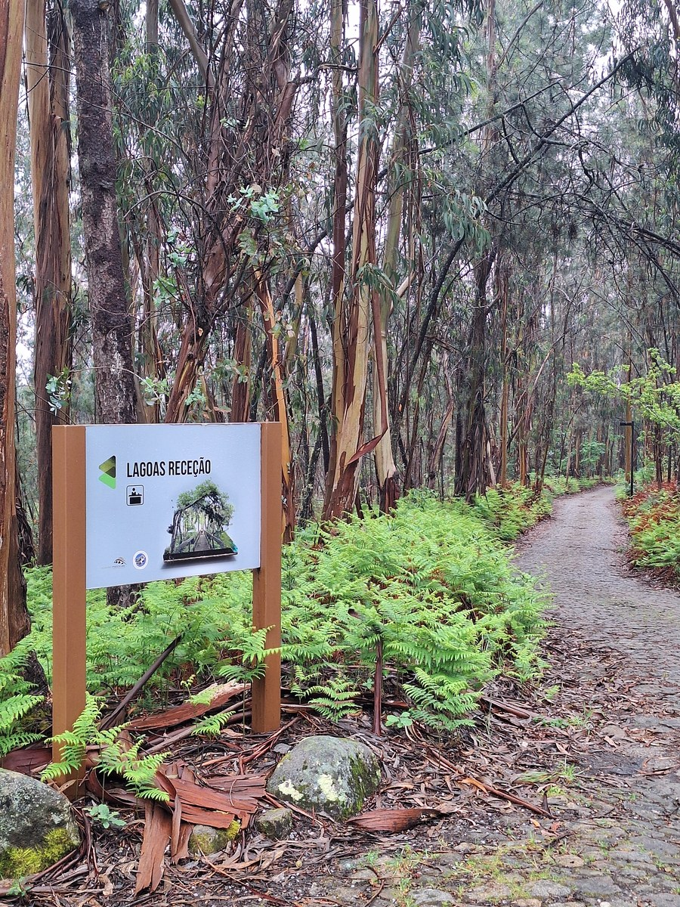
  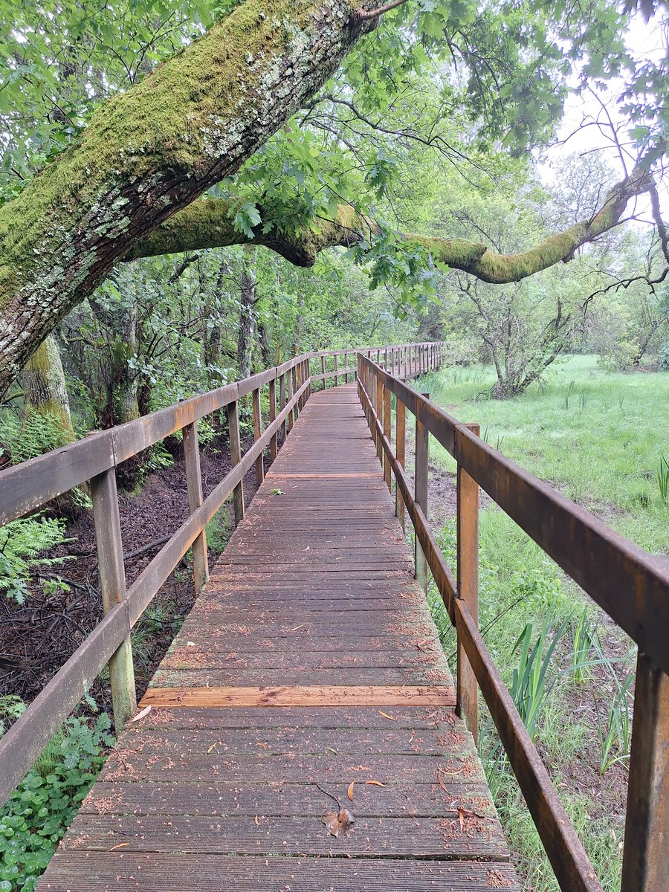

Las wyglądał niezwykle tajemniczo. Aby uatrakcyjnić spacer naszej córce, sprawdziliśmy, czy w pobliżu znajdują się jakieś 
skrytki geocachingowe. Były dwie, co w zupełności wystarczyło, aby utrzymać jej motywację przez całą trasę.
Geocaching to terenowa gra polegająca na poszukiwaniu ukrytych pojemników, zwanych skrytkami, przy pomocy smartfona lub 
odbiornika GPS. Skrytki są zakładane przez innych użytkowników, a każda z nich zamienia zwykły spacer lub wędrówkę w małą 
przygodę.

Podczas podróżowania z dziećmi geocaching świetnie sprawdza się jako sposób na utrzymanie ich zaangażowania i motywacji. 
W czasie naszych wędrówek dawał córce poczucie celu i zachęcał ją do dalszego marszu oraz odkrywania okolicy. Zamiast 
skupiać się na długości trasy, z niecierpliwością wypatrywała kolejnej ukrytej skrytki, dzięki czemu sama droga była równie 
przyjemna jak cel wyprawy.

W tę grę gra z tatą już od dłuższego czasu. Szczególnie ucieszyła się ze znalezienia jednej ze skrytek ukrytej pod ogromnym 
eukaliptusem, choć niestety notes znajdujący się w środku był całkowicie przemoczony.
Sam spacer okazał się bardzo przyjemny. Trasa nie była długa, a po drodze mijaliśmy ogromne poduszki mchu nasiąknięte wodą. 
Na drzewach rosło również wiele porostów, świadczących o bardzo czystym powietrzu. Wydaje mi się, że zauważyłam porost z 
rodzaju Ramalina, krzaczkowaty porost będący doskonałym bioindykatorem, ponieważ do prawidłowego wzrostu wymaga czystego, 
niezanieczyszczonego powietrza.

  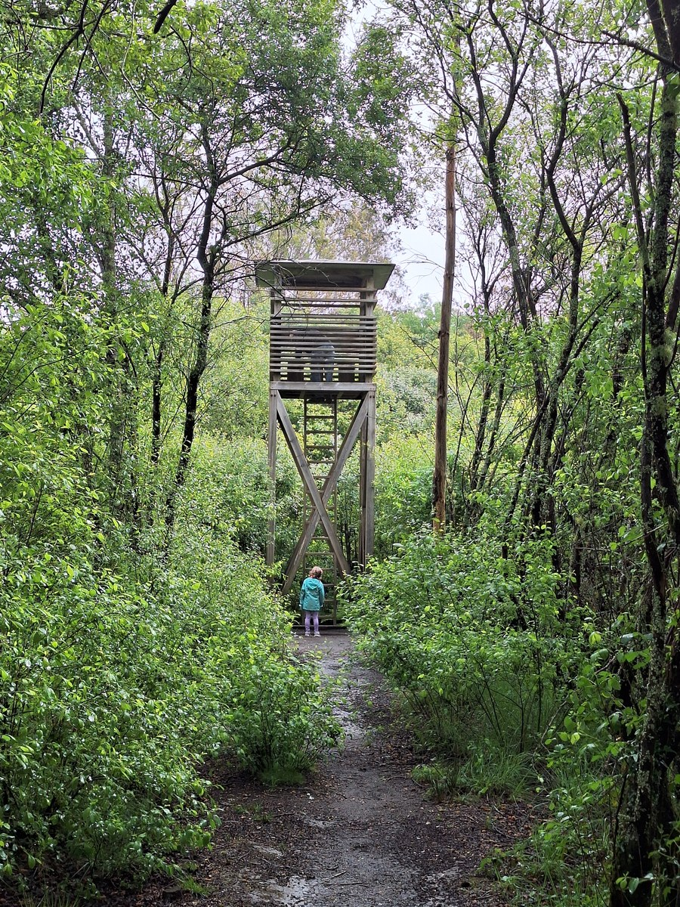
  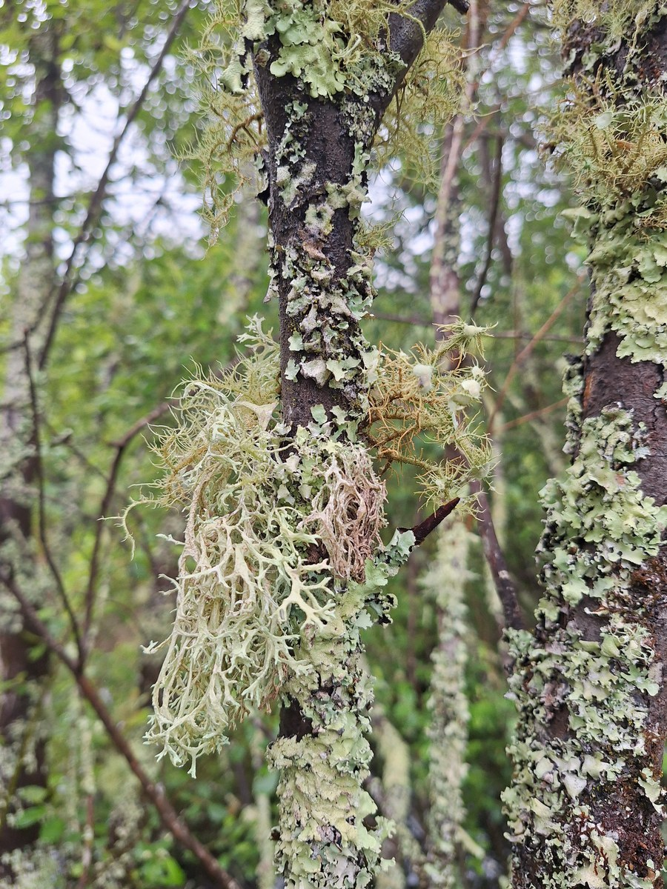

Podczas całej wędrówki spotkaliśmy zaledwie kilka osób, dzięki czemu okolica sprawiała wrażenie wyjątkowo spokojnej i 
sprzyjała relaksowi. Podwyższone drewniane pomosty były bardzo dobrze oznakowane, a wzdłuż trasy znajdowało się kilka 
czatowni ornitologicznych oraz punktów obserwacyjnych. W drugiej części szlaku szliśmy wzdłuż rzeki Estorãos, wcześniej 
okrążając słodkowodne laguny po drewnianych pomostach. Ponieważ teren wokół lagun jest naturalnie grząski, podmokły i 
bardzo delikatny, zbudowano rozbudowaną sieć podwyższonych kładek. Dzięki nim odwiedzający mogą swobodnie przemierzać 
mokradła, nie zapadając się w błoto i nie niszcząc cennych siedlisk przyrodniczych.

W drodze powrotnej do miasta zatrzymaliśmy się na lunch w lokalnej restauracji. Później byliśmy już gotowi, aby odkrywać 
**Ponte de Lima**, jedno z najbardziej urokliwych miasteczek północnej Portugalii, często określane jako najstarsze miasto 
w kraju. Położone nad brzegiem rzeki Lima słynie ze średniowiecznego mostu, nadrzecznych ogrodów pełnych kwiatów oraz 
spokojnej, relaksującej atmosfery. Nazwa miejscowości dosłownie oznacza „Most nad Limą” i nawiązuje do zabytkowego kamiennego 
mostu, który był ważną przeprawą na rzymskiej drodze łączącej Bragę z Astorgą.

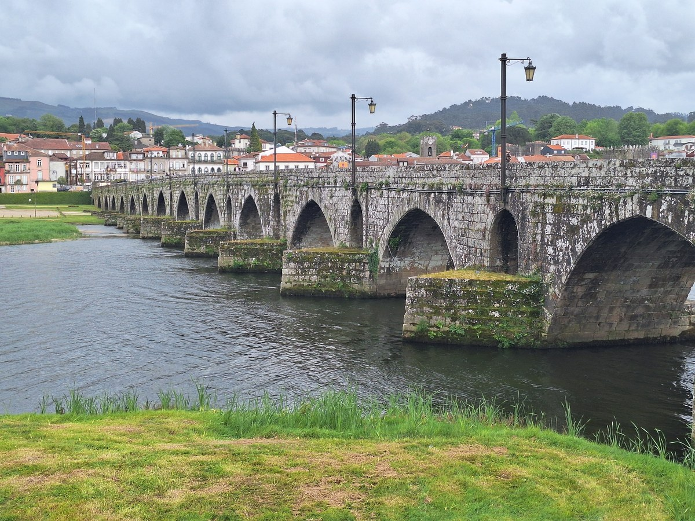

W kwietniu Ponte de Lima prezentuje się wyjątkowo pięknie, ponieważ parki i nadrzeczne bulwary toną w wiosennych kwiatach 
i soczystej zieleni. Szczególne wrażenie robią kwitnące glicynie. Samochód zostawiliśmy przy Parque Temático do Arnado, 
gdzie przywitały nas drzewa pomarańczowe, fontanny, urocze miejsca do odpoczynku oraz niezwykły pokaz kwitnących glicynii. 
Można było podziwiać kwiaty w wielu odcieniach fioletu, a pnącza poprowadzono tak, że tworzyły tunele, pod którymi można 
było spacerować z kwiatami zwisającymi nad głową. Opadłe płatki pokrywały alejki, tworząc złudzenie fioletowych dywanów 
rozciągających się po całym parku. To było zdecydowanie moje ulubione miejsce w całym mieście.
Pośrodku parku znajdował się również plac zabaw, który na dłuższą chwilę zajął naszą córkę. Co ciekawe, podczas naszej 
podróży po Portugalii naprawdę trudno było znaleźć dobrze wyposażone place zabaw, dlatego ten był bardzo miłym zaskoczeniem.

  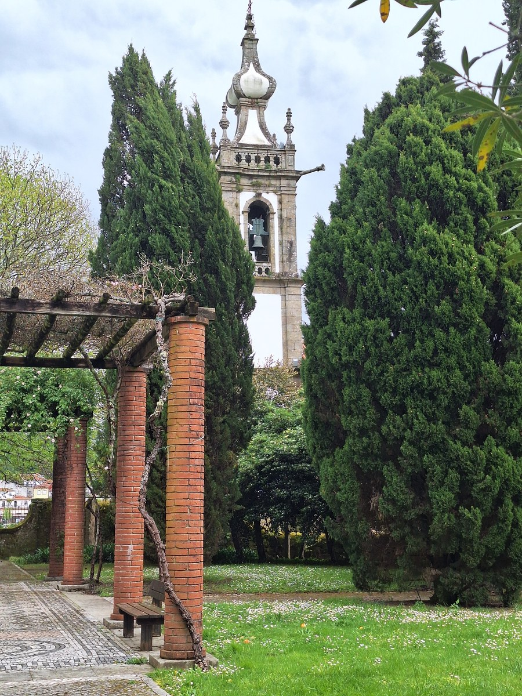
  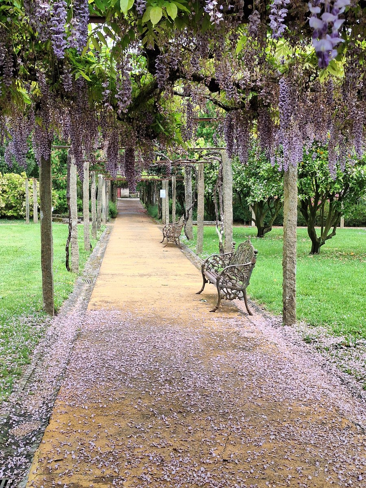

Po opuszczeniu parku ruszyliśmy w stronę centrum miasta, przechodząc przez słynny most, obok którego stoi Igreja de Santo 
António da Torre Velha. Most ten jest również silnie związany z Camino de Santiago, ponieważ Ponte de Lima jest jednym z 
ważniejszych przystanków na portugalskim szlaku prowadzącym do Santiago de Compostela. Spacerując po mieście, zauważyliśmy 
kilku pielgrzymów odpoczywających w pobliżu mostu i robiących sobie przerwę przed dalszą drogą. Widzieliśmy również tablice 
oferujące proste i niedrogie noclegi dla pielgrzymów, co uświadomiło nam, że ta wielowiekowa tradycja nadal stanowi bardzo 
ważną część codziennego życia w Ponte de Lima.

  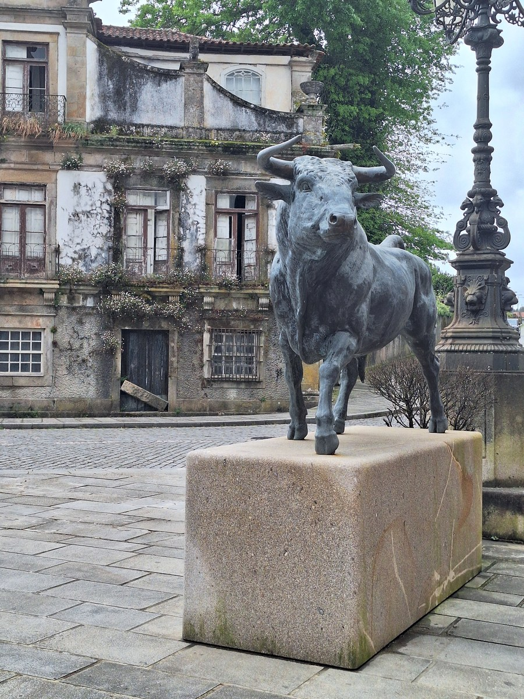
  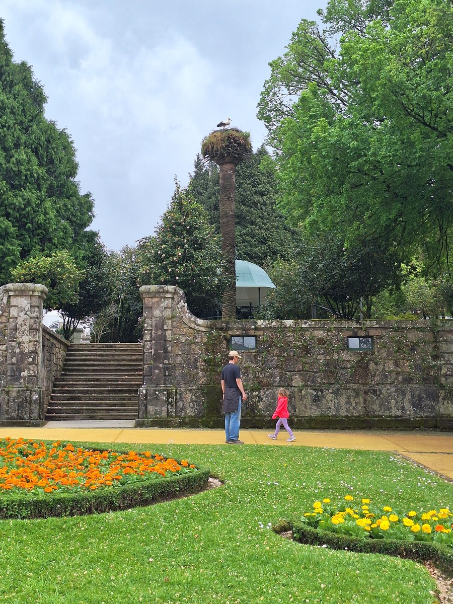

Spędziliśmy również trochę czasu przy Paço do Marquês de Ponte de Lima. Z murów zamkowych rozciąga się piękny widok na 
miasto. W pałacu mieści się Centrum Interpretacji Historii Wojskowości, którego nie odwiedziliśmy, ponieważ nie wydawało 
nam się szczególnie interesujące dla naszej córki. Miłośnikom historii wojskowości z pewnością może się jednak spodobać.
Następnie przeszliśmy główną ulicą R. Agostinho José Taveira, podziwiając zabytkową zabudowę, aż dotarliśmy nad rzekę i 
na słynną Avenida dos Plátanos. To idealne miejsce, aby schronić się przed letnim upałem, usiąść na ławce w cieniu platanów 
i cieszyć się spokojnym widokiem na rzekę. Ostatecznie wróciliśmy wzdłuż nabrzeża do mostu, który ponownie przeszliśmy, 
kierując się do samochodu.

  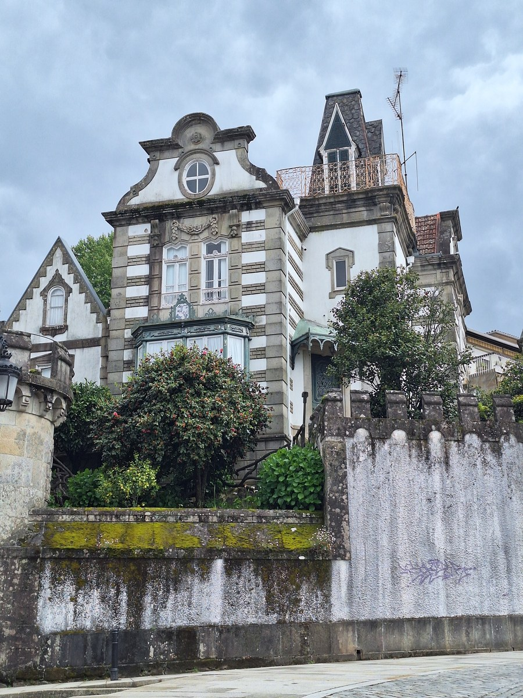
  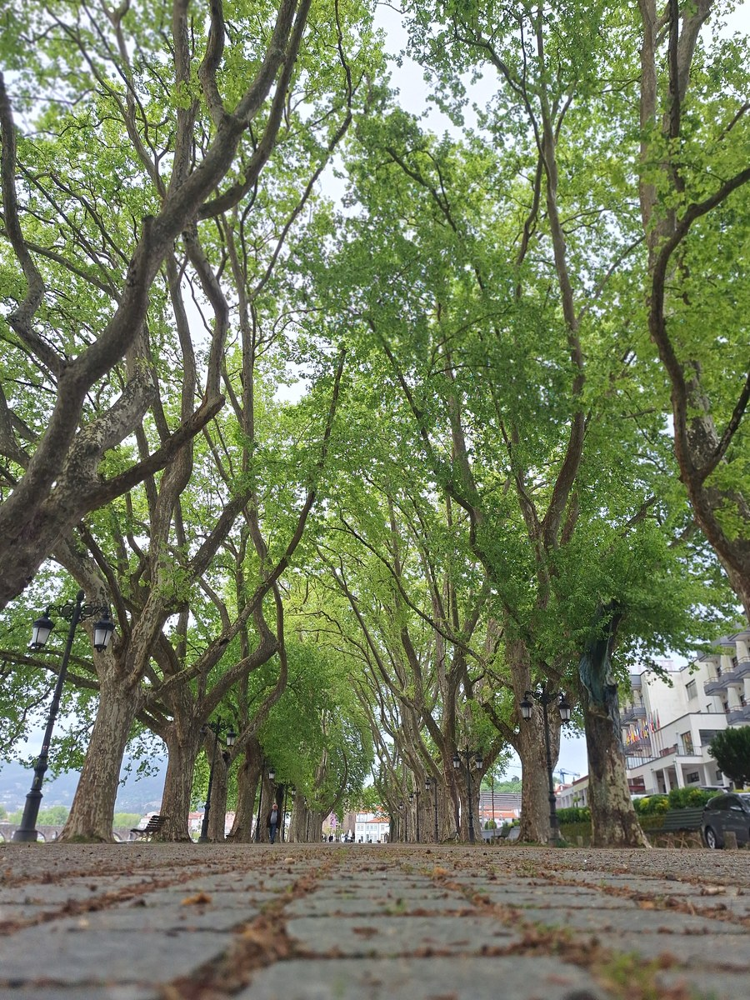

Wciąż mieliśmy jeszcze trochę czasu na ostatni przystanek bliżej gór **Passadiços e Moinhos da Ribeira de S. João**, który 
okazał się wspaniałą niespodzianką. Choć trasa liczy mniej niż dwa kilometry, kryje mnóstwo atrakcji: drewniane kładki, 
mosty wiszące, niewielkie drewniane budynki będące prawdopodobnie dawnymi młynami wodnymi oraz bardzo malownicze krajobrazy.
Nasza córka najbardziej polubiła przechodzenie po kołyszących się mostach i bieganie po drewnianych pomostach, dlatego z 
radością pokonała całą trasę, ani razu nie narzekając. Uważam, że jest to fantastyczne miejsce na wycieczkę z dziećmi, 
ponieważ za każdym zakrętem czeka coś ciekawego.

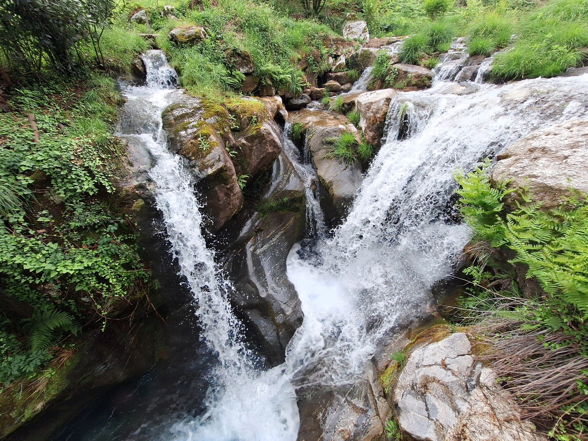

  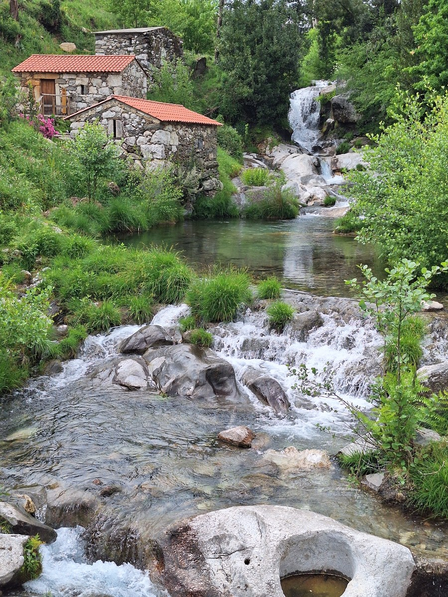
  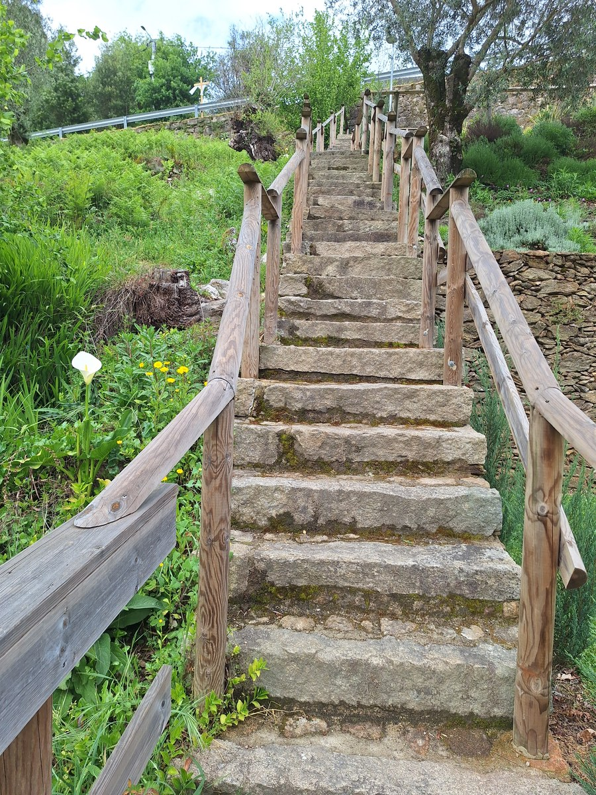

Na miejscu znajduje się nowocześnie wyglądające centrum informacji, jednak niestety było zamknięte, podobnie jak toalety 
znajdujące się obok ekomuzeum. Gdy przyjechaliśmy, minęliśmy jedynie kilka osób kończących spacer, dlatego przez większość 
czasu mieliśmy cały szlak praktycznie tylko dla siebie. Jedyną rzeczą, która może być nieco myląca, jest to, że trasa 
składa się z dwóch oddzielnych odcinków rozdzielonych drogą. Najpierw przeszliśmy większą pętlę, na której znajdują się 
główne wodospady. Następnie poszliśmy drogą obok miejscowego kościoła aż do ekomuzeum, za którym rozpoczyna się druga 
część szlaku. Oznacza to, że aby przejść całą trasę, trzeba dwukrotnie pokonać ten sam odcinek drogi. Ponieważ nie ma 
tam chodnika, a droga jest dość kręta, warto zachować szczególną ostrożność, zwłaszcza podczas wycieczki z dziećmi.

  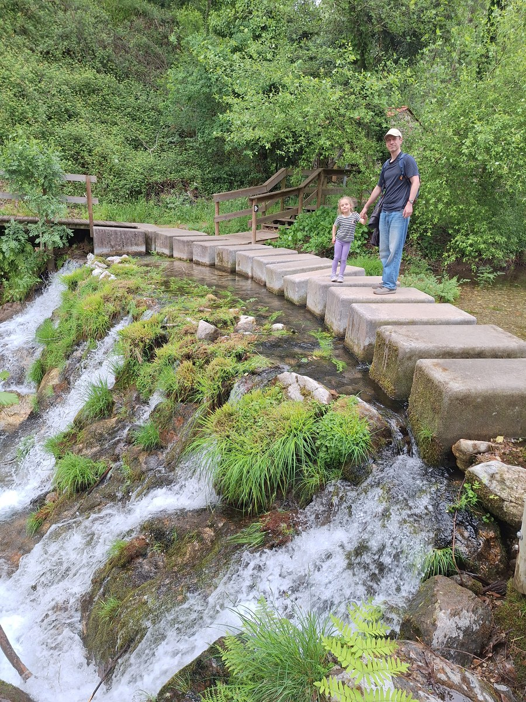
  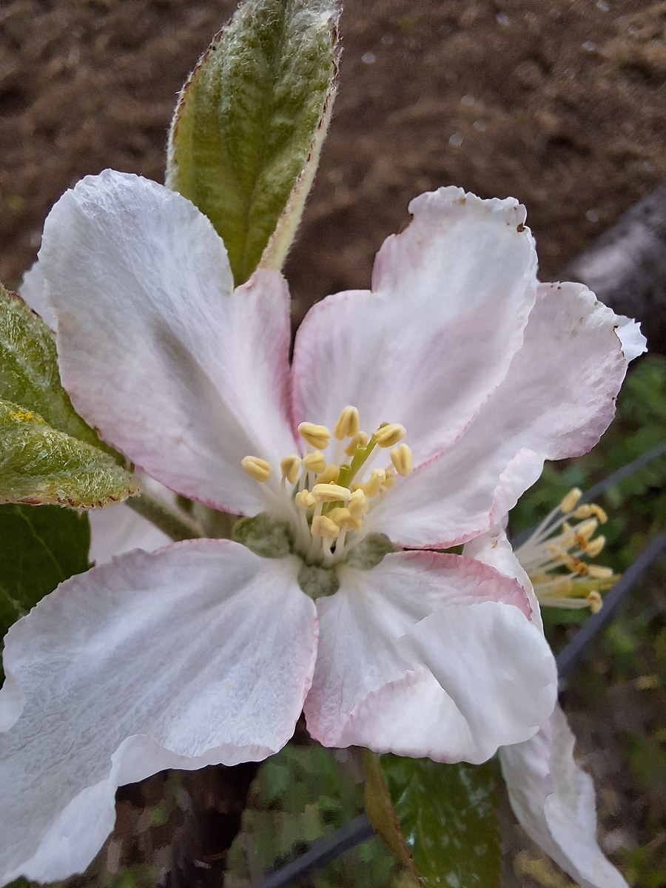

Choć szlak jest krótki, okazał się znacznie bardziej urozmaicony, niż się spodziewaliśmy. W niecałą godzinę przeszliśmy 
przez kilka mostów, obejrzeliśmy wodospady, podziwialiśmy stare młyny i cieszyliśmy się spokojem leśnej scenerii. Był to 
idealny ostatni przystanek przed powrotem do Bragi.

Ponte de Lima okazało się jednym z najważniejszych punktów naszej podróży po północnej Portugalii. Początkowo planowaliśmy 
tylko krótką wizytę w miasteczku oraz dwa niewielkie spacery, ale połączenie wiosennych kwiatów, spokojnych krajobrazów 
i przyjaznych rodzinom szlaków sprawiło, że żałowaliśmy, iż nie zaplanowaliśmy tutaj więcej czasu. To właśnie takie miejsce, 
w którym samo zwolnienie tempa i cieszenie się chwilą staje się częścią całego doświadczenia.

__Informacje praktyczne:__

* National Park Lagoas de Bertiandos e São Pedro d'Arcos: wstęp bezpłatny   
Czas zwiedzania: 2 godziny
Opisy szlaków znajdują się na [oficjalnej stronie](https://lagoas.cm-pontedelima.pt/informacoes/atividades/percursos-e-rotas/poi/percurso-do-rio-pr-3) gdzie można również pobrać pliki PDF z dokładnym opisem każdej 
trasy w języku angielskim i hiszpańskim (my wybraliśmy szlak PR3).

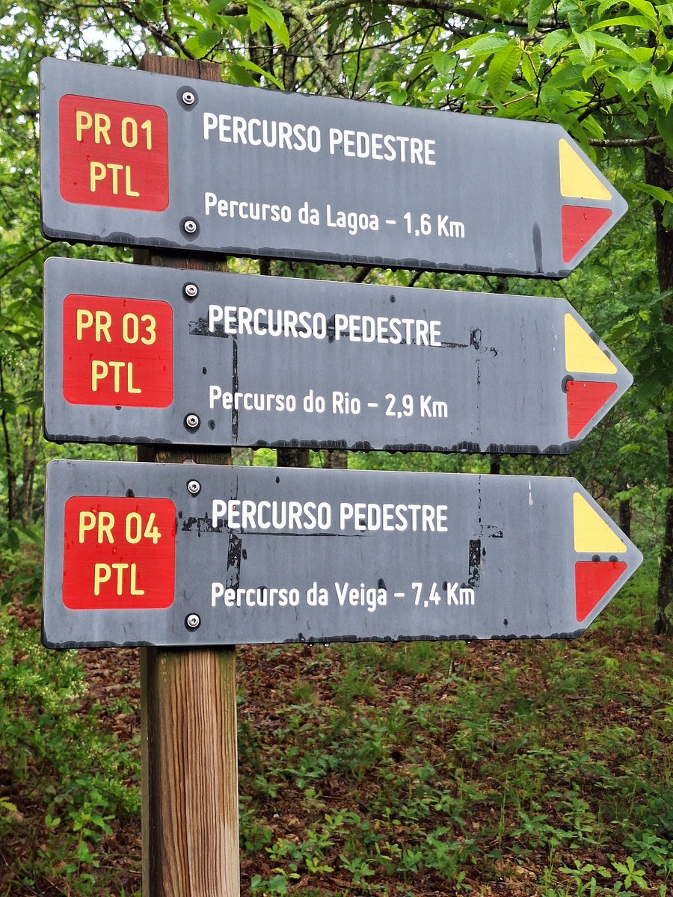

* Ponte de Lima:
[Parking](https://maps.app.goo.gl/R2tQfwCrHU248e6q9), wzdłuż rzeki znajduje się wiele darmowych miejsc postojowych. 
Bezpłatna toaleta publiczna na placu Camões   
Interpretation Center Of Military History - bilet wstępu:€1   
* Restauracja: [NACOS Restaurante](https://maps.app.goo.gl/99sAeSKDWcBVUKgW7)
* Passadiços e moinhos da Ribeira de S.João: wstęp bezpłatny   
Czas zwiedzania: 45-60 minut
Na początku szlaku znajduje się niewielki bezpłatny parking, mieszczący zaledwie kilka samochodów. Zauważyliśmy również 
kilka dodatkowych miejsc postojowych w pobliżu Ekomuzeum. Największy parking, jaki znaleźliśmy, to utwardzony plac żwirowy 
obok kościoła, [tuż przy głównej drodze](https://maps.app.goo.gl/HveHTcM2D8PDLaaT9). Prawdopodobnie przeznaczony jest głównie dla osób odwiedzających kościół, 
ale może być również wygodnym miejscem do zaparkowania, gdy mniejsze parkingi są już pełne.

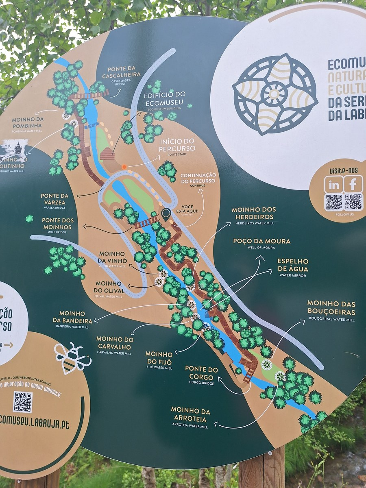

