Postanowiliśmy wykorzystać jeden z majowych długich weekendów, aby w końcu poznać region Belgii, w którym nigdy wcześniej nie
byłam. Szukaliśmy raczej dłuższych szlaków niż krótkich rodzinnych spacerów, więc zostawiliśmy córkę u dziadków i pojechaliśmy
w stronę Liège. Pogoda miała jednak inne plany. Prognoza na długi weekend była zaskakująco zła, a nad całą Belgią zapowiadano
burze. Ponieważ nasze mieszkanie znajdowało się w Liège, a pogoda wyglądała lepiej w okolicy XIII-wiecznego kompleksu zamkowego
**Alden Biesen**, postanowiliśmy wykorzystać sytuację i zatrzymać się tam po drodze.

## Alden Biesen – łatwy szlak wokół zamku
Zdecydowaliśmy się na trasę oznaczoną pomarańczowym krzyżem, która prowadzi przez pola wokół zamku i ma około 8,2 km długości.
Szlak zaczyna się dokładnie przy okazałej bramie zamku, gdzie minęliśmy przyjemne miejsce do odpoczynku i małą drewnianą
przyczepę o nazwie De Bij-Mobiel. Okazało się, że to przyczepa zaprojektowana w Limburgii, służąca do edukowania mieszkańców
o pszczołach i bioróżnorodności. Pokazuje, jak istotne są pszczoły dla zapylania krzyżowego,
kluczowego dla rozległych sadów owocowych w tym regionie. Wiosną, w czasie kwitnienia drzew owocowych, musi to być fantastyczne 
miejsce do odwiedzenia.

  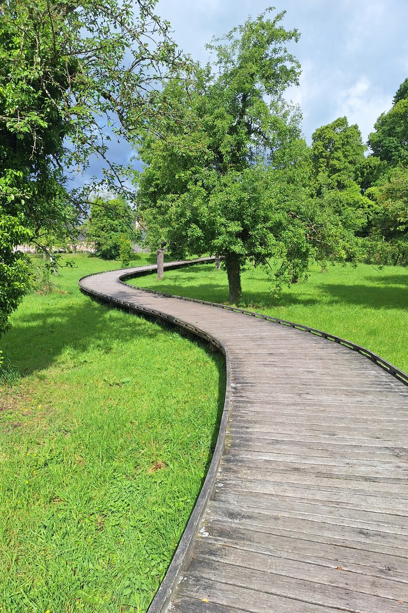
  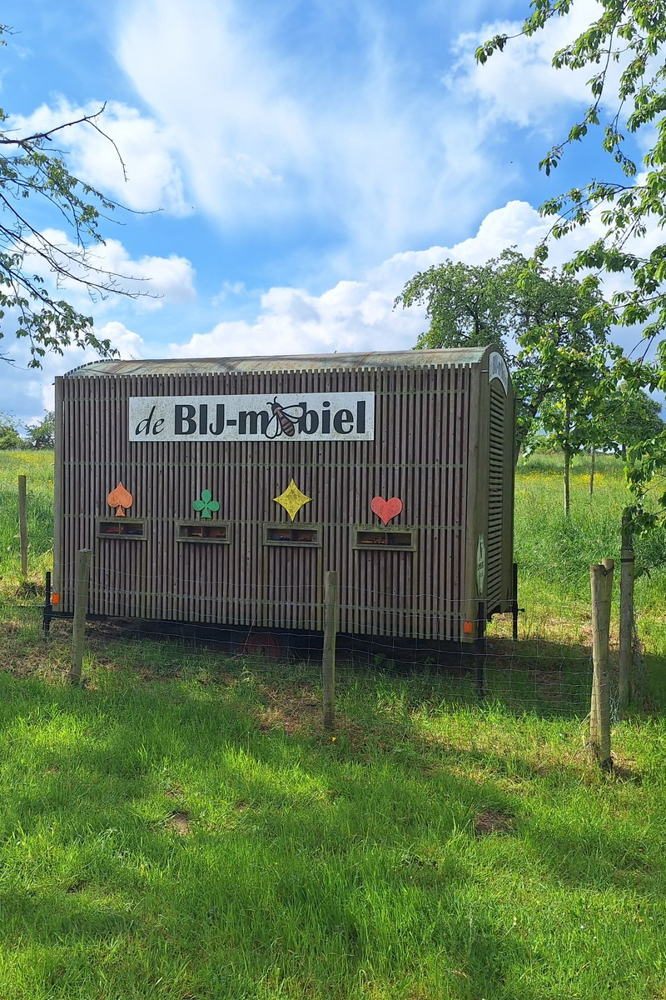

Zostawiając mury zamku za sobą, szlak prowadził nas przez pola uprawne, zalesione doliny strumieni i bujne
tereny podmokłe, gdzie znaleźliśmy drewniane kładki nad rzeką Demer. Po drodze minęliśmy wiele przyjemnych miejsc z ławkami
i naprawdę spodobała nam się piękna różnorodność tej pętli. Po zakończeniu wędrówki, wracając w stronę parkingu, zwiedziliśmy
jeszcze dziedziniec zamku i ogród francuski.

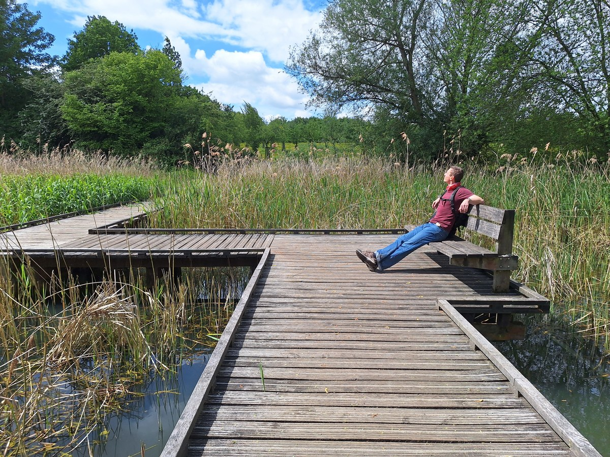

  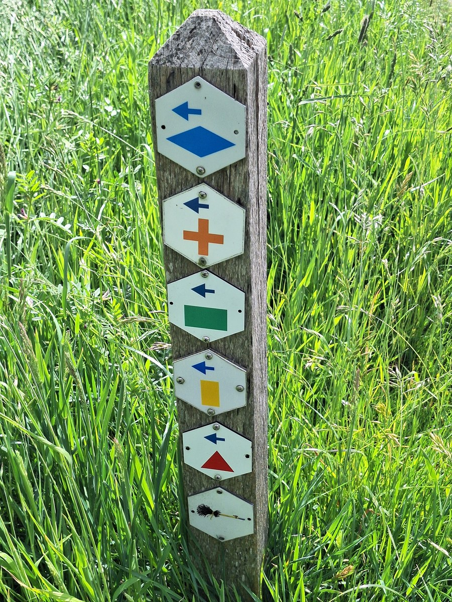
  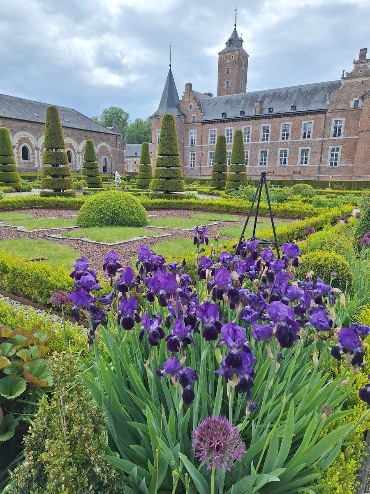

## Esneux – wędrówka przerwana przez burzę
Mimo niestabilnej pogody postanowiliśmy odwiedzić Esneux i spróbować przejść trasę wzdłuż rzeki Ourthe. Niebieska linia na
mapie pokazuje trasę, którą pierwotnie planowaliśmy, a czerwona linia trasę, którą faktycznie przeszliśmy. Niestety już po
pierwszych 1,5 km zatrzymał nas ulewny deszcz i grzmoty. Ponieważ most, po którym mogliśmy przejść na drugą stronę rzeki,
znajdował się prawdopodobnie na szóstym kilometrze trasy, nie mielibyśmy żadnej możliwości skrócenia wędrówki, gdyby pogoda
stała się jeszcze bardziej nieprzyjemna.
Kiedy burza przeszła, weszliśmy pod górę do kościoła św. Huberta, a następnie ruszyliśmy ścieżką wzdłuż ogrodzenia Château
Le Fy, powoli schodząc zboczem w stronę Rue Grandfosse. Stamtąd wracaliśmy do samochodu wzdłuż rzeki, mijając po drodze
dworzec kolejowy. Nie była to wędrówka, którą pierwotnie planowaliśmy, ale przynajmniej udało nam się poznać choć trochę
tej okolicy pomiędzy burzami, bo gdy ruszaliśmy z miasta w droge powrotną, znowu zaczęło pagać.

## Hautes Fagnes – długa wędrówka przez las oraz drewniane pomosty
Następnego dnia prognoza pogody była znacznie lepsza, ale tylko do godziny 16, więc musieliśmy zadbać o to, żeby być na początku szlaku 
najpóźniej o 10. Z naszego mieszkania mieliśmy jeszcze 60 km do przejechania, co zajęło nam około godziny bez dodatkowych korków. Warto 
pamiętać o tym, że jedzie się drogami lokalnymi, więc w zależności od natężenia ruchu może to potrwać znacznie dłużej.

Parking obok restauracji i małej kaplicy był rano całkiem pusty. Miałam zaznaczone kilka ścieżek w aplikacji Organic Maps, którymi 
chciałam pójść, ale musieliśmy zmodyfikować trasę z powodu podmokłych odcinków, których nie dało się przejść. Kilka poprzednich dni 
było zdecydowanie bardziej deszczowych niż reszta miesiąca. Na początku szliśmy bardzo wyraźnymi leśnymi ścieżkami. Za każdym razem, 
gdy próbowaliśmy skręcić głębiej w las i podążać mniejszymi ścieżkami, zatrzymywał nas bardzo błotnisty teren, więc zdecydowaliśmy 
się trzymać głównej trasy.

Jedną z rzeczy, która szczególnie mi się spodobała na początku szlaku, była wełnianka rosnąca na dużym obszarze. Jej puszyste, białe 
kłosy pięknie były widoczne na tle zielonej i brązowej roślinności, sprawiając, że krajobraz wyglądał jak pokryty małymi kłębkami 
bawełny.

  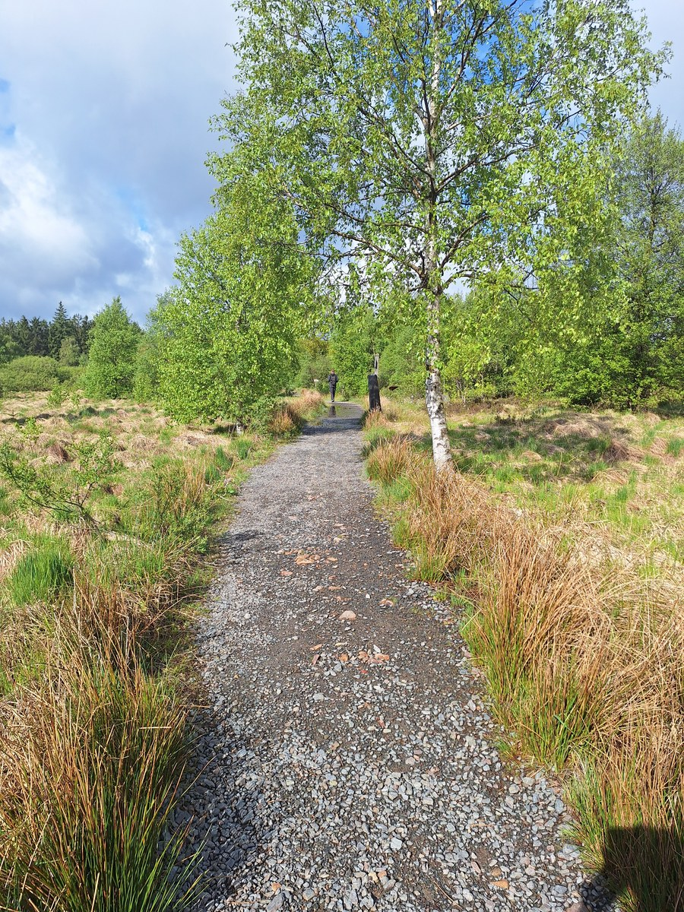
  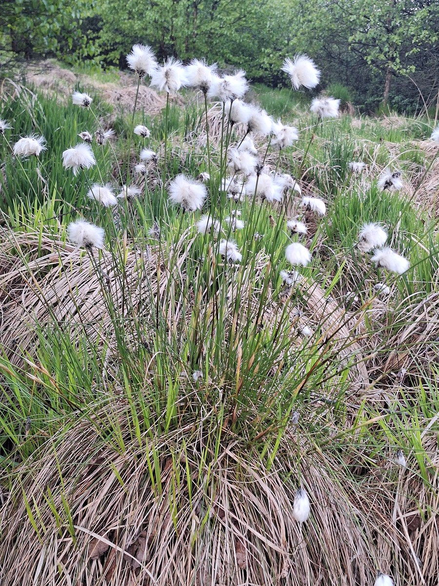

Las był bardzo cichy i rozległy, a tablice wskazywały trasy dla rowerów górskich w okolicy. Częściowo szliśmy właśnie tymi trasami, 
a później skręciliśmy na mniejsze leśne ścieżki. Najdalszym punktem, do którego dotarliśmy, był ładny punkt widokowy z zadaszoną 
platformą i kilkoma ławkami. Stamtąd słyszeliśmy i widzieliśmy kaskady wody spływające w dolinie poniżej. Zauważyłam na mapie małą 
ścieżkę prowadzącą stromo w dół, w kierunku strumienia, i postanowiliśmy nią zejść. To była dla mnie jedna z ciekawszych część wędrówki, 
było tu więcej skał, a ścieżka była wąska i stroma, co osobiście lubię znacznie bardziej. Bardzo szybko dotarliśmy do strumienia, 
gdzie ku naszemu zaskoczeniu zauważyliśmy wiele osób na drugim brzegu. Widziałam w pobliżu trasę o nazwie Promenade de la Hoëgne, 
która prowadziła wzdłuż rzeki, i myślę, że trafiliśmy właśnie na jej fragment, aż do mostu Pont du Centenaire.

Okolica strumienia była naprawdę interesująca, z drewnianymi kładkami i mostkami, ale był to zdecydowanie najbardziej zatłoczony 
odcinek całej wędrówki. Wiele razy musieliśmy czekać, żeby przepuścić innych, ponieważ szli znacznie wolniej od nas, a ścieżka była 
bardzo wąska, więc wyprzedzanie nie było łatwe.

  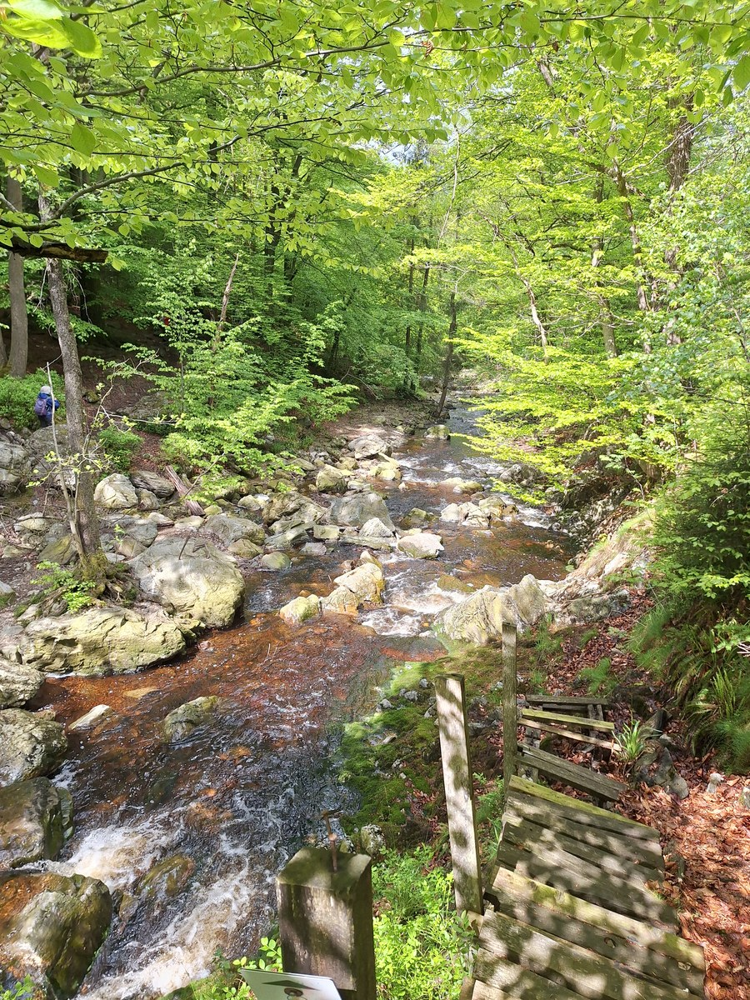
  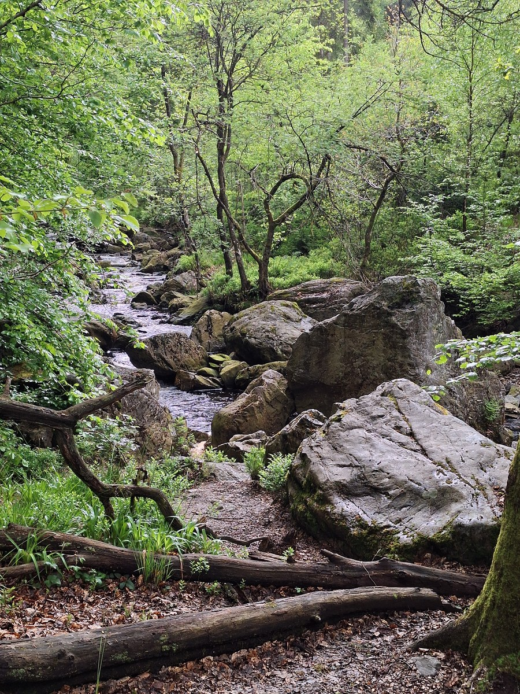

Jedną z rzeczy, która natychmiast zwróciła moją uwagę, był kolor wody w niektórych strumieniach. Była zaskakująco ciemna, niemal 
rdzawobrązowa, i wyglądała trochę jak herbata. Mimo to woda była na tyle przejrzysta, że można było dostrzec kamienie na dnie. 
Jej kolor pochodzi od materii organicznej uwalnianej przez torf i roślinność tego podmokłego krajobrazu, nadając strumieniom 
charakterystyczną, ciemną barwę. Od mostu postanowiliśmy zawrócić w kierunku parkingu, na którym zostawiliśmy samochód. 
Już po kilkuset metrach znów byliśmy sami. 

  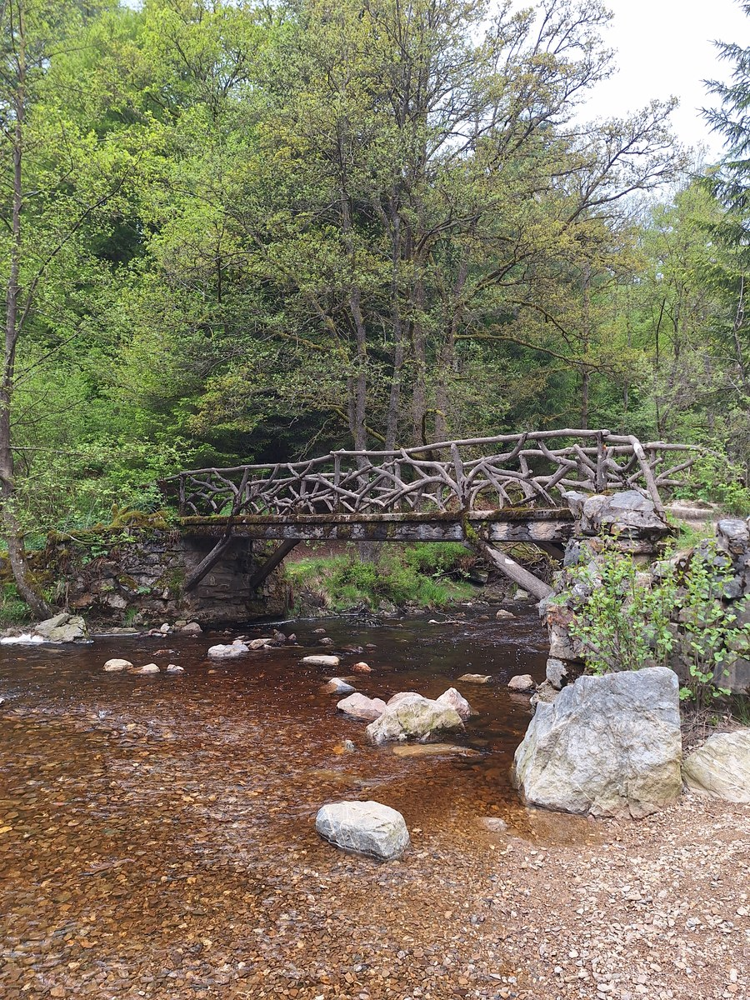
  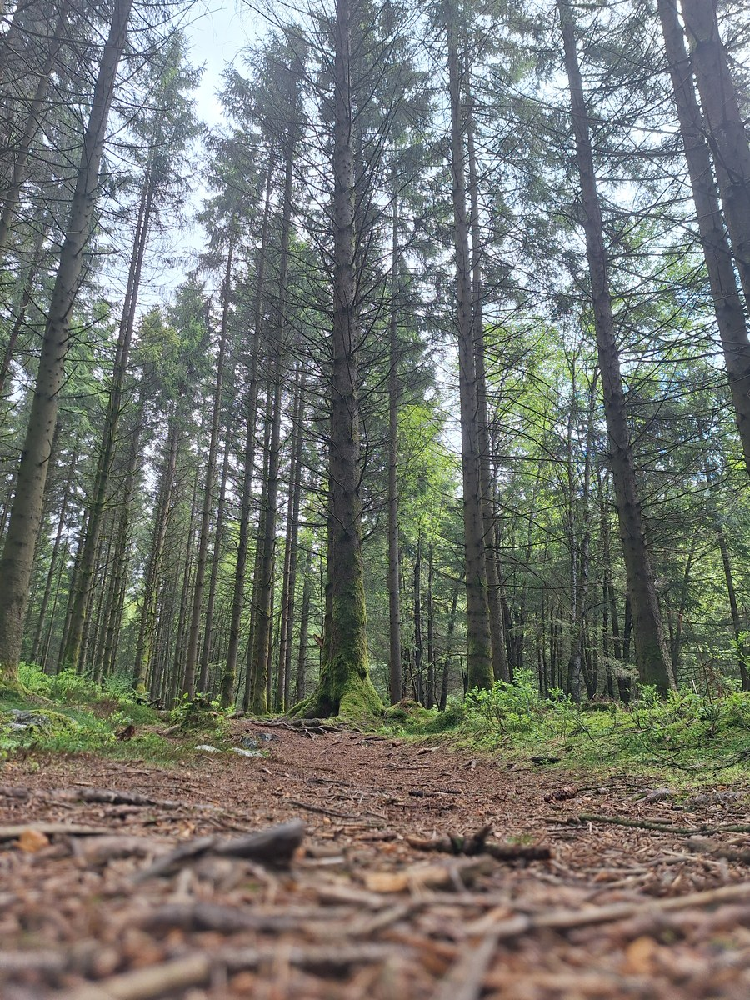

Zastanawiałam się, gdzie są te charakterystyczne drewniane kładki, które widziałam na tak wielu zdjęciach. Dotarliśmy do nich 
dopiero na ostatnich 3 kilometrach wędrówki. Już wtedy mój mąż już narzekał na ból stóp i okazało się, że ma kilka pęcherzy. 
Dlatego, kiedy dotarliśmy do ostatniego odcinka ścieżki prowadzącej w stronę parkingu, zdecydowaliśmy, że ja przejdę jeszcze 
małą pętlę po drugiej stronie głównej drogi, żeby zobaczyć, jak wygląda tamtejszy krajobraz, a on poczeka w samochodzie. 
Kiedy się rozdzieliliśmy, przeszłam przez główną drogę obok hotelu Le Mont Rigi i weszłam na obszar zwany Hautes Fagnes, który 
bardzo różnił się od reszty trasy. Krajobraz jest tam niezwykle otwarty, z niewielką liczbą drzew na horyzoncie. Przez większość 
czasu trzeba jednak poruszać się po drewnianych kładkach, ponieważ teren jest w dużej mierze podmokły. Można tu odbyć naprawdę 
piękne spacery prowadzące po licznych kładkach. Zrobiłam tylko szybką, około 3-kilometrową pętlę, żeby zobaczyć ten obszar, 
ale po tej stronie głównej drogi można wybrać się na znacznie dłuższą wędrówkę, aż do kolejnego rezerwatu przyrody, Fagne de 
Brackvenn, z parkingiem Nahtsief.

  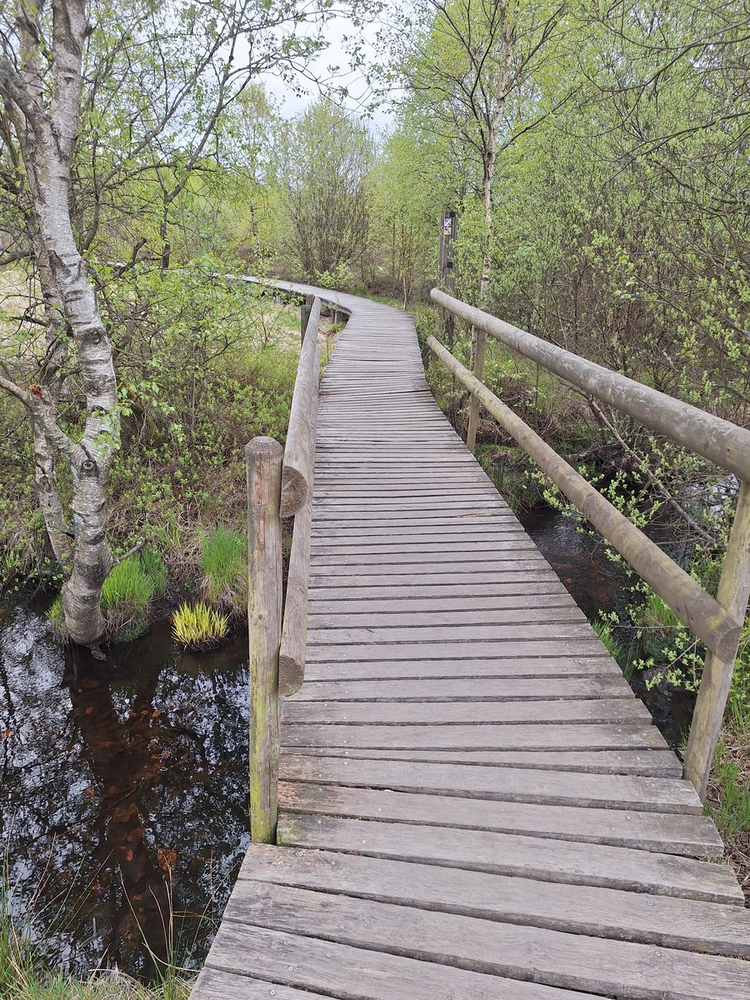
  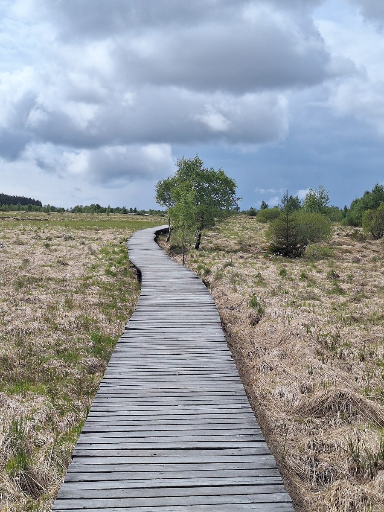

Osoby, które naprawdę chcą stanąć na najwyższym szczycie Belgii, mogą podjechać nieco dalej, na parking Signal de Botrange. 
W rzeczywistości jest to jednak tylko wierzchołek wzgórza ze schodami, znajdujący się tuż obok parkingu, dlatego postanowiliśmy 
to pominąć. W 1923 roku zdecydowano się zbudować te schody, aby podnieść symboliczny najwyższy punkt Belgii dokładnie do wysokości 
700 metrów, ponieważ naturalny wierzchołek znajduje się kilka metrów niżej. Oczywiście Signal de Botrange może być również świetnym 
punktem startowym kolejnej niesamowitej wędrówki po tej okolicy. Była to intensywna, ale bardzo satysfakcjonująca wędrówka, 
pełna pięknych krajobrazów i zaskakująco małej liczby ludzi. Więcej osób spotkaliśmy jedynie na krótkim odcinku wzdłuż strumienia w 
pobliżu Pont du Centenaire oraz w okolicy parkingu, gdzie znajdują się słynne drewniane kładki.

## Vallon du Ninglinspo – piękny, ale zbyt zatłoczony
Ostatni dzień zaczęliśmy od wędrówki w okolicy Vallon du Ninglinspo. To było największe rozczarowanie naszego wyjazdu. Po 
pierwsze, musieliśmy zaparkować samochód nieco dalej od początku szlaku, ponieważ jeszcze przed godziną 10:00 oba małe parkingi były już 
pełne. Bardzo szybko sama wędrówka stała się nieco myląca. W niektórych miejscach między drzewami rozciągnięto taśmy wskazujące, że ze 
względu na prowadzone w okolicy prace, powinniśmy przejść inną trasą, ale nie było jasne, którędy właściwie należy iść. Czasami 
strzałki wskazywały nawet kierunki, w których przejście przez strumień było niemożliwe. Było też bardzo tłoczno, a im dalej szliśmy, 
tym sytuacja robiła się gorsza. Spotkaliśmy wiele osób z małymi dziećmi, ale ta wędrówka wcale nie była łatwa. Nie polecałabym jej 
rodzinom z małymi dziećmi ze względu na liczne śliskie kamienie, błoto i miejsca, w których trzeba było robić większe kroki. Zauważyłam, 
że wiele dzieci miało trudności z pokonaniem tych odcinków. My również wielokrotnie musieliśmy czekać, ponieważ inni turyści mieli problemy 
z przejściem przez najwęższe fragmenty ścieżki, które tego dnia były szczególnie błotniste. Mieliśmy wrażenie, że tak duża liczba turystów 
mocno wpłynęła na ten krajobraz. Wszędzie było widać liczne wydeptane ślady, a niektóre miejsca wyglądały tak, jakby przyroda wyraźnie 
cierpiała z powodu ogromnej liczby odwiedzających.

  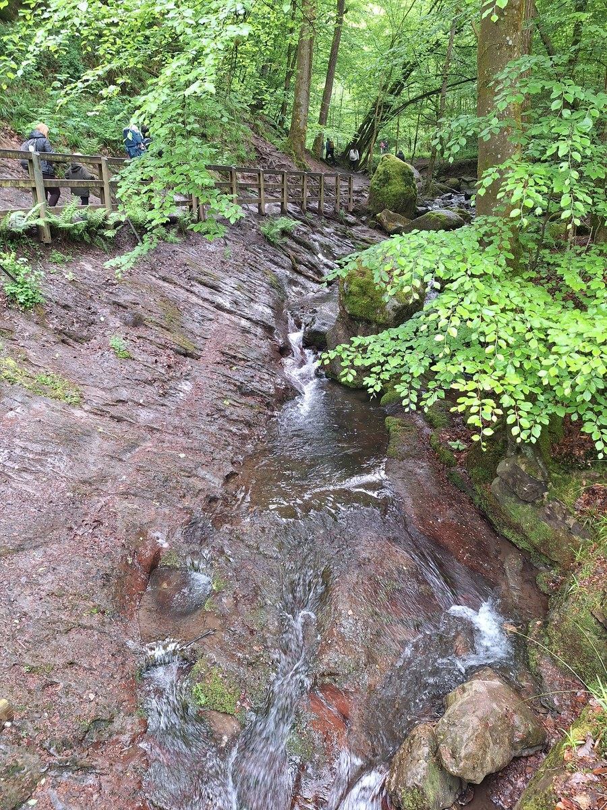
  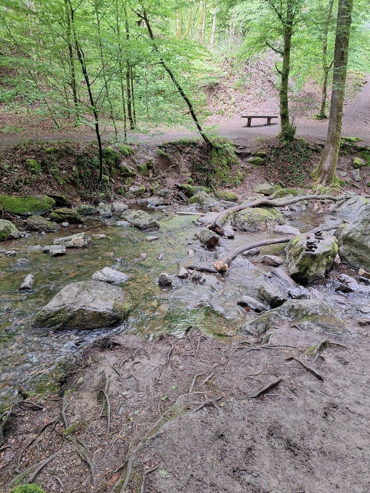

Po około 3 km postanowiliśmy na chwilę odejść od głównej trasy i wydłużyć naszą wędrówkę o dodatkową, 6-kilometrową pętlę prowadzącą do 
La Charmille du Haut Marêt. To urokliwa aleja o długości 573 metrów, w której ponad 4500 grabów tworzy niesamowity, zielony tunel. I właśnie 
ta część wędrówki okazała się dla nas największym pozytywnym zaskoczeniem. Po zatłoczonej i momentami chaotycznej trasie Ninglinspo nagle znaleźliśmy 
się w zupełnie innym świecie, spokojnym, cichym i niemal pustym. Przez większość czasu nie spotkaliśmy nikogo. Szliśmy dobrze utrzymanymi 
leśnymi ścieżkami, które bez problemu znaleźliśmy na mapie w Organic Maps, aż dotarliśmy do słynnej alei.

Po krótkim odpoczynku ruszyliśmy w drogę powrotną, wybierając inną trasę przez las. Ścieżki były tutaj dość szerokie i niemal całkowicie 
płaskie, dzięki czemu szło się bardzo przyjemnie. Tylko raz, mniej więcej na ósmym kilometrze, skręciliśmy w niewłaściwą stronę, ale szybko 
zorientowaliśmy się w sytuacji. Po drodze mijaliśmy również kilka tablic wskazujących trasy rowerowe. Kiedy w końcu wróciliśmy na trasę Ninglinspo, 
druga połowa wędrówki okazała się znacznie łatwiejsza. Szeroka, wygodna ścieżka prowadziła przez las i nie sprawiała już żadnych problemów. 
Ta część była zdecydowanie mniej spektakularna – widoków było niewiele, a krajobraz nie zmieniał się tak często jak wcześniej. Z drugiej 
strony nie musieliśmy już przedzierać się przez błoto ani uważać na śliskie skały, więc po trudniejszym początku był to całkiem przyjemny 
sposób na zakończenie wędrówki.

  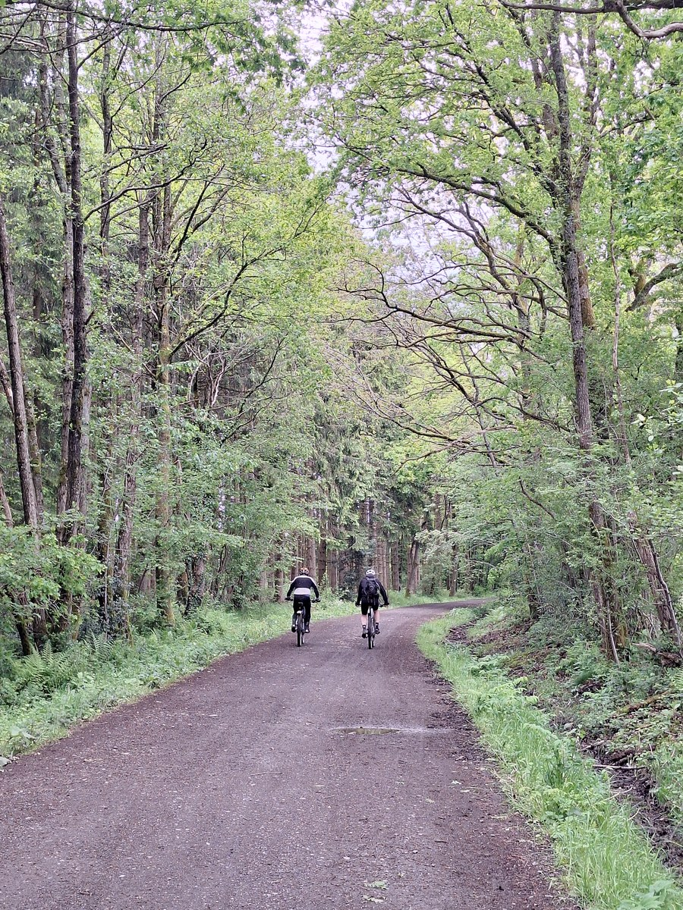
  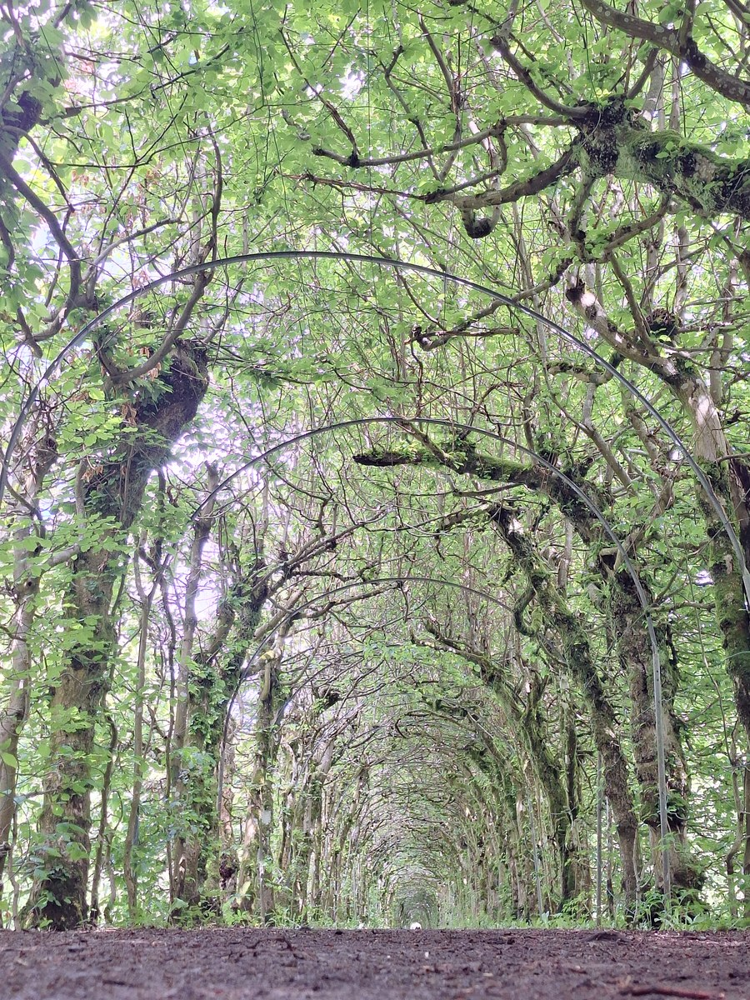

## Heid Des Gattes – krótka dodatkowa wędrówka w okolicy Aywaille
Ponieważ mieliśmy jeszcze trochę czasu, a pogoda nadal była stabilna, postanowiliśmy zatrzymać się w Heid des Gattes, niedaleko Aywaille. 
Tym razem na wędrówkę wybrałam się sama, a mój mąż został na ławce nad brzegiem rzeki bo wciąż miałam ochotę trochę pochodzić i zobaczyć, 
co kryje się na wzgórzu. Po krotkim ale stromym podejściu teren szybko się wypłaszczył, a między drzewami zaczęły pojawiać się widoki na 
miasto i rzekę znajdującą się poniżej. Na górze minęłam kilka małych domów i ruszyłam wyraźną ścieżką, która doprowadziła mnie do pole, na 
którym spotkałam dwa osły i w tej okolicy zaczęłam szukać drogi powrotnej na parking. Ścieżka prowadząca w dół była wąska i dość stroma, 
ale szybko dotarłam do niższych partii wzgórza.

  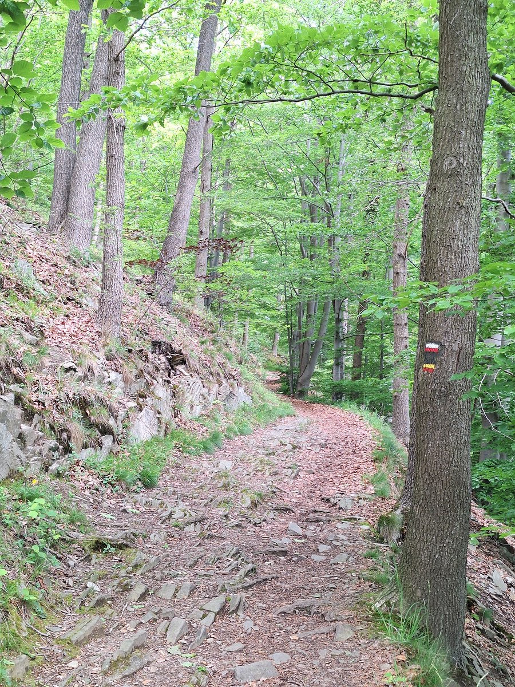
  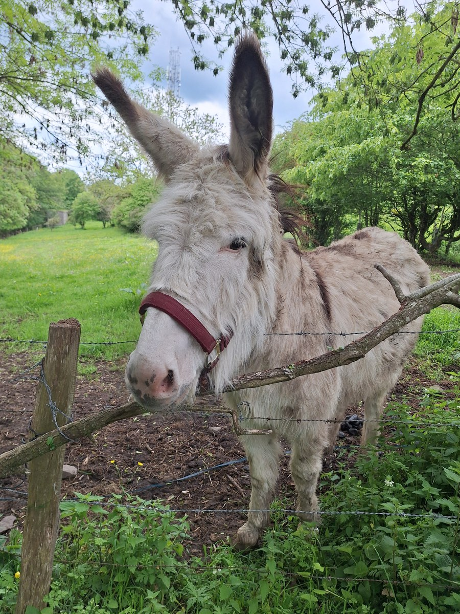

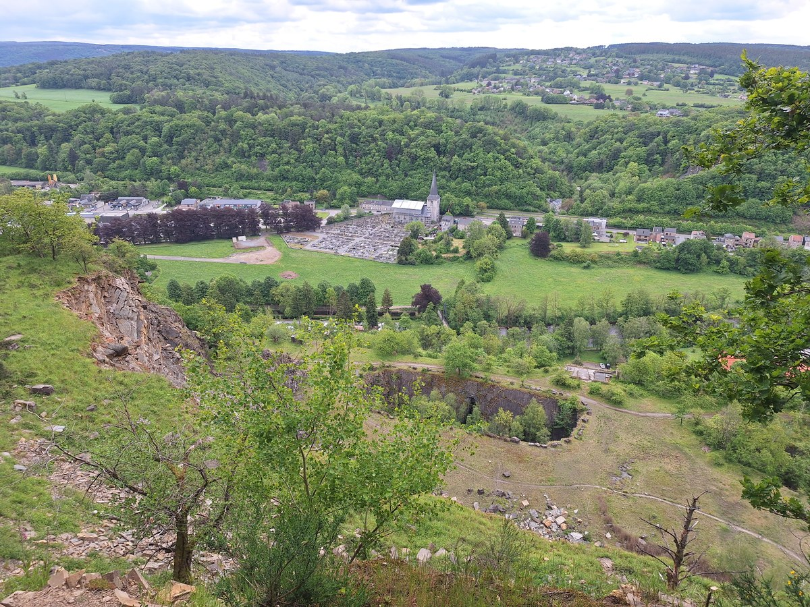

W drodze powrotnej, w kierunku miejsca, gdzie miały znajdować się kozy, ze szczytu wzgórza zauważyłam coś naprawdę niezwykłego. W ziemi 
znajdowała się ogromna, głęboka dziura, przypominająca niemal krater, a na jej dnie rosły drzewa. Widok z góry robił ogromne wrażenie, 
a najbardziej zaskoczyło mnie to, jak nagle teren urywał się w dół. Na dużej części krawędzi nie było żadnego ogrodzenia ani innego 
zabezpieczenia, więc wyglądało na to, że ktoś mniej uważny mógłby bez problemu spaść kilka metrów w dół. Wzdłuż niektórych fragmentów 
ustawiono ogromne kamienie, ale nie wyglądały one na wystarczające zabezpieczenie wszystkich potencjalnie niebezpiecznych miejsc.

Później dowiedziałam się, że na tym terenie znajduje się kilka starych kamieniołomów, a to było jedno z dawnych 
wyrobisk. Niestety, żadnych kóz tym razem nie udało mi się zobaczyć. W okolicy znajdowała się tablica informacyjna dotycząca podchodzenia 
do kóz i ich karmienia, dlatego nie jestem pewna, czy można je spotkać tylko w określonych porach roku lub dnia, czy też po prostu nie 
przebywają tam już na stałe. Na tym zakończyła się nasza ostatnia przygoda tego wyjazdu. Pozostało nam już tylko wrócić po córkę do dziadków i ruszyć w drogę
 powrotną do Leuven. 

  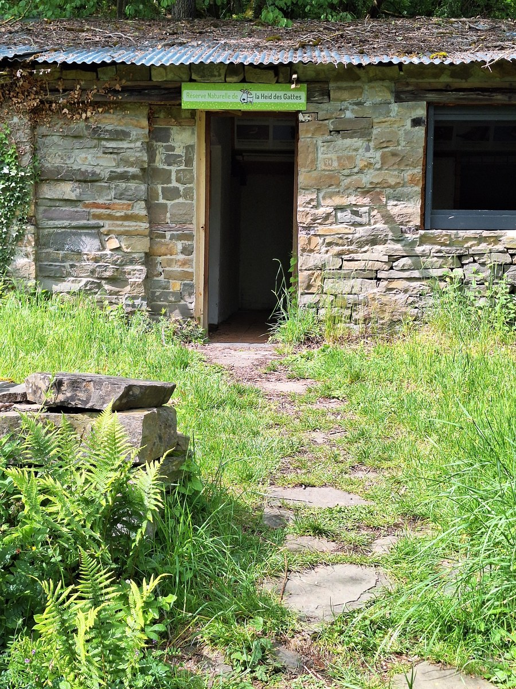
  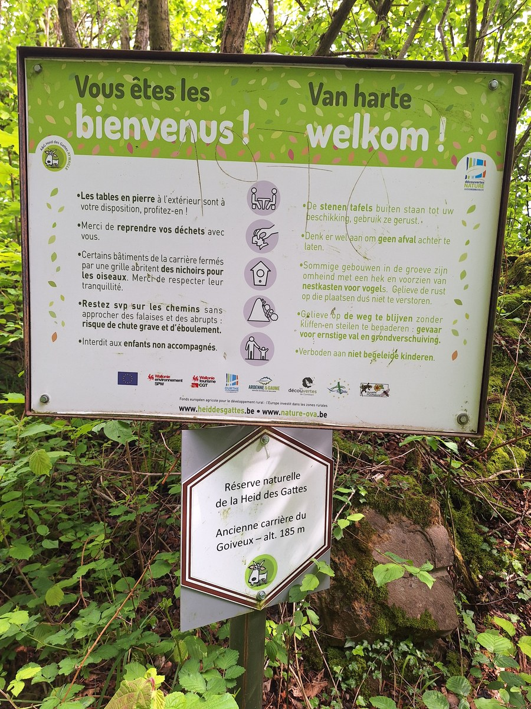

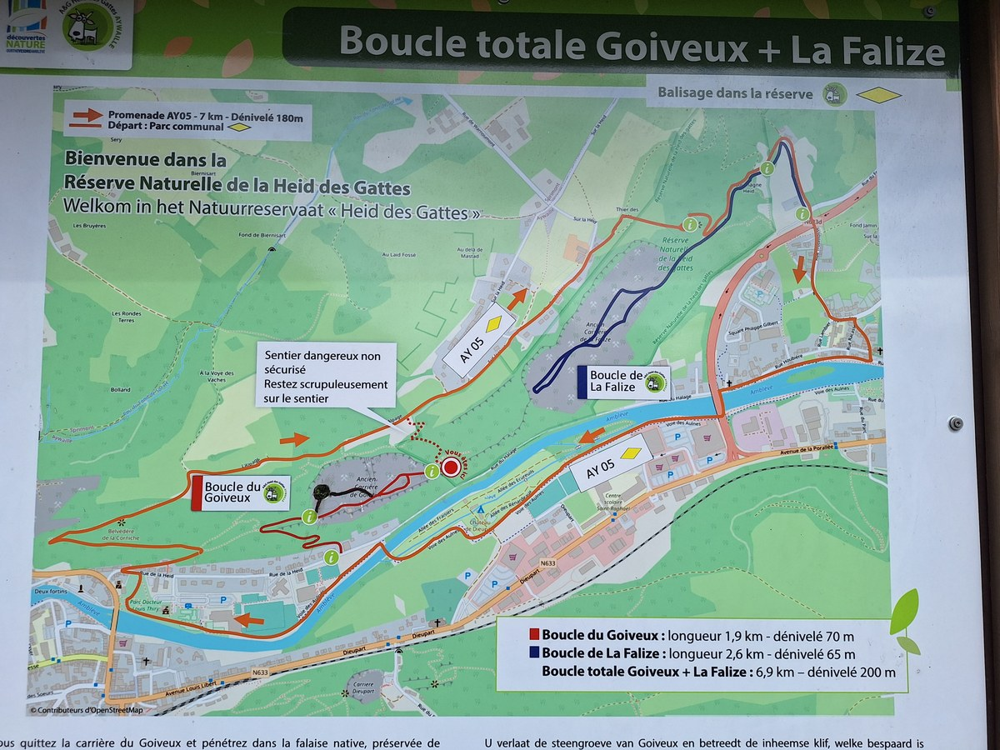

## Informacje praktyczne:

**Alden Biesen**  
Opis szlaku: [wandeleninlimburg.be](https://www.wandeleninlimburg.be/en/wandellus/alden-biesen-orange-cross-193)  
Czas przejścia: 1 godz. 45 min  
Długość trasy: 9 km  
GPX: [pobierz](/assets/Belgium/Liege/2026-05-14-Alden%20Biesen.gpx)  
Bezpłatny parking: [Google Maps](https://maps.app.goo.gl/eoudxYgX2bHpea5j8)  
Zamek: [alden-biesen.be](http://www.alden-biesen.be/)  
De Bij-Mobiel: [boomgaardenstichting.be](https://www.boomgaardenstichting.be/activiteiten/projecten/de-bij-mobiel)  

**Esneux**  
Bezpłatny parking obok mostu: [Google Maps](https://maps.app.goo.gl/4evZeH9sQ6nLW2499)  

**Hautes Fagnes**  
Bezpłatny parking obok restauracji La Baraque Michel: [Google Maps](https://maps.app.goo.gl/ut7yH3u1873iRfbZA)  
Czas przejścia: 5 godz. 45 min  
Długość trasy: 23 km  
GPX: [pobierz](/assets/Belgium/Liege/2026-05-15-Hautes%20Fagnes.gpx)  
Signal de Botrange: [Google Maps](https://maps.app.goo.gl/6pebocht3KyJWsk3A)  

**Balade du Ninglinspo**  
Parking: wzdłuż drogi, ponieważ płatny parking był całkowicie pełny jeszcze przed godziną 10:00. Zauważyliśmy też drugi parking, 
bezpłatny, ale również był pełny, a połowa z niego była zamknięta z powodu prac budowlanych. Chodzenie 
wzdłuż drogi jest niebezpieczne, bo samochody stoją po obu stronach, tworząc głębokie błoto na poboczach. Mam nadzieję, że wkrótce 
powstanie nowy parking, bo obecnie w tej okolicy panuje duży chaos.  
Czas przejścia: 3 godz. 45 min  
Długość trasy: 12,5 km  
GPX: [pobierz](/assets/Belgium/Liege/2026-05-16-Ninglinspo.gpx)  

**Aywaille**  
Bezpłatny parking: duży parking obok [Google Maps](https://maps.app.goo.gl/EBUZt4bvPvUK93Zh9)  
Szłam ścieżką zaznaczoną w Organic Maps, która nie była widoczna na Google Maps.  
Czas przejścia: 1 godz.  
Długość trasy: 4 km  
GPX: [pobierz](/assets/Belgium/Liege/2026-05-16-Aywaille.gpx)  

**Gdzie się zatrzymaliśmy**  
Mieszkanie na Airbnb w Liège: [airbnb.com](https://www.airbnb.com/rooms/1362297371259597564)
